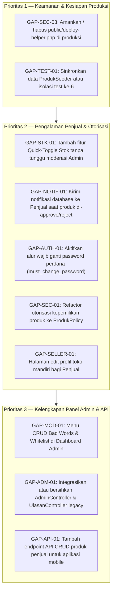

# Analisis Kesenjangan (Gap Analysis) — SiswaMart

## Informasi Dokumen

| Atribut | Detail |
|---|---|
| **Judul Dokumen** | Analisis Kesenjangan Sistem (*Gap Analysis*) — SiswaMart |
| **Versi Dokumen** | 1.1.0 |
| **Tanggal Pembaruan** | 27 Oktober 2026 |
| **Status** | Final (*Source-Code Backed*) |
| **Penulis** | Tim Arsitek Perangkat Lunak & Analis Sistem |
| **Sumber Data** | Inspeksi kode sumber (`app/`, `routes/`, `database/`, `resources/`, `public/`, `tests/`), output `php artisan migrate:status`, dan hasil uji PHPUnit |
| **Dokumen Terkait** | [PRD.md](PRD.md) • [SRS.md](../02-srs/SRS.md) • [MIGRASI.md](../04-database/MIGRASI.md) • [KEAMANAN.md](../09-operasional/KEAMANAN.md) • [ROADMAP.md](../10-proyek/ROADMAP.md) |

---

## Daftar Isi

1. [Ringkasan Eksekutif & Perubahan Status Sejak Audit Sebelumnya](#1-ringkasan-eksekutif--perubahan-status-sejak-audit-sebelumnya)
2. [Matriks Utama Analisis Kesenjangan](#2-matriks-utama-analisis-kesenjangan)
3. [Analisis Kesenjangan yang Telah Diselesaikan (Resolved Gaps)](#3-analisis-kesenjangan-yang-telah-diselesaikan-resolved-gaps)
4. [Analisis Mendalam Kesenjangan Aktif (Open & Partial Gaps)](#4-analisis-mendalam-kesenjangan-aktif-open--partial-gaps)
5. [Matriks Prioritas & Rencana Tindakan](#5-matriks-prioritas--rencana-tindakan)
6. [Rujukan Kode](#6-rujukan-kode)

---

## 1. Ringkasan Eksekutif & Perubahan Status Sejak Audit Sebelumnya

Dokumen ini membandingkan **kebutuhan ideal / desain sistem** dengan **implementasi aktual pada kode sumber SiswaMart** per **27 Oktober 2026**.

Dibandingkan dengan kondisi audit tanggal 25 Oktober 2026, sejumlah kesenjangan kritis (**P0/P1**) telah berhasil diselesaikan di kode sumber dan basis data lokal:
1. **Sinkronisasi 5 Migrasi Batch 9 (`GAP-DB-01` — Resolved):** Ke-5 migrasi bertanggal `2026_10_15` (`000001` s.d. `000005`) kini telah berstatus **`Ran`** pada basis data aktif `siswamartid`. Seluruh 15 test pada `GoogleLoginTest` kini **lulus 100%**.
2. **Ekspor Laporan Excel Multi-Sheet (`GAP-REP-01` — Resolved):** Fitur unduh laporan format `.xlsx` untuk Penjual dan Admin telah diimplementasikan penuh menggunakan `App\Support\XlsxWriter` dan `App\Services\LaporanPenjualService` / `LaporanAdminService`.
3. **Penutupan Registrasi API & Revokasi Token Akun Nonaktif (`GAP-SEC-02` — Resolved):** Endpoint `POST /api/register` kini secara eksplisit mengembalikan `403 Forbidden` (`app/Http/Controllers/Api/AuthController.php#L29-L36`), dan penonaktifan akun mencabut seluruh token Sanctum (`EnsureUserIsActive.php#L23-L25`, `Admin\PenjualController.php#L227-L229`).

---

## 2. Matriks Utama Analisis Kesenjangan

| ID Gap | Area / Fitur | Perilaku Ideal yang Diharapkan | Kondisi Aktual di Kode Sumber | Status Fitur | Prioritas | Status Gap & Rekomendasi |
|---|---|---|---|---|---|---|
| **GAP-DB-01** | Sinkronisasi Skema Database (*Batch 9 Migrations*) | Seluruh 27 migrasi berstatus `Ran` dan skema tabel aktif selaras dengan model Eloquent. | Output `php artisan migrate:status` menunjukkan seluruh **27 migrasi berstatus `Ran`** (Batch 1–9). Kolom `username`, `google_id`, `pending_action`, dan `pending_changes` sudah aktif di DB lokal. | `[Implemented]` | P0 (Selesai) | **Resolved.** Pastikan `php artisan migrate --force` dijalankan saat deployment ke server baru. |
| **GAP-REP-01** | Ekspor Laporan Format Excel (`.xlsx`) | Penjual dan Admin dapat mengunduh laporan rekapitulasi dalam format Excel selain PDF. | `Penjual\LaporanController@sheet` dan `Admin\LaporanController@penjualSheet` / `ulasanSheet` / `penjualExport` menghasilkan file `.xlsx` multi-sheet via `XlsxWriter`. | `[Implemented]` | P1 (Selesai) | **Resolved.** Diuji otomatis pada `LaporanPdfTest` dan `LaporanRekapitulasiUnifiedExportTest`. |
| **GAP-SEC-01** | Standarisasi Otorisasi Kepemilikan Data (*Policies*) | Otorisasi edit/hapus produk menggunakan *Laravel Authorization Policies* (`$this->authorize('update', $produk)`). | `Penjual\ProdukController` (`L189, L203, L258`) memeriksa kepemilikan secara manual: `abort_unless($produk->penjual_id === $penjualId, 403)`. Belum ada folder `app/Policies/`. | `[Partial]` | P2 (Sedang) | **Open.** Buat `App\Policies\ProdukPolicy` untuk memusatkan aturan otorisasi kepemilikan produk. |
| **GAP-SEC-03** | Keamanan Skrip `public/deploy-helper.php` | Skrip helper deployment tidak menyimpan kunci rahasia statis di dalam kode sumber publik. | `public/deploy-helper.php#L6` menyimpan `$secretKey = 'siswamart2026'` secara *hardcoded* untuk memicu `migrate` dan `storage:link` di shared hosting. | `[Partial]` | P1 (Tinggi) | **Open.** Hapus berkas `public/deploy-helper.php` segera setelah proses deploy selesai atau ambil kunci dari `env('DEPLOY_HELPER_KEY')`. |
| **GAP-AUTH-01** | Penegakan Flag `must_change_password` | Penjual baru yang dibuat Admin diberi `must_change_password = true` dan diarahkan paksa mengganti password saat login perdana. | Kolom `users.must_change_password` ada (`User.php#L16, L59`) dan di-reset ke `false` saat reset password (`NewPasswordController.php#L63`), tetapi `Admin\PenjualController@store` (`L93-L99`) tidak menyetel `true` dan tidak ada middleware redirect paksa. | `[Partial]` | P2 (Sedang) | **Open.** Tambahkan middleware `EnsurePasswordChanged` atau setel `must_change_password = true` saat pembuatan akun penjual baru. |
| **GAP-SELLER-01** | Pengelolaan Profil Toko Mandiri oleh Penjual | Penjual dapat memperbarui deskripsi toko, jam operasional, atau foto toko dari dasbor penjual. | Penjual hanya dapat mengubah status `buka`/`tutup` (`PATCH /penjual/status-toko`) dan nama/email user (`/profile`). Perubahan data toko dilakukan oleh Admin di `/admin/penjual/{penjual}/edit`. | `[Partial]` | P2 (Sedang) | **Open.** Tambahkan halaman pengaturan profil toko di area `/penjual/*` bila kebijakan sekolah mengizinkan. |
| **GAP-STK-01** | Aksi Cepat Ubah Stok (*Quick-Toggle Stock*) | Penjual dapat mengubah status stok (`tersedia`, `po`, `habis`) secara instan dari tabel daftar produk tanpa melalui antrean moderasi penuh. | Perubahan stok saat ini dilakukan melalui form edit produk (`PUT /penjual/produk/{produk}`) yang masuk ke antrean `pending_action = 'update'` dan menunggu approval Admin. | `[Planned]` | P2 (Sedang) | **Open.** Sediakan endpoint khusus `PATCH /penjual/produk/{produk}/stok` yang langsung memperbarui kolom `stok` tanpa perlu moderasi ulang. |
| **GAP-MOD-01** | Antarmuka CRUD Kamus `bad_words` & `whitelists` serta Log Pelanggaran | Admin dapat mengelola daftar kata kasar/whitelist dari web, melihat log komentar yang ditolak, dan menggunakan `whitelists` saat pemindaian. | Tabel `bad_words`, `whitelists`, dan `comment_moderation_logs` ada di DB, namun belum ada menu CRUD di UI Admin. `CommentModerationService.php#L42` tidak membaca tabel `whitelists`, dan penolakan pra-simpan di `UlasanController` tidak menulis ke `comment_moderation_logs`. | `[Partial]` | P3 (Rendah) | **Open.** Buat controller CRUD kamus moderasi di panel Admin dan sesuaikan pencatatan log bila diperlukan untuk audit guru BK. |
| **GAP-API-01** | Endpoint `/api/cart` (`501`) & Ketiadaan CRUD Produk Penjual di API | Klien mobile memiliki kejelasan kontrak API untuk keranjang dan pengelolaan produk penjual. | Ke-4 rute `/api/cart*` mengembalikan `HTTP 501 Not Implemented` (`Api\CartController.php#L9-L15`). API penjual baru mencakup `GET /api/seller/dashboard` dan `PATCH /api/seller/store-status`. | `[Partial]` | P3 (Rendah) | **By Design / Open.** Dokumentasikan `/api/cart` sebagai *deprecated/501* di OpenAPI, dan bangun `Api\SellerProductController` jika aplikasi mobile penjual dikembangkan. |
| **GAP-NOTIF-01** | Notifikasi ke Penjual (*Seller Notifications*) | Penjual menerima notifikasi di dasbor/API ketika produknya disetujui atau ditolak oleh Admin. | `AdminNotificationService.php` (`L10-L16`) hanya mengirim notifikasi ke `User::where('role', 'admin')`. Meskipun `GET /api/notifications` dapat diakses penjual, belum ada *producer* notifikasi untuk role `penjual`. | `[Partial]` | P2 (Sedang) | **Open.** Kirim database notification ke `$produk->penjual->user` pada `Admin\ProdukController::updateStatus`. |
| **GAP-ADM-01** | Controller Admin yang Belum Terhubung ke Rute (`AdminController` & `UlasanController`) | Seluruh controller di `app/Http/Controllers/Admin/` terhubung ke rute aktif atau dibersihkan jika sudah digantikan. | `Admin\AdminController.php` (CRUD akun sesama admin) dan `Admin\UlasanController.php` (approve/reject ulasan legacy) ada di kode sumber, tetapi **tidak terdaftar** di `routes/web.php` (moderasi ulasan kini ditangani oleh `Admin\KomentarController`). | `[Partial]` | P3 (Rendah) | **Open.** Daftarkan rute manajemen sub-admin untuk `AdminController` jika dibutuhkan, atau hapus `Admin\UlasanController` yang sudah digantikan oleh `KomentarController`. |
| **GAP-TEST-01** | Ketergantungan 1 Test pada Data Seeder di DB Aktif | Seluruh test di `tests/Feature` bersifat *self-contained* (menyiapkan datanya sendiri di dalam `setUp()` / test method). | `AdminAndPenjualFilteringAndPaginationTest::test_every_existing_registered_seller_has_at_least_10_products` (`L263-L275`) membaca seluruh penjual yang ada di DB lokal dan gagal karena toko `Edmund's Hearth` hanya memiliki 1 produk. | `[Partial]` | P3 (Rendah) | **Open.** Jalankan `php artisan db:seed --class=ProdukSeeder` pada DB lokal atau ubah test agar hanya memeriksa penjual yang dibuat di dalam test. |

---

## 3. Analisis Kesenjangan yang Telah Diselesaikan (Resolved Gaps)

### 3.1 Penyelesaian `GAP-DB-01` (Migrasi Batch 9)
Pada audit 25 Oktober 2026, lima berkas migrasi (`2026_10_15_000001` s.d. `000005`) masih berstatus *Pending* sehingga `GoogleLoginTest` mengalami 8 error SQL. Saat ini:
- Kelima migrasi tersebut telah dijalankan pada Batch 9 (`php artisan migrate:status` menampilkan 27/27 `Ran`).
- Tabel `users` telah memiliki kolom `username` (`varchar(80) UNIQUE`) dan `google_id` (`varchar(255) UNIQUE`).
- Tabel `produk` telah memiliki kolom `pending_action` (`varchar(20)`) dan `pending_changes` (`json`).
- Tabel `penjual` telah memiliki indeks unik `penjual_user_id_unique` dan `penjual_nisn_unique`.
- Hasil uji `GoogleLoginTest` kini **15 PASSED, 0 ERROR**.

### 3.2 Penyelesaian `GAP-REP-01` (Ekspor Laporan Excel & Layanan Terpadu)
Fitur ekspor Excel yang sebelumnya berada di Roadmap kini telah diimplementasikan melalui:
- [`app/Support/XlsxWriter.php`](../../app/Support/XlsxWriter.php) (`L1-L609`) dan [`app/Exports/Concerns/StylesSheet.php`](../../app/Exports/Concerns/StylesSheet.php) (`L1-L105`).
- [`app/Services/LaporanPenjualService.php`](../../app/Services/LaporanPenjualService.php) dan [`app/Services/LaporanAdminService.php`](../../app/Services/LaporanAdminService.php) yang memastikan angka pada tampilan web, PDF, dan Excel 100% identik.

---

## 4. Analisis Mendalam Kesenjangan Aktif (Open & Partial Gaps)

### 4.1 Analisis `GAP-SEC-01` & `GAP-SEC-03`: Otorisasi dan `deploy-helper.php`
1. **Otorisasi Kepemilikan Produk (`GAP-SEC-01`):**
   Di `app/Http/Controllers/Penjual/ProdukController.php` (`L189`, `L203`, `L258`), pengecekan kepemilikan dilakukan secara prosedural:
   ```php
   $penjualId = $this->getPenjualId();
   abort_unless($produk->penjual_id === $penjualId, 403, 'Akses ditolak.');
   ```
   Pendekatan ini aman untuk method yang ada saat ini, namun pembuatan `App\Policies\ProdukPolicy` akan meningkatkan konsistensi bila endpoint API manajemen produk penjual ditambahkan di masa depan.
2. **Keberadaan `public/deploy-helper.php` (`GAP-SEC-03`):**
   Berkas `public/deploy-helper.php#L6` mendefinisikan `$secretKey = 'siswamart2026';`. Di lingkungan produksi, berkas ini wajib dihapus setelah instalasi awal agar tidak disalahgunakan.

### 4.2 Analisis `GAP-STK-01`: Perubahan Stok memerlukan Approval Admin
Saat ini, kolom `stok` (`tersedia`, `po`, `habis`) berada di dalam form yang sama dengan `nama`, `harga`, `deskripsi`, dan `foto_utama` (`Penjual\ProdukController@update`, `L208-L231`). Akibatnya, ketika jajanan seorang siswa habis terjual pada jam istirahat pertama dan siswa tersebut mengubah stok menjadi `habis`, perubahan tersebut masuk ke `pending_changes` (`pending_action = 'update'`) dan baru tampil sebagai `HABIS` di katalog publik setelah disetujui Admin. Memisahkan aksi *Quick-Toggle Stok* dari alur *staging* konten akan sangat meningkatkan akurasi informasi stok secara *real-time*.

### 4.3 Analisis `GAP-MOD-01`: Pemanfaatan Tabel Moderasi Lanjutan
Basis data memiliki 3 tabel pendukung moderasi: `bad_words`, `whitelists`, dan `comment_moderation_logs`, serta kolom `original_komentar`, `display_content`, `is_censored`, `detected_words`, `moderated_at`, dan `moderated_by` pada tabel `ulasan`.
Namun pada implementasi saat ini:
- Ulasan yang terdeteksi mengandung kata kasar oleh `CommentModerationService::moderate()` langsung ditolak sebelum disimpan (`UlasanController.php#L34-L42`, `Api\ReviewController.php#L69-L84`), sehingga kolom sensor pada `ulasan` dan tabel `comment_moderation_logs` tidak terisi pada alur normal.
- Tabel `whitelists` diisi oleh `WhitelistSeeder.php`, namun belum dipanggil di dalam `CommentModerationService.php`.

---

## 5. Matriks Prioritas & Rencana Tindakan



---

## 6. Rujukan Kode

- [`app/Http/Controllers/Penjual/ProdukController.php`](../../app/Http/Controllers/Penjual/ProdukController.php) (`L186-L288`)
- [`app/Http/Controllers/Admin/ProdukController.php`](../../app/Http/Controllers/Admin/ProdukController.php) (`L100-L222`)
- [`app/Http/Controllers/Admin/PenjualController.php`](../../app/Http/Controllers/Admin/PenjualController.php) (`L77-L118`, `L220-L258`)
- [`app/Http/Controllers/Admin/AdminController.php`](../../app/Http/Controllers/Admin/AdminController.php) (`L1-L179`)
- [`app/Http/Controllers/Admin/UlasanController.php`](../../app/Http/Controllers/Admin/UlasanController.php) (`L1-L44`)
- [`app/Http/Controllers/Api/CartController.php`](../../app/Http/Controllers/Api/CartController.php) (`L1-L16`)
- [`app/Http/Controllers/Api/AuthController.php`](../../app/Http/Controllers/Api/AuthController.php) (`L29-L36`)
- [`app/Services/CommentModerationService.php`](../../app/Services/CommentModerationService.php) (`L28-L256`)
- [`app/Services/AdminNotificationService.php`](../../app/Services/AdminNotificationService.php) (`L10-L16`)
- [`public/deploy-helper.php`](../../public/deploy-helper.php) (`L1-L130`)
- [`tests/Feature/AdminAndPenjualFilteringAndPaginationTest.php`](../../tests/Feature/AdminAndPenjualFilteringAndPaginationTest.php) (`L263-L275`)
