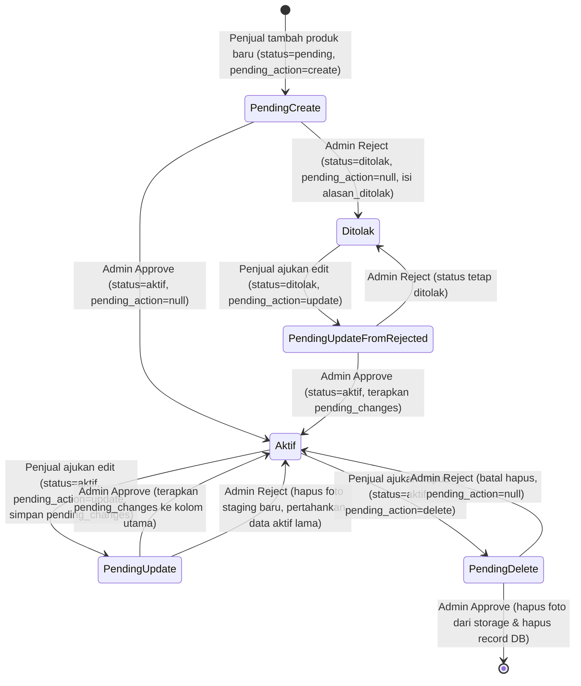
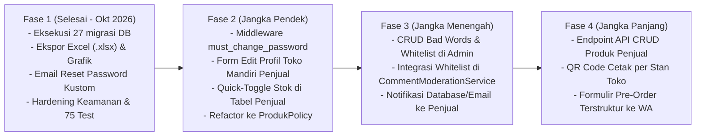

# Product Requirements Document (PRD) — SiswaMart

## Informasi Dokumen

| Atribut | Keterangan |
|---|---|
| **Judul Dokumen** | Product Requirements Document (PRD) — SiswaMart |
| **Nama Produk** | SiswaMart (Platform Promosi & Katalog Produk Kantin Sekolah dan Siswa Wirausaha) |
| **Versi Dokumen** | 1.1.0 (Pembaruan Audit Kode Sumber & Skema Aktual) |
| **Tanggal Pembaruan** | 27 Oktober 2026 |
| **Status Dokumen** | Disetujui (*Source-Code Backed*) |
| **Penulis / Auditor** | Senior Product Manager, Business Analyst & Software Architect |
| **Lokasi Repositori** | `C:\laragon\www\siswamartid` |
| **Sumber Data Primer** | Kode sumber aktif (`app/`, `routes/`, `database/`, `resources/`, `tests/`, `config/`), `composer.json`, `package.json`, `php artisan route:list`, `php artisan migrate:status` |
| **Dokumen Terkait** | [GAP_ANALYSIS.md](GAP_ANALYSIS.md) • [SRS.md](../02-srs/SRS.md) • [ERD.md](../04-database/ERD.md) • [ATURAN_BISNIS.md](../05-desain/ATURAN_BISNIS.md) • [KEAMANAN.md](../09-operasional/KEAMANAN.md) |

---

## Daftar Isi

1. [Batasan Audit & Kondisi Aktual](#a-batasan-audit--kondisi-aktual)
2. [Ringkasan Eksekutif (Executive Summary)](#b-ringkasan-eksekutif-executive-summary)
3. [Latar Belakang Produk (Product Background)](#c-latar-belakang-produk-product-background)
4. [Visi dan Tujuan Produk (Vision & Objectives)](#d-visi-dan-tujuan-produk-vision--objectives)
5. [Target Pengguna dan Persona](#e-target-pengguna-dan-persona-target-audience--personas)
6. [Ruang Lingkup dan Batasan (Scope & Boundaries)](#f-ruang-lingkup-dan-batasan-scope--boundaries)
7. [Kebutuhan Fungsional (Functional Requirements)](#g-kebutuhan-fungsional-functional-requirements)
8. [User Stories dan Acceptance Criteria](#h-user-stories-dan-acceptance-criteria)
9. [Alur Pengguna (User Flows)](#i-alur-pengguna-user-flows)
10. [Arsitektur Informasi dan Antarmuka (IA & UI)](#j-arsitektur-informasi-dan-antarmuka-ia--ui)
11. [Model Data Ringkas](#k-model-data-ringkas)
12. [Aturan Bisnis (Business Rules)](#l-aturan-bisnis-business-rules)
13. [Kebutuhan Non-Fungsional (Non-Functional Requirements)](#m-kebutuhan-non-fungsional-non-functional-requirements)
14. [Integrasi dan Dependensi Eksternal](#n-integrasi-dan-dependensi-eksternal-integrations)
15. [Pengujian dan Jaminan Kualitas](#o-pengujian-dan-jaminan-kualitas-testing--quality-assurance)
16. [Penilaian Risiko dan Keamanan (Risk Assessment)](#p-penilaian-risiko-dan-keamanan-risk-assessment)
17. [Ringkasan Analisis Kesenjangan (Gap Analysis Summary)](#q-ringkasan-analisis-kesenjangan-gap-analysis-summary)
18. [Peta Jalan Pengembangan (Product Roadmap)](#r-peta-jalan-pengembangan-product-roadmap)
19. [Pertanyaan Terbuka dan Asumsi](#s-pertanyaan-terbuka-dan-asumsi-open-questions--assumptions)
20. [Changelog Dokumen PRD](#t-changelog-dokumen-prd)
21. [Rujukan Kode](#u-rujukan-kode)

---

## A. Batasan Audit & Kondisi Aktual

1. **Verifikasi Read-Only:** Audit dilakukan secara *read-only* terhadap basis data lokal `siswamartid` dan kode aplikasi tanpa mengubah logika bisnis yang berjalan.
2. **Kondisi Skema Lokal Terkini (27 Oktober 2026):** Seluruh **27 berkas migrasi** (termasuk 5 migrasi penyelarasan bertanggal 15 Oktober 2026 pada Batch 9: `2026_10_15_000001` hingga `2026_10_15_000005`) kini telah berstatus **`Ran`** pada basis data lokal `siswamartid` (total **19 tabel**). Meski demikian, kode PHP tetap mempertahankan pengecekan defensif `Schema::hasColumn()` (`app/Models/User.php#L26`, `app/Http/Controllers/Penjual/ProdukController.php#L156`) agar aman dijalankan pada server yang belum mengeksekusi Batch 9.
3. **Kerahasiaan Kredensial:** Seluruh nilai rahasia pada `.env`, kunci API, token OAuth, dan hash kata sandi tidak disertakan di dalam dokumen ini.

---

## B. Ringkasan Eksekutif (Executive Summary)

**SiswaMart** adalah platform katalog digital dan sarana promosi produk berbasis sekolah yang dirancang khusus untuk memfasilitasi publikasi, penemuan, dan promosi produk hasil karya siswa wirausaha, unit produksi/PKK sekolah, serta pedagang kantin sekolah (studi kasus: **SMKN 11 Bandung**, rujukan `resources/views/layouts/public.blade.php#L283`).

Berbeda dari lokapasar (*e-commerce*) komersial umum yang menyediakan fasilitas keranjang belanja lintas toko, *checkout* otomatis, dan *payment gateway*, SiswaMart menerapkan model **Katalog Promosi Terkurasi (*Showcase Marketplace*) dengan Pemesanan Langsung via WhatsApp (*Direct-to-WhatsApp Ordering*)**. Keputusan desain ini dilandasi oleh karakteristik lingkungan sekolah:
1. Meminimalkan biaya komisi transaksi dan kerumitan integrasi perbankan/rekening *escrow* bagi siswa di bawah umur.
2. Memberikan fleksibilitas pengambilan produk secara langsung (*cash on pickup* / COD) di ruang kelas atau stan kantin sekolah saat jam istirahat.
3. Menjamin keamanan ekosistem komunitas sekolah melalui kontrol kurasi terpusat oleh Admin/Guru (*two-tier staging moderation*) serta penyaringan konten ulasan otomatis (*Automated Bad-Word Filtering Engine*).

### Nilai Tambah Utama (*Value Propositions*)
- **Bagi Pembeli (Siswa & Warga Sekolah):** Akses instan ke katalog jajanan, makanan, minuman, dan produk kreatif siswa tanpa kewajiban mendaftar akun. Pembeli dapat memeriksa ketersediaan stok (`tersedia`, `po`, `habis`), status operasional toko (`buka`, `tutup`), lokasi kelas/stan penjual, dan langsung menghubungi penjual via WhatsApp dengan pesan terformat otomatis.
- **Bagi Penjual (Siswa & Kantin):** Dasbor mandiri untuk mengelola etalase produk, mengatur status buka/tutup toko, memantau statistik penayangan produk (*views*) dan interaksi klik WhatsApp, serta mengunduh berkas rekapitulasi performa mingguan dalam format **PDF (A4 Portrait)** dan **Excel (`.xlsx` multi-sheet dengan grafik)**.
- **Bagi Sekolah & Administrator:** Kendali moderasi dua tingkat (*staging moderation*) di mana produk baru (`create`), revisi produk aktif (`update` di `pending_changes`), maupun permintaan hapus (`delete`) wajib disetujui Admin sebelum berdampak pada katalog publik; ditambah rekapitulasi laporan tingkat sekolah format **PDF (A4 Landscape)** dan **Excel (`.xlsx`)**.

---

## C. Latar Belakang Produk (Product Background)

### 1. Masalah yang Dihadapi (*Problem Statement*)
- **Fragmentasi Informasi Penjualan:** Kegiatan kewirausahaan siswa (Praktik Produk Kreatif dan Kewirausahaan / PKK) dan jajanan kantin sering dipromosikan secara sporadis melalui status WhatsApp pribadi atau grup kelas yang cepat tertimbun.
- **Kesulitan Mengetahui Ketersediaan Stok & Status Toko:** Pembeli sering mendatangi kelas atau stan kantin hanya untuk mendapati bahwa produk sudah habis terjual atau toko sedang tutup.
- **Kurangnya Portofolio & Laporan Kewirausahaan Siswa:** Siswa dan guru pembina kesulitan mengukur performa promosi produk secara kuantitatif (jumlah kunjungan dan minat beli) sebagai bahan evaluasi pembelajaran.
- **Kekhawatiran Keamanan Konten & Ketertiban Sekolah:** Membuka marketplace publik tanpa kurasi rentan terhadap akun palsu dari luar sekolah, penjualan barang terlarang, atau komentar perundungan (*cyberbullying*) pada ulasan produk.

### 2. Solusi yang Diterapkan SiswaMart
- **Platform Web Responsif & Ringan:** Dibangun di atas **PHP `^8.3`** dan **Laravel Framework `^13.38` (`v13.38.0`)** (`composer.json#L9-L11`) dengan **Tailwind CSS `^4.0.7`** (`package.json#L12`) dan gaya visual *Soft Neubrutalism* berpalet *Muted Blue & Amber Accent* (`public/css/siswamart-theme.css#L2-L47`).
- **Pendaftaran Terkendali (*Admin-Curated Seller Accounts*):** Pembuatan akun penjual dilakukan secara tertutup oleh Admin Sekolah dengan validasi NISN 10 digit unik, alamat, lokasi kelas, dan nomor WhatsApp (`app/Http/Controllers/Admin/PenjualController.php#L77-L118`).
- **Moderasi Produk Preservatif (*Pending Changes Architecture*):** Penjual yang mengubah produk aktif tidak langsung menimpa data tayang; sistem menyimpan usulan revisi di kolom JSON `pending_changes` (`pending_action = 'update'`) sehingga katalog publik tetap menampilkan data lama yang aman hingga disetujui Admin (`app/Http/Controllers/Penjual/ProdukController.php#L200-L250`).
- **Sistem Moderasi Ulasan Otomatis:** Pengunjung dapat mengirim ulasan tanpa login, tetapi `guest_username` dan `komentar` dipindai oleh `CommentModerationService` dengan normalisasi *leetspeak* dan pencocokan batas kata regex terhadap kamus `badwords-list.json` + tabel `bad_words` (`app/Services/CommentModerationService.php#L28-L256`).

---

## D. Visi dan Tujuan Produk (Vision & Objectives)

### 1. Visi Produk
Menjadi ekosistem digital kewirausahaan sekolah yang inklusif, aman, dan mendidik, menjembatani kreativitas siswa dalam berbisnis dengan kemudahan belanja seluruh warga sekolah.

### 2. Tujuan Terukur (*Measurable Objectives*)

| Kode | Sasaran | Indikator Keberhasilan (KPI) | Status Verifikasi |
|---|---|---|---|
| **OBJ-01** | Aksesibilitas Katalog Tanpa Hambatan | 100% halaman katalog dan detail produk publik dapat diakses tanpa registrasi/login. | `[Implemented]` — `routes/web.php#L9-L28` |
| **OBJ-02** | Akurasi Kontak & Konversi WhatsApp | 100% tombol pesan mengarahkan ke nomor WhatsApp penjual berformat `628xxx` dengan pesan terformat dan mencatat log konversi. | `[Implemented]` — `Public\ProdukController::trackWhatsapp` (`L91-L121`) |
| **OBJ-03** | Keamanan Ekosistem Konten Ramah Sekolah | Penolakan otomatis 100% ulasan yang memuat kata terlarang di sisi backend sebelum disimpan ke database. | `[Implemented]` — `Public\UlasanController::store` (`L30-L42`), `Api\ReviewController::store` (`L69-L84`) |
| **OBJ-04** | Pelaporan Akademik & Audit Multi-Format | Tersedianya fungsi ekspor laporan performa berkala dalam format **PDF** dan **Excel (`.xlsx`)** yang konsisten untuk Admin dan Penjual. | `[Implemented]` — `Admin\LaporanController`, `Penjual\LaporanController`, `XlsxWriter` |
| **OBJ-05** | Kestabilan Katalog Saat Revisi Produk | 0 gangguan atau perubahan tanpa izin pada data produk tayang ketika penjual mengajukan edit atau hapus produk aktif. | `[Implemented]` — `Penjual\ProdukController::update` (`L227-L231`), `Admin\ProdukController::updateStatus` (`L102-L197`) |

---

## E. Target Pengguna dan Persona (Target Audience & Personas)

```mermaid
flowchart TD
    User(["Pengguna SiswaMart"]) --> Public["Pengunjung / Pembeli (Guest)"]
    User --> Penjual["Penjual Siswa / Kantin (role: penjual)"]
    User --> Admin["Administrator Sekolah (role: admin)"]

    Public -->|"Tanpa Login"| PB1["Eksplorasi Beranda & Katalog Kategori"]
    Public -->|"Tanpa Login"| PB2["Cek Stok, Status Toko & Lokasi Kelas"]
    Public -->|"Tanpa Login"| PB3["Klik Pesan via WhatsApp"]
    Public -->|"Guest Username"| PB4["Kirim Rating 1-5 & Ulasan"]

    Penjual -->|"Login Email/Username/Google"| PJ1["Kelola Produk (Staging Create/Update/Delete)"]
    Penjual -->|"Login Email/Username/Google"| PJ2["Toggle Status Toko (Buka / Tutup)"]
    Penjual -->|"Login Email/Username/Google"| PJ3["Pantau Views & Ulasan Mingguan"]
    Penjual -->|"Login Email/Username/Google"| PJ4["Unduh Laporan Mingguan (PDF & Excel)"]

    Admin -->|"Hak Akses Tertinggi"| AD1["Kelola Akun Penjual & Validasi NISN"]
    Admin -->|"Hak Akses Tertinggi"| AD2["Moderasi Produk (Approve/Reject Diff)"]
    Admin -->|"Hak Akses Tertinggi"| AD3["Kelola Master Kategori & Ikon"]
    Admin -->|"Hak Akses Tertinggi"| AD4["Moderasi / Hapus Komentar Ulasan"]
    Admin -->|"Hak Akses Tertinggi"| AD5["Unduh Laporan Agregat (PDF & Excel)"]
```

### Profil Persona Pengguna

1. **Persona 1 — Pembeli / Pengunjung (`Guest`):**
   - **Karakteristik:** Siswa, guru, staf sekolah, atau warga sekolah yang mengakses katalog melalui ponsel saat jam istirahat.
   - **Kebutuhan:** Menemukan makanan/minuman yang tersedia hari ini, memeriksa harga dan lokasi kelas/stan penjual, menghubungi penjual via WhatsApp dalam satu klik, dan memberi ulasan produk.
   - **Hak Akses:** Publik tanpa login.
2. **Persona 2 — Penjual Siswa / Pengelola Kantin (`role = 'penjual'`):**
   - **Karakteristik:** Siswa peserta program kewirausahaan atau pedagang kantin mitra sekolah.
   - **Kebutuhan:** Mengajukan produk baru beserta foto, memperbarui harga/stok, membuka/menutup toko, memantau statistik kunjungan produk, serta mengunduh laporan PDF/Excel mingguan untuk tugas kewirausahaan.
   - **Hak Akses:** Terautentikasi dengan middleware `auth` dan `penjual` (`App\Http\Middleware\EnsurePenjual`). Hanya dapat mengelola produk miliknya sendiri (`penjual_id`).
3. **Persona 3 — Administrator Sekolah (`role = 'admin'`):**
   - **Karakteristik:** Guru pembina kewirausahaan, koordinator kantin, atau staf IT sekolah.
   - **Kebutuhan:** Mendaftarkan akun penjual resmi ber-NISN valid, meninjau dan menyetujui/menolak produk baru maupun perubahan produk (`pending_changes`), mengelola kategori, menghapus komentar yang melanggar, memantau notifikasi aktivitas, serta mengekspor laporan rekapitulasi seluruh penjual dan ulasan.
   - **Hak Akses:** Terautentikasi dengan middleware `auth` dan `admin` (`App\Http\Middleware\EnsureAdmin`).

---

## F. Ruang Lingkup dan Batasan (Scope & Boundaries)

### 1. Fitur Dalam Ruang Lingkup (*In-Scope*)
- **Katalog Publik & Kategori:** Beranda kurasi (produk hero, rekomendasi, populer, testimoni), eksplorasi per kategori, pencarian kata kunci (`q`), filter rentang harga (`min_price`, `max_price`), dan pengurutan (`terbaru`, `termurah`, `termahal`, `terpopuler`).
- **Direct-to-WhatsApp Ordering & Logging:** Pengalihan ke `https://wa.me/62...` dengan template pesan otomatis (termasuk pemberitahuan bila toko sedang `tutup`) dan pencatatan interaksi di `produk_views_logs` (`type = 'view'` dan `type = 'whatsapp'`).
- **Moderasi Produk Dua Tingkat (*Staging Lifecycle*):** Alur pengajuan produk baru (`pending_action = 'create'`), revisi produk aktif (`pending_action = 'update'` di kolom JSON `pending_changes`), dan permohonan hapus (`pending_action = 'delete'`).
- **Ulasan Tamu dengan Penyaring Kata Kasar:** Pengiriman ulasan tamu tanpa login dengan pemindaian kata kasar otomatis (*leetspeak-aware*) terhadap `guest_username` dan `komentar`.
- **Autentikasi & Keamanan Akun:** Login via Email/Username + Password (`LoginRequest`), Google OAuth SSO khusus akun terdaftar (`GoogleAuthController`), Reset Password via email bertemplat khusus (`ResetPasswordNotification`), serta pencabutan sesi/token otomatis saat akun dinonaktifkan (`EnsureUserIsActive`).
- **Pelaporan & Ekspor PDF + Excel (`.xlsx`):** Rekapitulasi mingguan/bulanan terpadu (`LaporanPenjualService` & `LaporanAdminService`) dengan unduhan PDF (`barryvdh/laravel-dompdf`) dan Excel multi-sheet (`App\Support\XlsxWriter`).
- **Notifikasi Aktivitas Admin:** Notifikasi database untuk Admin beserta *polling* AJAX setiap 10 detik di panel admin (`Admin\NotificationController::poll`).
- **REST API Katalog, Ulasan, Profil & Dasbor Penjual:** 26 endpoint API berbasis Laravel Sanctum (`routes/api.php`).

### 2. Fitur di Luar Ruang Lingkup (*Out-of-Scope*)
- **Keranjang Belanja & Checkout Web:** Tidak tersedia di web. Pada REST API, ke-4 rute `/api/cart*` secara eksplisit mengembalikan **`HTTP 501 Not Implemented`** (`app/Http/Controllers/Api/CartController.php#L9-L15`).
- **Gerbang Pembayaran (*Payment Gateway*):** Tidak ada integrasi transfer otomatis, QRIS dinamis, atau dompet digital internal.
- **Integrasi Kurir Ekspedisi:** Distribusi dilakukan langsung di lingkungan sekolah.
- **Registrasi Mandiri Publik (Web maupun API):** Rute `register` di web dikomentari (`routes/auth.php#L19-L22`) dan `POST /api/register` mengembalikan **`HTTP 403 Forbidden`** (`app/Http/Controllers/Api/AuthController.php#L29-L36`).

---

## G. Kebutuhan Fungsional (Functional Requirements)

> [!NOTE]
> Tabel di bawah mempertahankan ID asli PRD (`FR-AUTH-001`, dst.) sekaligus mencantumkan kode urut padanan (`FR-001` s.d. `FR-038`) untuk keterlacakan penuh di [02-srs/SRS.md](../02-srs/SRS.md) dan [08-pengujian/TEST_CASE.md](../08-pengujian/TEST_CASE.md).

| ID Utama | ID Urut | Modul | Deskripsi Kebutuhan Fungsional | Role | Prioritas | Status | Bukti Kode Sumber |
|---|---|---|---|---|---|---|---|
| **FR-AUTH-001** | FR-001 | Autentikasi | Login web menggunakan Email atau Username dan kata sandi dengan pembatasan laju (*rate limit* 5 percobaan/menit per identitas+IP). | Admin, Penjual | Must Have | `[Implemented]` | `app/Http/Requests/Auth/LoginRequest.php#L41-L97`, `routes/auth.php#L24-L27` |
| **FR-AUTH-002** | FR-002 | Autentikasi | Login Google OAuth 2.0 yang hanya mengizinkan akun yang sudah terdaftar dan aktif di SiswaMart, dengan fallback stateless otomatis. | Admin, Penjual | Must Have | `[Implemented]` | `app/Http/Controllers/Auth/GoogleAuthController.php#L17-L142`, `routes/auth.php#L16-L17` |
| **FR-AUTH-003** | FR-003 | Autentikasi | Pemblokiran akses dan pencabutan sesi/token Sanctum otomatis apabila `users.is_active = false`. | Admin, Penjual | Must Have | `[Implemented]` | `app/Http/Middleware/EnsureUserIsActive.php#L17-L44`, `EnsureAdmin.php#L26-L34`, `EnsurePenjual.php#L26-L34` |
| **FR-AUTH-004** | FR-004 | Autentikasi | Penutupan registrasi mandiri publik pada web (rute dinonaktifkan) dan API (respons 403 Forbidden). | Publik | Must Have | `[Implemented]` | `routes/auth.php#L19-L22`, `app/Http/Controllers/Api/AuthController.php#L29-L36` |
| **FR-AUTH-005** | FR-005 | Autentikasi | Lupa & Reset Password melalui email dengan template kustom SiswaMart, anti-enumerasi email, dan *throttle* 5 req/menit. | Admin, Penjual | Should Have | `[Implemented]` | `app/Http/Controllers/Auth/PasswordResetLinkController.php#L28-L58`, `NewPasswordController.php#L32-L79`, `ResetPasswordNotification.php#L39-L77` |
| **FR-AUTH-006** | FR-006 | Autentikasi | Penyediaan flag `must_change_password` pada akun pengguna dan reset otomatis flag menjadi `false` saat kata sandi diatur ulang. *(Catatan: pengalihan paksa saat login belum diimplementasikan di middleware).* | Penjual | Could Have | `[Partial]` | `database/migrations/2026_10_14_000002_add_must_change_password_to_users_table.php#L14-L18`, `NewPasswordController.php#L63` |
| **FR-PROD-001** | FR-007 | Publik | Beranda publik menampilkan produk hero, daftar kategori beserta jumlah produk aktif, produk rekomendasi, produk populer, testimoni ulasan, dan pencarian cepat. | Publik | Must Have | `[Implemented]` | `app/Http/Controllers/Public/HomeController.php#L18-L102`, `routes/web.php#L9` |
| **FR-PROD-002** | FR-008 | Publik | Katalog publik hanya menampilkan produk dengan `status = 'aktif'` dari penjual dengan `users.is_active = true` (`scopePublicVisible`), serta mengalihkan `/produk` secara permanen (301) ke `/kategori`. | Publik | Must Have | `[Implemented]` | `app/Models/Produk.php#L108-L114`, `routes/web.php#L14` |
| **FR-PROD-003** | FR-009 | Publik | Pencarian dan penyaringan produk berdasarkan kata kunci (`q`), kategori (`/kategori/{kategori:slug}`), rentang harga (`min_price`, `max_price`), serta pengurutan (`terbaru`, `termurah`, `termahal`, `terpopuler`). | Publik | Must Have | `[Implemented]` | `app/Http/Controllers/Public/KategoriController.php#L16-L115`, `Public/ProdukController.php#L16-L47` |
| **FR-PROD-004** | FR-010 | Publik | Paginasi katalog publik 12 item per halaman dengan mempertahankan query string filter. | Publik | Must Have | `[Implemented]` | `app/Http/Controllers/Public/KategoriController.php#L47, L100` |
| **FR-PROD-005** | FR-011 | Publik | Halaman detail produk menampilkan foto/fallback kategori, harga, badge stok, info toko penjual, ulasan publik, dan 4 produk terkait (`throttle:60,1`). | Publik | Must Have | `[Implemented]` | `app/Http/Controllers/Public/ProdukController.php#L53-L86`, `routes/web.php#L15-L17` |
| **FR-PROD-006** | FR-012 | Publik | Pencatatan otomatis counter `produk.views` dan log interaksi `produk_views_logs` (`type = 'view'`) saat detail produk diakses. | Publik | Must Have | `[Implemented]` | `app/Http/Controllers/Public/ProdukController.php#L57-L65` |
| **FR-WA-001** | FR-013 | WhatsApp | Pengalihan ke WhatsApp penjual (`https://wa.me/62...`) dengan normalisasi nomor telepon awalan `0` menjadi `62` (`throttle:30,1`). | Publik | Must Have | `[Implemented]` | `app/Http/Controllers/Public/ProdukController.php#L91-L121`, `routes/web.php#L18-L20` |
| **FR-WA-002** | FR-014 | WhatsApp | Penyisipan teks pemberitahuan otomatis pada pesan WhatsApp apabila status toko penjual sedang `tutup`. | Publik | Should Have | `[Implemented]` | `app/Http/Controllers/Public/ProdukController.php#L113-L115` |
| **FR-WA-003** | FR-015 | WhatsApp | Pencatatan log interaksi klik WhatsApp ke tabel `produk_views_logs` (`type = 'whatsapp'`). | Publik | Must Have | `[Implemented]` | `app/Http/Controllers/Public/ProdukController.php#L105-L111` |
| **FR-REV-001** | FR-016 | Ulasan | Pengiriman ulasan tamu (`guest_username`, `rating` 1–5, `komentar`) tanpa login dengan pembatasan `throttle:3,1` di web. | Publik | Must Have | `[Implemented]` | `routes/web.php#L26-L28`, `app/Http/Controllers/Public/UlasanController.php#L18-L28` |
| **FR-REV-002** | FR-017 | Ulasan | Pemeriksaan kata kasar otomatis (*leetspeak-aware*) pada `guest_username` dan `komentar` sebelum simpan; penolakan langsung jika terdeteksi kata terlarang. | Publik | Must Have | `[Implemented]` | `app/Http/Controllers/Public/UlasanController.php#L30-L42`, `app/Services/CommentModerationService.php#L28-L133` |
| **FR-REV-003** | FR-018 | Ulasan | Hanya ulasan yang memenuhi `scopePublicVisible` (`moderation_status = 'approved'`) yang ditampilkan ke publik dan dihitung dalam rata-rata rating. | Publik | Must Have | `[Implemented]` | `app/Models/Ulasan.php#L71-L84`, `app/Models/Produk.php#L91-L102` |
| **FR-SELLER-001** | FR-019 | Penjual | Dasbor penjual menampilkan ringkasan performa toko: total produk, produk aktif, pending, total views, total ulasan publik, top 3 produk, dan 5 produk terbaru. | Penjual | Must Have | `[Implemented]` | `app/Http/Controllers/Penjual/DashboardController.php#L17-L47` |
| **FR-SELLER-002** | FR-020 | Penjual | Pengalih (*toggle*) status operasional toko antara `buka` dan `tutup`. | Penjual | Must Have | `[Implemented]` | `app/Http/Controllers/Penjual/DashboardController.php#L52-L61`, `routes/web.php#L74` |
| **FR-SELLER-003** | FR-021 | Penjual | Pengajuan produk baru dengan status awal `pending` dan `pending_action = 'create'` beserta unggahan foto maks 2 MB (`jpg,jpeg,png,webp`). | Penjual | Must Have | `[Implemented]` | `app/Http/Controllers/Penjual/ProdukController.php#L136-L181` |
| **FR-SELLER-004** | FR-022 | Penjual | Pengajuan edit produk milik sendiri ke kolom JSON `pending_changes` (`pending_action = 'update'`) tanpa mengubah data produk tayang; menolak edit bila masih ada pengajuan pending. | Penjual | Must Have | `[Implemented]` | `app/Http/Controllers/Penjual/ProdukController.php#L200-L250` |
| **FR-SELLER-005** | FR-023 | Penjual | Pengajuan penghapusan produk milik sendiri (`pending_action = 'delete'`) yang menunggu persetujuan Admin. | Penjual | Must Have | `[Implemented]` | `app/Http/Controllers/Penjual/ProdukController.php#L255-L288` |
| **FR-SELLER-006** | FR-024 | Penjual | Penyaringan daftar produk penjual berdasarkan tab status (`aktif`, `pending`, `ditolak`), pencarian teks, kategori, status stok (`tersedia`, `po`, `habis`), dan jumlah baris per halaman. | Penjual | Must Have | `[Implemented]` | `app/Http/Controllers/Penjual/ProdukController.php#L38-L101` |
| **FR-SELLER-007** | FR-025 | Penjual | Dasbor rekapitulasi mingguan penjual (navigasi `week_offset <= 0`) dan unduh laporan format **PDF A4 Portrait**. | Penjual | Must Have | `[Implemented]` | `app/Http/Controllers/Penjual/LaporanController.php#L26-L41, L269-L286`, `app/Services/LaporanPenjualService.php#L19-L189` |
| **FR-SELLER-008** | FR-026 | Penjual | Unduh laporan rekapitulasi mingguan penjual dalam format **Excel (`.xlsx` 5 sheet + grafik batang)**. | Penjual | Must Have | `[Implemented]` | `app/Http/Controllers/Penjual/LaporanController.php#L46-L264`, `routes/web.php#L76` |
| **FR-ADMIN-001** | FR-027 | Admin | Dasbor admin menampilkan metrik global: total penjual, total produk aktif, dan jumlah produk yang memerlukan moderasi. | Admin | Must Have | `[Implemented]` | `app/Http/Controllers/Admin/DashboardController.php#L21-L38` |
| **FR-ADMIN-002** | FR-028 | Admin | Pembuatan dan pembaruan akun penjual beserta profil toko dalam transaksi DB (`NISN` 10 digit unik, email unik, nama toko, WA, lokasi kelas, alamat, foto toko). | Admin | Must Have | `[Implemented]` | `app/Http/Controllers/Admin/PenjualController.php#L77-L190` |
| **FR-ADMIN-003** | FR-029 | Admin | Pengaktifan/penonaktifan (`toggle-status`) akun penjual disertai pencabutan seluruh token Sanctum jika dinonaktifkan. | Admin | Must Have | `[Implemented]` | `app/Http/Controllers/Admin/PenjualController.php#L220-L236` |
| **FR-ADMIN-004** | FR-030 | Admin | Pencegahan penghapusan akun penjual (oleh Admin maupun penjual sendiri) apabila penjual masih memiliki produk. | Admin, Penjual | Must Have | `[Implemented]` | `app/Http/Controllers/Admin/PenjualController.php#L243-L258`, `app/Http/Controllers/ProfileController.php#L51-L53` |
| **FR-ADMIN-005** | FR-031 | Admin | Moderasi produk (`approve`/`reject` untuk `pending_action` `create`, `update`, `delete` dengan perbandingan *diff* nilai lama vs `pending_changes`, serta ubah status langsung). | Admin | Must Have | `[Implemented]` | `app/Http/Controllers/Admin/ProdukController.php#L86-L222` |
| **FR-ADMIN-006** | FR-032 | Admin | Manajemen master kategori produk (CRUD dengan 4 opsi ikon standar) dan proteksi larangan hapus kategori yang masih memiliki produk. | Admin | Must Have | `[Implemented]` | `app/Http/Controllers/Admin/KategoriController.php#L13-L84` |
| **FR-ADMIN-007** | FR-033 | Admin | Manajemen komentar ulasan publik (pencarian, filter rating & kategori, serta penghapusan ulasan). | Admin | Must Have | `[Implemented]` | `app/Http/Controllers/Admin/KomentarController.php#L14-L63` |
| **FR-ADMIN-008** | FR-034 | Admin | Laporan agregat kinerja penjual dan ulasan (filter periode `weekly`/`monthly`) dengan unduhan **PDF A4 Landscape**. | Admin | Must Have | `[Implemented]` | `app/Http/Controllers/Admin/LaporanController.php#L23-L106, L374-L389`, `app/Services/LaporanAdminService.php` |
| **FR-ADMIN-009** | FR-035 | Admin | Unduhan laporan agregat kinerja penjual (`4 sheet`), laporan ulasan (`2 sheet`), dan ekspor master penjual dalam format **Excel (`.xlsx`)**. | Admin | Must Have | `[Implemented]` | `app/Http/Controllers/Admin/LaporanController.php#L108-L372`, `routes/web.php#L43-L44, L48` |
| **FR-NOTIF-001** | FR-036 | Notifikasi | Pengiriman notifikasi aktivitas ke database untuk seluruh Admin saat ada produk baru, permohonan edit/hapus produk, perubahan status, atau ulasan baru. | Admin | Should Have | `[Implemented]` | `app/Services/AdminNotificationService.php#L10-L16`, `app/Notifications/AdminActivityNotification.php` |
| **FR-NOTIF-002** | FR-037 | Notifikasi | Polling notifikasi belum dibaca setiap 10 detik via AJAX JSON (`/admin/notifikasi/poll`) serta aksi tandai satu/semua terbaca. | Admin | Should Have | `[Implemented]` | `app/Http/Controllers/Admin/NotificationController.php#L12-L42`, `resources/views/layouts/admin.blade.php#L628-L739` |
| **FR-API-001** | FR-038 | API | Penyediaan REST API publik & terproteksi Sanctum (produk, kategori, penjual, ulasan, profil, notifikasi, dasbor penjual) serta respons eksplisit `501 Not Implemented` pada `/api/cart*`. | API Client | Could Have | `[Implemented]` *(Cart: `[Partial]` 501)* | `routes/api.php#L19-L76`, `app/Http/Controllers/Api/*` |

---

## H. User Stories dan Acceptance Criteria

### US-01: Menghubungi Penjual via WhatsApp Langsung dari Katalog
- **Sebagai** siswa pembeli, **saya ingin** menekan tombol WhatsApp pada halaman produk yang otomatis membuka chat penjual dengan pesan terformat, **agar** saya dapat langsung memesan tanpa menyimpan nomor atau mengetik ulang nama produk.
- **Acceptance Criteria:**
  1. Mengakses `GET /produk/{produk:slug}/whatsapp` pada produk aktif mencatat 1 baris di `produk_views_logs` dengan `type = 'whatsapp'` (`Public\ProdukController.php#L105-L108`).
  2. Nomor WhatsApp penjual berawalan `0` dikonversi ke kode negara `62` (`L95-L102`). Jika nomor kosong, pengguna dikembalikan dengan flash error *"Nomor kontak WhatsApp penjual belum tersedia."* (`L97-L99`).
  3. Jika `penjual.status_toko === 'tutup'`, pesan diawali `[Pemberitahuan: Toko sedang tutup, balasan mungkin tertunda]\n\n` (`L113-L115`).
  4. Pengguna dialihkan (HTTP 302) ke `https://wa.me/{waNumber}?text=...` (`L118-L120`).

### US-02: Pengajuan Perubahan Data Produk Aktif Tanpa Mengganggu Katalog (*Staging Diff*)
- **Sebagai** penjual siswa, **saya ingin** memperbarui harga/deskripsi/foto produk aktif tanpa langsung mengubah tampilan katalog publik, **agar** produk saya tetap tayang sambil menunggu persetujuan Admin.
- **Acceptance Criteria:**
  1. Saat penjual menyimpan form edit (`PUT /penjual/produk/{produk}`), data produk utama tetap utuh, `pending_action` diset `'update'`, dan data baru disimpan di `pending_changes` (JSON) (`Penjual\ProdukController.php#L227-L231`).
  2. Jika produk masih memiliki `pending_action` yang belum diproses Admin, percobaan edit/hapus baru ditolak dengan pesan peringatan (`L204-L206`, `L259-L261`).
  3. Saat Admin menekan **Approve** (`PATCH /admin/produk/{produk}/update-status`), payload `pending_changes` disalin ke kolom utama, foto lama dihapus bila diganti, dan `pending_action` serta `pending_changes` dikosongkan (`Admin\ProdukController.php#L144-L170`).
  4. Saat Admin menekan **Reject**, foto baru di `pending_changes` dihapus dari disk, produk utama tetap memakai data lama, dan `alasan_ditolak` disimpan (`L179-L192`).

### US-03: Moderasi Ulasan Pengunjung Menggunakan Penyaring Kata Kasar
- **Sebagai** pengelola sekolah, **saya ingin** ulasan tamu dipindai secara otomatis dari kata kasar dan variasi *leetspeak*, **agar** ruang ulasan produk sekolah bebas dari perundungan dan kata tidak pantas.
- **Acceptance Criteria:**
  1. Saat pengunjung mengirim `POST /produk/{produk:slug}/ulasan`, `CommentModerationService::moderate()` memeriksa `guest_username` dan `komentar` (`Public\UlasanController.php#L31-L32`).
  2. Jika terdeteksi kata terlarang, penyimpanan dibatalkan (`Ulasan::create` tidak dipanggil) dan pengguna diarahkan kembali ke `#ulasan` dengan flash `review_warning` (`L34-L42`).
  3. Jika lolos validasi dan moderasi, ulasan disimpan dengan `moderation_status = 'approved'` (`L44-L55`) dan Admin menerima notifikasi database (`L57-L65`).

### US-04: Pendaftaran Akun Penjual Terkendali & Ekspor Laporan Multi-Format
- **Sebagai** Administrator / Guru Pembina, **saya ingin** mendaftarkan akun penjual dengan validasi NISN 10 digit unik dan mengunduh rekapitulasi performa toko dalam format PDF maupun Excel, **agar** kegiatan kewirausahaan siswa tertib dan mudah dinilai.
- **Acceptance Criteria:**
  1. Form `POST /admin/penjual` memvalidasi `nisn` (`required|digits:10|unique:penjual,nisn`) dan membuat `User` + `Penjual` di dalam `DB::transaction()` (`Admin\PenjualController.php#L79-L113`).
  2. Admin dan Penjual dapat mengunduh rekapitulasi performa dalam format PDF (`.pdf`) maupun Excel (`.xlsx`) dengan angka metrik yang identik karena bersumber dari service yang sama (`LaporanAdminService` dan `LaporanPenjualService`).

---

## I. Alur Pengguna (User Flows)

Diagram alur aktivitas, *sequence diagram*, dan *state diagram* lengkap untuk seluruh skenario utama didokumentasikan secara rinci pada [05-desain/ACTIVITY_SEQUENCE.md](../05-desain/ACTIVITY_SEQUENCE.md). Berikut adalah diagram siklus hidup status moderasi produk:

---

## J. Arsitektur Informasi dan Antarmuka (IA & UI)

### 1. Peta Situs (*Sitemap Architecture*)
- **Area Publik (Tanpa Login):**
  - `GET /` — Beranda (`Public\HomeController@index`)
  - `GET /kategori` — Eksplorasi katalog & filter semua kategori (`Public\KategoriController@index`)
  - `GET /kategori/{kategori:slug}` — Katalog per kategori (`Public\KategoriController@show`)
  - `GET /produk` — Redirect 301 ke `/kategori` (`routes/web.php#L14`)
  - `GET /produk/{produk:slug}` — Detail produk (`Public\ProdukController@show`)
  - `GET /produk/{produk:slug}/whatsapp` — Redirect konversi WhatsApp (`Public\ProdukController@trackWhatsapp`)
  - `POST /produk/{produk:slug}/ulasan` — Kirim ulasan tamu (`Public\UlasanController@store`)
  - `GET /cara-pemesanan` & `GET /tentang-kami` — Halaman informasi statis
- **Area Autentikasi & Profil:**
  - `GET|POST /login`, `POST /logout`, `GET /auth/google`, `GET /auth/google/callback`
  - `GET|POST /forgot-password`, `GET /reset-password/{token}`, `POST /reset-password`
  - `GET|PATCH|DELETE /profile`, `PUT /password`
- **Area Dasbor Penjual (`/penjual/*`, Middleware `auth`, `penjual`):**
  - `GET /penjual/dashboard`, `PATCH /penjual/status-toko`
  - `Resource /penjual/produk` (`index`, `create`, `store`, `show`, `edit`, `update`, `destroy`)
  - `GET /penjual/laporan`, `GET /penjual/laporan/pdf`, `GET /penjual/laporan/sheet`
- **Area Dasbor Administrator (`/admin/*`, Middleware `auth`, `admin`):**
  - `GET /admin/dashboard`
  - `GET /admin/notifikasi/poll`, `POST /admin/notifikasi/baca-semua`, `POST /admin/notifikasi/{notification}/baca`
  - `GET /admin/penjual/export`, `Resource /admin/penjual`, `PATCH /admin/penjual/{penjual}/toggle-status`
  - `Resource /admin/categories` (`index`, `store`, `update`, `destroy`)
  - `GET /admin/produk`, `GET /admin/produk/{produk}`, `PATCH /admin/produk/{produk}/update-status`, `DELETE /admin/produk/{produk}`
  - `GET /admin/komentar` (alias `GET /admin/ulasan`), `DELETE /admin/komentar/{ulasan}`
  - `GET /admin/laporan`, `GET /admin/laporan/produk`, `GET /admin/laporan/ulasan`, `GET /admin/laporan/pdf`, `GET /admin/laporan/penjual/pdf`, `GET /admin/laporan/penjual/sheet`, `GET /admin/laporan/ulasan/pdf`, `GET /admin/laporan/ulasan/sheet`

### 2. Ringkasan Sistem Desain Visual (*Design System*)
Sesuai implementasi aktual pada `public/css/siswamart-theme.css#L2-L47`, SiswaMart menggunakan karakter **Soft Neubrutalism** dengan proporsi warna **60% Neutral — 30% Muted Blue — 10% Amber Accent**:
- **Neutral (60%):** `--sm-bg: #F5F8FC`, `--sm-surface: #FFFFFF`, `--sm-primary-soft: #E3ECF5`.
- **Muted Blue (30%):** `--sm-primary: #3F6A96`, `--sm-primary-hover: #35597E`, `--sm-ink: #1F3550`, `--sm-text-muted: #4C6078`.
- **Amber Accent (10%):** `--sm-accent: #F2B84B`, `--sm-accent-hover: #E5A735`, `--sm-on-accent: #1F2A3A`.
- **Bentuk & Bayangan:** Border `--border-w: 2.5px` (`solid #1F3550`), radius `--r-card: 28px`, `--r-input: 18px`, `--r-pill: 999px`, dan *hard offset shadow* `--shadow: 4px 4px 0 var(--sm-ink)`.
- Spesifikasi lengkap token desain dan komponen UI tersedia pada [05-desain/DESIGN_SYSTEM.md](../05-desain/DESIGN_SYSTEM.md).

---

## K. Model Data Ringkas

Basis data aktif `siswamartid` memiliki **19 tabel** yang dibentuk dari **27 berkas migrasi** (`Ran` seluruhnya). Entitas domain utama meliputi:
1. `users` — Akun pengguna (`admin`, `penjual`) dengan dukungan `username`, `google_id`, `is_active`, `must_change_password`.
2. `penjual` — Profil toko penjual (`user_id` UK, `nisn` 10 digit UK, `nama_toko`, `nomor_whatsapp`, `lokasi_kelas`, `status_toko` enum `buka|tutup`, `alamat`, `foto_toko`, pelacakan aktivitas).
3. `kategori` — Taksonomi kategori produk (`nama` UK, `slug` UK, `icon`).
4. `produk` — Katalog produk (`penjual_id` FK, `kategori_id` FK, `slug` UK, `harga`, `stok` enum `tersedia|po|habis`, `status` enum `draft|pending|aktif|ditolak`, `alasan_ditolak`, `pending_action`, `pending_changes` JSON, `views`).
5. `ulasan` — Ulasan pengunjung (`produk_id` FK, `guest_username`, `rating` 1–5, `komentar`, `moderation_status`, `moderated_by` FK).
6. `produk_views_logs` — Log analitik kunjungan (`view`) dan klik pesan (`whatsapp`).
7. `bad_words`, `whitelists`, `comment_moderation_logs` — Infrastruktur moderasi kata kasar.
8. `notifications`, `personal_access_tokens` — Notifikasi aktivitas admin dan token API Sanctum.

Detail lengkap skema tersedia di [04-database/ERD.md](../04-database/ERD.md), [04-database/KAMUS_DATA.md](../04-database/KAMUS_DATA.md), dan [04-database/MIGRASI.md](../04-database/MIGRASI.md).

---

## L. Aturan Bisnis (Business Rules)

Ringkasan aturan bisnis utama (spesifikasi rinci beserta potongan kode ada di [05-desain/ATURAN_BISNIS.md](../05-desain/ATURAN_BISNIS.md)):

| Kode Aturan | Kode Alias | Judul Aturan | Rujukan Kode Sumber |
|---|---|---|---|
| **BR-PROD-01** | BR-01 | Visibilitas Katalog Publik (`status = 'aktif'` & `user.is_active = true`) | `app/Models/Produk.php#L108-L114` |
| **BR-PROD-02** | BR-02 | Moderasi Produk Baru (`status = 'pending'`, `pending_action = 'create'`) | `app/Http/Controllers/Penjual/ProdukController.php#L150-L159` |
| **BR-PROD-03** | BR-03 | Staging Revisi Produk Aktif (`pending_action = 'update'`, JSON `pending_changes`) | `app/Http/Controllers/Penjual/ProdukController.php#L204-L231` |
| **BR-PROD-04** | BR-04 | Staging Penghapusan Produk (`pending_action = 'delete'`) | `app/Http/Controllers/Penjual/ProdukController.php#L259-L268`, `Admin/ProdukController.php#L111-L142` |
| **BR-PROD-05** | BR-05 | Keunikan Slug Produk Otomatis (`-1`, `-2`, dst.) | `app/Http/Controllers/Penjual/ProdukController.php#L118-L130`, `Admin/ProdukController.php#L148-L157` |
| **BR-SELLER-01** | BR-06 | Registrasi Penjual Tertutup oleh Admin & Validasi NISN 10 Digit Unik | `app/Http/Controllers/Admin/PenjualController.php#L77-L118`, `routes/auth.php#L19-L22` |
| **BR-SELLER-02** | BR-07 | Proteksi Penghapusan Akun Penjual yang Memiliki Produk | `app/Http/Controllers/Admin/PenjualController.php#L247-L251`, `app/Http/Controllers/ProfileController.php#L51-L53` |
| **BR-STORE-01** | BR-08 | Status Operasional Toko (`buka`/`tutup`) & Penyesuaian Pesan WhatsApp | `app/Http/Controllers/Public/ProdukController.php#L95-L120`, `Penjual/DashboardController.php#L52-L61` |
| **BR-REV-01** | BR-09 | Penyaringan Kata Kasar Leetspeak Sebelum Simpan (`guest_username` & `komentar`) | `app/Http/Controllers/Public/UlasanController.php#L30-L42`, `app/Services/CommentModerationService.php#L28-L256` |
| **BR-REV-02** | BR-10 | Filter Visibilitas Ulasan Publik (`scopePublicVisible`) | `app/Models/Ulasan.php#L71-L84` |
| **BR-REV-03** | BR-11 | Pembatasan Frekuensi Ulasan (`throttle:3,1` Web, `throttle:10,1` API) | `routes/web.php#L28`, `routes/api.php#L43` |
| **BR-AUTH-01** | BR-12 | Google OAuth Khusus Akun Terdaftar & Anti-Takeover `google_id` | `app/Http/Controllers/Auth/GoogleAuthController.php#L78-L120` |
| **BR-AUTH-02** | BR-13 | Pembatasan Brute-Force Login (5x/menit) & Pencabutan Sesi/Token Akun Nonaktif | `app/Http/Requests/Auth/LoginRequest.php#L41-L97`, `app/Http/Middleware/EnsureUserIsActive.php#L17-L44` |
| **BR-AUTH-03** | BR-14 | Anti-Enumerasi pada Permintaan Reset Password | `app/Http/Controllers/Auth/PasswordResetLinkController.php#L37-L47` |
| **BR-KAT-01** | BR-15 | Proteksi Larangan Hapus Kategori yang Masih Memiliki Produk | `app/Http/Controllers/Admin/KategoriController.php#L77-L79` |
| **BR-REP-01** | BR-16 | Sanitasi Formula Injection pada Ekspor Excel (`.xlsx`) | `app/Exports/Concerns/StylesSheet.php#L24-L38` |

---

## M. Kebutuhan Non-Fungsional (Non-Functional Requirements)

| ID | Area | Kebutuhan Spesifik | Bukti Implementasi / Metrik Verifikasi | Status |
|---|---|---|---|---|
| **NFR-001** | Performance | Paginasi server-side dan *eager loading* relasi (`with(['kategori', 'penjual.user'])`) untuk mencegah *N+1 query*. | Katalog publik 12 item/halaman; tabel dasbor 10/25/50 item (`Public\KategoriController.php`, `Admin\ProdukController.php`). | `[Implemented]` |
| **NFR-002** | Security | Proteksi CSRF pada seluruh mutasi web dan auto-escaping XSS pada Blade (`{{ }}`). | Middleware `web` aktif (`bootstrap/app.php#L11`). | `[Implemented]` |
| **NFR-003** | Security | Hashing kata sandi menggunakan Bcrypt (`BCRYPT_ROUNDS=12`) dan pemutaran token sesi saat login/logout/reset. | `app/Models/User.php#L57`, `.env.example#L16`, `NewPasswordController.php#L62`. | `[Implemented]` |
| **NFR-004** | Security | Isolasi kredensial di `.env` dan larangan menyertakan rahasia di repositori. | `.gitignore`, `.env.example`. | `[Implemented]` |
| **NFR-005** | Reliability | Generator PDF (`DomPDF`) dan Excel (`XlsxWriter`) bebas ketergantungan ekstensi `ext-gd` atau `ext-zip` sistem operasi. | `app/Support/XlsxWriter.php#L553-L584` (custom binary ZIP stream), template PDF berbasis CSS/SVG. | `[Implemented]` |
| **NFR-006** | Usability / UI | Antarmuka responsif dari resolusi mobile `360px` hingga desktop `1920px` dengan laci navigasi (*off-canvas drawer*) di bawah `900px`. | `public/css/siswamart-theme.css`, `resources/views/layouts/partials/dashboard-drawer-script.blade.php`. | `[Implemented]` |
| **NFR-007** | Maintainability | Pemisahan logika agregasi laporan dan moderasi komentar ke lapisan Service (`app/Services/`). | `LaporanAdminService.php`, `LaporanPenjualService.php`, `CommentModerationService.php`. | `[Implemented]` |
| **NFR-008** | Data Integrity | Operasi pembuatan/pembaruan akun+profil penjual dan penghapusan produk dibungkus dalam `DB::transaction()`. | `Admin\PenjualController.php#L92, L152`, `Admin\ProdukController.php#L114`. | `[Implemented]` |
| **NFR-009** | Scalability | Tabel log interaksi `produk_views_logs` dilengkapi indeks komposit `(produk_id, created_at)` dan `(type, created_at)`. | `database/migrations/2026_09_16_000003_create_produk_views_logs_table.php#L20-L21`. | `[Implemented]` |
| **NFR-010** | Compliance | Penyaringan kata kotor ber-cache file 24 jam (`CACHE_TTL = 86400`) untuk menjaga etika lingkungan sekolah. | `app/Services/CommentModerationService.php#L11-L12, L201-L233`. | `[Implemented]` |
| **NFR-011** | Security | Sanitasi sel spreadsheet terhadap karakter pemicu formula (`=`, `+`, `-`, `@`, `\t`, `\r`, `\n`). | `app/Exports/Concerns/StylesSheet.php#L24-L38`, diuji di `LaporanRekapitulasiUnifiedExportTest.php`. | `[Implemented]` |
| **NFR-012** | Portability | Dukungan multi-struktur path (`public_html` terpisah dari folder `core`/`siswamartid`) untuk deployment Shared Hosting cPanel/DirectAdmin. | `public/index.php#L5-L36`, `config/dompdf.php#L6-L8`. | `[Implemented]` |

---

## N. Integrasi dan Dependensi Eksternal (Integrations)

| Dependensi / Layanan | Versi di `composer.json` / `package.json` | Versi Terinstal (`lock`) | Peran dan Fungsi | Bukti Kode Sumber |
|---|---|---|---|---|
| **Laravel Framework** | `^13.38` | `v13.38.0` | Kerangka kerja utama aplikasi backend, routing, ORM, dan autentikasi. | `composer.json#L11` |
| **Barryvdh DomPDF** | `^3.1` | `v3.1.2` | Pembuatan dokumen laporan PDF A4 Portrait (Penjual) dan Landscape (Admin). | `composer.json#L10`, `Admin\LaporanController.php`, `Penjual\LaporanController.php` |
| **Laravel Socialite** | `^5.31` | `v5.31.0` | Integrasi OAuth 2.0 Google Sign-In. | `composer.json#L13`, `Auth\GoogleAuthController.php` |
| **Laravel Sanctum** | `*` | `v4.3.3` | Autentikasi Bearer Token untuk REST API (`/api/*`). | `composer.json#L12`, `routes/api.php` |
| **Custom XlsxWriter** | Internal (`App\Support\XlsxWriter`) | Native PHP 8.3 | Generator berkas OpenXML `.xlsx` multi-sheet beserta grafik batang DrawingML tanpa `ext-zip`. | `app/Support/XlsxWriter.php#L1-L609` |
| **WhatsApp Click-to-Chat** | URL Protocol (`https://wa.me/`) | Eksternal | Saluran komunikasi pemesanan langsung pembeli ke penjual. | `Public\ProdukController.php#L118`, `Api\ProductController.php#L125` |
| **Tailwind CSS & Vite** | `tailwindcss: ^4.0.7`, `vite: ^6.2.4` | `4.0.7` / `6.2.4` | Utilitas styling CSS dan *bundler* aset frontend. | `package.json#L9-L13`, `vite.config.js` |
| **Alpine.js** | `^3.14.9` | `3.14.9` | Interaktivitas komponen dropdown, filter mobile, dan menu unduh laporan. | `package.json#L10`, `resources/js/app.js` |

---

## O. Pengujian dan Jaminan Kualitas (Testing & Quality Assurance)

### 1. Inventaris Suite Pengujian Otomatis (`tests/Feature/`)
Terdapat **10 berkas pengujian otomatis** dengan total **75 skenario uji (test methods)** dan **427 assertions** yang seluruhnya aman dijalankan karena menggunakan trait `DatabaseTransactions` (atau tanpa mutasi DB):

| No | Berkas Uji (`tests/Feature/...`) | Jumlah Test | Hasil Eksekusi Aktual | Keterangan |
|---:|---|---:|---|---|
| 1 | `Auth/GoogleLoginTest.php` | 15 | **15 PASSED** | Menguji alur OAuth Google, validasi email terdaftar, akun nonaktif, anti-takeover `google_id`, dan fallback stateless. |
| 2 | `Auth/PasswordResetTest.php` | 15 | **15 PASSED** | Menguji lupa password, email reset kustom, anti-enumerasi, masa berlaku token, single-use token, dan validasi password. |
| 3 | `LaporanPdfTest.php` | 18 | **18 PASSED** | Menguji laporan penjual & admin (PDF dan Sheet `.xlsx`), filter periode 7 hari, `week_offset`, dan otorisasi unduhan. |
| 4 | `LaporanRekapitulasiUnifiedExportTest.php` | 7 | **7 PASSED** | Menguji kesamaan metrik Web/PDF/Excel, karakter spesial, proteksi *formula injection*, dan isolasi data antar-penjual. |
| 5 | `AdminAndPenjualFilteringAndPaginationTest.php` | 6 | **5 PASSED, 1 FAILED** | 5 test pencarian/filter/paginasi lulus; 1 test (`test_every_existing_registered_seller_has_at_least_10_products`) gagal karena memeriksa data riil DB lokal (`Edmund's Hearth` memiliki 1 produk). |
| 6 | `AdminRekapPenjualTest.php` | 5 | **5 PASSED** | Menguji kartu statistik dasbor admin, tabel rekap penjual, dan proteksi akses non-admin. |
| 7 | `SecurityHardeningTest.php` | 5 | **5 PASSED** | Menguji pencabutan token Sanctum saat akun dinonaktifkan, blokir akses admin nonaktif, dan filter kata kasar pada `guest_username`. |
| 8 | `XlsxWriterTest.php` | 2 | **2 PASSED** | Menguji struktur biner OpenXML `.xlsx` dan sheet kosong. |
| 9 | `PublicCatalogRedirectTest.php` | 1 | **1 PASSED** | Menguji redirect `301` dari `GET /produk` ke `/kategori`. |
| 10 | `SellerExportAuthorizationTest.php` | 1 | **1 PASSED** | Menguji otorisasi unduhan master ekspor penjual (`GET /admin/penjual/export`). |
| **Total** | **10 Berkas Test** | **75 Test** | **74 PASSED, 1 FAILED** | **Tingkat kelulusan fungsional kode: 98,67% (0 error skema/logika).** |

### 2. Pengujian Fungsional Black-Box
Terdapat **38 skenario uji Black-Box** (`TC-001` s.d. `TC-038`) yang berasal dari matriks `Pengujian_Black_Box_SiswaMart.xlsx` dan didokumentasikan secara lengkap beserta pemetaan ke test otomatis di [08-pengujian/TEST_CASE.md](../08-pengujian/TEST_CASE.md) dan [08-pengujian/HASIL_PENGUJIAN.md](../08-pengujian/HASIL_PENGUJIAN.md).

---

## P. Penilaian Risiko dan Keamanan (Risk Assessment)

| ID Risiko | Kategori | Deskripsi Temuan & Risiko | Keparahan | Status Saat Ini & Rekomendasi Mitigasi |
|---|---|---|---|---|
| **RSK-01** | Database / Skema | Ketergantungan kode pada 5 migrasi Batch 9 (`2026_10_15_000001` s.d. `000005` untuk `username`, `google_id`, `pending_action`, `pending_changes`). | **Sedang** *(Sebelumnya Tinggi)* | **Terselesaikan di DB Lokal (`Ran`).** Saat deploy ke server baru, pastikan menjalankan `php artisan migrate --force` setelah backup DB. |
| **RSK-02** | Otorisasi Akses | Validasi kepemilikan produk penjual (`$produk->penjual_id === $penjualId`) dilakukan manual dengan `abort_unless` di `Penjual\ProdukController` daripada menggunakan *Laravel Policy*. | **Sedang** | Kontrol manual saat ini berfungsi dan teruji (`TC-019`, `LaporanRekapitulasiUnifiedExportTest`), namun disarankan membuat `App\Policies\ProdukPolicy` pada pengembangan berikutnya. |
| **RSK-03** | Infrastruktur & Deployment | Berkas `public/deploy-helper.php` memiliki kunci statis `$secretKey = 'siswamart2026'` (`L6`) untuk membantu migrasi/symlink di shared hosting tanpa SSH. Jika tidak dihapus pasca-deploy, pihak luar yang mengetahui kunci dapat memicu `migrate` atau `cache:clear`. | **Tinggi** | **Wajib menghapus `public/deploy-helper.php` segera setelah deployment selesai** (sesuai peringatan pada `deploy-helper.php#L126-L128`) atau memindahkan kunci ke variabel `.env`. |
| **RSK-04** | Ketergantungan Eksternal | Transaksi bergantung pada keaktifan nomor WhatsApp penjual. Jika nomor salah ketik atau tidak terdaftar di WA, pembeli gagal menghubungi penjual. | **Sedang** | Sistem telah menormalisasi awalan `0` ke `62` (`Public\ProdukController.php#L95-L102`). Disarankan menambah tombol uji tautan WA di form Admin Penjual. |
| **RSK-05** | Keamanan File Symlink | Gambar produk dan foto toko disimpan di `storage/app/public/` dan diakses melalui symlink `public/storage`. Jika symlink rusak di hosting cPanel, gambar gagal dimuat. | **Rendah** | Komponen UI memiliki fallback ilustrasi kategori otomatis (`product-card.blade.php`), dan pembuatan symlink didokumentasikan di [09-operasional/DEPLOYMENT.md](../09-operasional/DEPLOYMENT.md). |
| **RSK-06** | Integritas Moderasi | Tabel `whitelists` dan model `Whitelist` tersedia di DB, namun `CommentModerationService::moderate` (`L42`) saat ini tidak mengecualikan frasa *whitelist* dan belum ada CRUD kamus `bad_words`/`whitelists` di UI Admin. | **Rendah** | Kamus dikelola melalui `BadWordSeeder` dan `resources/dictionaries/badwords-list.json`. Antarmuka CRUD kamus dimasukkan ke Roadmap. |

---

## Q. Ringkasan Analisis Kesenjangan (Gap Analysis Summary)

Analisis kesenjangan lengkap tersedia di [01-prd/GAP_ANALYSIS.md](GAP_ANALYSIS.md). Berikut ringkasan status terkininya:

| ID Gap | Area / Fitur | Status pada PRD v1.0.0 | Status Aktual pada PRD v1.1.0 (27 Okt 2026) |
|---|---|---|---|
| **GAP-DB-01** | 5 Migrasi Pending (`2026_10_15_*`) | Open (Pending di DB lokal, 8 error di `GoogleLoginTest`) | **Resolved (`[Implemented]`)** — Seluruh 27 migrasi telah `Ran`; `GoogleLoginTest` lulus 15/15. |
| **GAP-REP-01** | Ekspor Laporan Excel (`.xlsx`) | Masih berupa rencana di Roadmap Fase 3 | **Resolved (`[Implemented]`)** — Telah diimplementasikan via `XlsxWriter` untuk Penjual & Admin. |
| **GAP-SEC-01** | Otorisasi berbasis Laravel Policy | Pengecekan manual `abort_unless` di controller | **Open (`[Planned]`)** — Fungsi aman namun belum direfaktor ke class `ProdukPolicy`. |
| **GAP-AUTH-01** | Penegakan `must_change_password` & Edit Profil Toko Mandiri oleh Penjual | Kolom ada di DB, belum ada middleware redirect paksa / form edit profil toko di area penjual | **Open (`[Partial]`)** — Kolom `must_change_password` di-reset saat reset password, namun belum memaksa redirect saat login; profil toko diubah melalui Admin. |
| **GAP-API-01** | Endpoint `/api/cart` mengembalikan 501 & belum ada CRUD produk penjual di API | `/api/cart` return 501; API hanya baca produk & toggle toko | **By Design / Open (`[Partial]`)** — Sesuai keputusan arsitektur *Direct-to-WhatsApp*. |
| **GAP-NOTIF-01** | Notifikasi Database untuk Penjual | Notifikasi hanya dikirim ke Admin (`AdminNotificationService`) | **Open (`[Planned]`)** — Penjual memantau status moderasi langsung dari tabel produk penjual. |

---

## R. Peta Jalan Pengembangan (Product Roadmap)

Detail peta jalan pengembangan berikutnya didokumentasikan di [10-proyek/ROADMAP.md](../10-proyek/ROADMAP.md):

---

## S. Pertanyaan Terbuka dan Asumsi (Open Questions & Assumptions)

### 1. Hal yang Perlu Konfirmasi (*Open Questions*)
1. **Penegakan `must_change_password` (`Perlu konfirmasi`):** Kolom `users.must_change_password` sudah ada di database (`default: 0`) dan di-reset menjadi `false` saat pengguna mereset password (`NewPasswordController.php#L63`), tetapi `Admin\PenjualController@store` belum menyetel nilai awal `true` dan belum ada middleware yang memaksa pengguna mengganti password pada login pertama. Apakah fitur ini akan diaktifkan penuh pada rilis berikutnya?
2. **Pembaruan Profil Toko oleh Penjual (`Perlu konfirmasi`):** Saat ini perubahan data toko (`nama_toko`, `nomor_whatsapp`, `lokasi_kelas`, `foto_toko`) dilakukan oleh Admin melalui `/admin/penjual/{penjual}/edit`, sedangkan penjual hanya dapat mengubah status `buka`/`tutup` (`PATCH /penjual/status-toko`) dan nama/email akun (`/profile`). Apakah penjual akan diberikan halaman khusus untuk mengedit profil tokonya sendiri?
3. **Pemanfaatan Tabel `whitelists` (`Perlu konfirmasi`):** Tabel `whitelists` dan `WhitelistSeeder` sudah ada, namun `CommentModerationService.php#L42` mencantumkan komentar *"Daftar kata terlarang tidak dapat dilewati oleh whitelist"*. Apakah pengecualian *whitelist* sengaja dinonaktifkan permanen atau akan diaktifkan kembali?
4. **Rute Legacy `Public\ProdukController@index` (`Perlu konfirmasi`):** Method `Public\ProdukController@index` dan view `resources/views/public/produk/index.blade.php` masih ada di kode, tetapi rute `GET /produk` di `routes/web.php#L14` telah dialihkan (`301`) ke `/kategori`. Apakah `Public\ProdukController@index` tetap dipertahankan sebagai cadangan atau akan dihapus?

### 2. Asumsi Teknis
- Setiap pembeli dan penjual memiliki perangkat dengan aplikasi WhatsApp aktif.
- Lingkungan server produksi menjalankan PHP `^8.3` dan MySQL/MariaDB dengan dukungan InnoDB.

---

## T. Changelog Dokumen PRD

| Versi | Tanggal | Penulis | Ringkasan Perubahan |
|---|---|---|---|
| **1.0.0** | 25 Oktober 2026 | Tim Arsitek & Analis | Baseline PRD awal hasil audit kode sumber. |
| **1.1.0** | 27 Oktober 2026 | Tim Dokumentasi Teknis | - Memperbarui versi Laravel menjadi `^13.38` (`v13.38.0`) dan PHP `^8.3` sesuai `composer.json` & `composer.lock`. - Memperbarui status 5 migrasi `2026_10_15_*` dari *Pending* menjadi *Ran* (total 27 migrasi `Ran`, 19 tabel aktif). - Memindahkan fitur **Ekspor Laporan Excel (`.xlsx`)** Penjual & Admin dari Roadmap ke status **`[Implemented]`** (`FR-SELLER-008`, `FR-ADMIN-009`, `BR-REP-01`, `NFR-011`). - Menambahkan dokumentasi fitur Reset Password kustom (`ResetPasswordNotification`, anti-enumerasi) dan redirect `301` pada `GET /produk` -> `/kategori`. - Mengoreksi rujukan rute, nama controller, status `POST /api/register` (`403 Forbidden`), perilaku `CommentModerationService`, serta memperbarui token warna Design System sesuai `public/css/siswamart-theme.css`. - Memperbarui hasil eksekusi pengujian otomatis menjadi **10 berkas / 75 test (74 Passed, 1 Failed)**. |

---

## U. Rujukan Kode

- [`composer.json`](../../composer.json), [`composer.lock`](../../composer.lock), [`package.json`](../../package.json)
- [`routes/web.php`](../../routes/web.php), [`routes/auth.php`](../../routes/auth.php), [`routes/api.php`](../../routes/api.php)
- [`app/Models/User.php`](../../app/Models/User.php), [`app/Models/Penjual.php`](../../app/Models/Penjual.php), [`app/Models/Produk.php`](../../app/Models/Produk.php), [`app/Models/Kategori.php`](../../app/Models/Kategori.php), [`app/Models/Ulasan.php`](../../app/Models/Ulasan.php)
- [`app/Http/Controllers/Public/HomeController.php`](../../app/Http/Controllers/Public/HomeController.php), [`KategoriController.php`](../../app/Http/Controllers/Public/KategoriController.php), [`ProdukController.php`](../../app/Http/Controllers/Public/ProdukController.php), [`UlasanController.php`](../../app/Http/Controllers/Public/UlasanController.php)
- [`app/Http/Controllers/Penjual/DashboardController.php`](../../app/Http/Controllers/Penjual/DashboardController.php), [`ProdukController.php`](../../app/Http/Controllers/Penjual/ProdukController.php), [`LaporanController.php`](../../app/Http/Controllers/Penjual/LaporanController.php)
- [`app/Http/Controllers/Admin/DashboardController.php`](../../app/Http/Controllers/Admin/DashboardController.php), [`PenjualController.php`](../../app/Http/Controllers/Admin/PenjualController.php), [`ProdukController.php`](../../app/Http/Controllers/Admin/ProdukController.php), [`KategoriController.php`](../../app/Http/Controllers/Admin/KategoriController.php), [`KomentarController.php`](../../app/Http/Controllers/Admin/KomentarController.php), [`LaporanController.php`](../../app/Http/Controllers/Admin/LaporanController.php), [`NotificationController.php`](../../app/Http/Controllers/Admin/NotificationController.php)
- [`app/Services/CommentModerationService.php`](../../app/Services/CommentModerationService.php), [`AdminNotificationService.php`](../../app/Services/AdminNotificationService.php), [`LaporanAdminService.php`](../../app/Services/LaporanAdminService.php), [`LaporanPenjualService.php`](../../app/Services/LaporanPenjualService.php)
- [`app/Support/XlsxWriter.php`](../../app/Support/XlsxWriter.php), [`app/Exports/Concerns/StylesSheet.php`](../../app/Exports/Concerns/StylesSheet.php)
- [`public/css/siswamart-theme.css`](../../public/css/siswamart-theme.css), [`public/deploy-helper.php`](../../public/deploy-helper.php)
