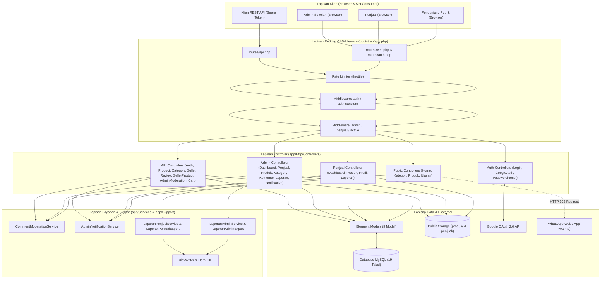

# Arsitektur Sistem — SiswaMart

| Informasi Dokumen | Detail |
| :--- | :--- |
| **Judul** | Arsitektur Sistem SiswaMart |
| **Versi** | `1.1.0` |
| **Tanggal** | 27 Oktober 2026 |
| **Status** | Final (Source-Code Backed) |
| **Penulis** | Tim Dokumentasi Teknis & Rekayasa Perangkat Lunak |
| **Sumber Data** | `bootstrap/app.php`, `composer.json`, `package.json`, `app/`, `routes/`, `config/`, `resources/` |

---

## Daftar Isi

1. [Gambaran Umum Arsitektur](#1-gambaran-umum-arsitektur)
2. [Teknologi dan Versi Paket Aktual](#2-teknologi-dan-versi-paket-aktual)
3. [Lapisan Aplikasi (Layered Architecture)](#3-lapisan-aplikasi-layered-architecture)
4. [Struktur Direktori Proyek](#4-struktur-direktori-proyek)
5. [Pola Desain yang Digunakan](#5-pola-desain-yang-digunakan)
6. [Diagram Komponen Sistem](#6-diagram-komponen-sistem)
7. [Alur Siklus Hidup Permintaan (Request Lifecycle)](#7-alur-siklus-hidup-permintaan-request-lifecycle)
8. [Rujukan Kode](#8-rujukan-kode)

---

## 1. Gambaran Umum Arsitektur

**SiswaMart** menggunakan arsitektur **Monolitik Modular Berbasis MVC + Service Layer** di atas kerangka kerja **Laravel 13.38.0** (`PHP ^8.3`). Sistem dirancang untuk melayani dua jalur antarmuka sekaligus dari satu basis kode (*single codebase*):
1. **Aplikasi Web Server-Side Rendered (SSR)** berbasis **Blade Templates**, **Tailwind CSS v4**, dan **Alpine.js v3** untuk Pengunjung Publik, Panel Penjual, dan Panel Admin.
2. **RESTful JSON API** berbasis **Laravel Sanctum Bearer Token** di bawah prefix `/api/*` untuk integrasi klien eksternal atau aplikasi bergerak (*mobile*).

---

## 2. Teknologi dan Versi Paket Aktual

Seluruh angka versi di bawah diambil langsung dari `composer.json`, `composer.lock`, dan `package.json`.

### 2.1 Backend & Runtime (`composer.json` & `composer.lock`)

| Komponen / Paket | Constraint (`composer.json`) | Versi Terkunci (`composer.lock`) | Peran dalam Sistem | Rujukan Berkas |
| :--- | :--- | :--- | :--- | :--- |
| **PHP Runtime** | `^8.3` (Platform `8.3.30`) | `8.3.30` | Bahasa pemrograman server | `composer.json#L9`, `#L85` |
| `laravel/framework` | `^13.38` | `v13.38.0` | Kerangka kerja inti aplikasi web & API | `composer.json#L12` |
| `laravel/sanctum` | `*` | `v4.3.3` | Autentikasi Bearer Token API (`personal_access_tokens`) | `composer.json#L13` |
| `laravel/socialite` | `^5.31` | `v5.31.0` | Integrasi OAuth 2.0 Google Sign-In | `composer.json#L14` |
| `barryvdh/laravel-dompdf` | `^3.1` | `v3.1.2` | Generator laporan PDF Admin & Penjual | `composer.json#L10` |
| `laravel/tinker` | `^3.0` | `v3.0.2` | REPL interaktif untuk inspeksi & pemeliharaan | `composer.json#L15` |
| `laravel/breeze` (dev) | `^2.4` | `v2.4.2` | Kerangka dasar autentikasi web | `composer.json#L19` |
| `phpunit/phpunit` (dev) | `^12.5.12` | `12.5.33` | Kerangka pengujian otomatis (*Feature & Unit Test*) | `composer.json#L25` |
| `laravel/pint` (dev) | `^1.27` | `v1.30.5` | Pemformat standar gaya kode PHP (PSR-12) | `composer.json#L23` |

### 2.2 Frontend & Bundler (`package.json`)

| Paket | Constraint (`package.json`) | Peran dalam Sistem | Rujukan Berkas |
| :--- | :--- | :--- | :--- |
| `tailwindcss` | `^4.0.7` | Utilitas CSS utama | `package.json#L13` |
| `@tailwindcss/vite` | `^4.0.7` | Plugin integrasi Tailwind CSS v4 dengan Vite | `package.json#L8` |
| `alpinejs` | `^3.14.9` | Reaktivitas UI ringan di sisi klien (modal, dropdown, tab) | `package.json#L9` |
| `vite` | `^6.2.4` | Bundler aset frontend (`resources/css/app.css`, `resources/js/app.js`) | `package.json#L14` |
| `laravel-vite-plugin` | `^1.2.0` | Integrasi manifest Vite dengan helper `@vite` Blade | `package.json#L12` |

---

## 3. Lapisan Aplikasi (Layered Architecture)

Sistem dibagi ke dalam **5 lapisan logis** dengan pemisahan tanggung jawab yang tegas:

1. **Lapisan Presentasi & Respons (Presentation & Response Layer)**
   - **Web UI**: `resources/views/` (Blade + komponen `<x-*>`, CSS tema `public/css/siswamart-theme.css` dan `public/css/homepage.css`).
   - **API JSON**: Metode pembantu transformasi di `app/Http/Controllers/Api/ApiController.php` (`success()`, `error()`) dan masing-masing kontroler API (`productData()`, `sellerData()`, `reviewData()`, dll.). *Catatan: Proyek tidak menggunakan direktori `app/Http/Resources` bawaan, melainkan transformer terkontrol di dalam kontroler API.*
   - **Dokumen Unduhan**: Template PDF (`resources/views/admin/laporan/pdf.blade.php`, `resources/views/penjual/laporan/pdf.blade.php`) dan generator Excel OpenXML `app/Support/XlsxWriter.php`.

2. **Lapisan Routing & Middleware (HTTP Boundary Layer)**
   - Definisi rute terpisah berdasarkan konteks: `routes/web.php`, `routes/auth.php`, `routes/api.php`, dan `routes/console.php`.
   - Pemeriksaan akses di `bootstrap/app.php#L18-L25` menggunakan middleware kustom:
     - `admin` $\rightarrow$ `App\Http\Middleware\EnsureAdmin` (`app/Http/Middleware/EnsureAdmin.php#L16-L31`)
     - `penjual` $\rightarrow$ `App\Http\Middleware\EnsurePenjual` (`app/Http/Middleware/EnsurePenjual.php#L16-L31`)
     - `active` $\rightarrow$ `App\Http\Middleware\EnsureUserIsActive` (`app/Http/Middleware/EnsureUserIsActive.php#L12-L26`)

3. **Lapisan Kontroler & Validasi (Controller & Request Validation Layer)**
   - Terbagi ke dalam 5 namespace: `Admin\`, `Penjual\`, `Public\`, `Auth\`, dan `Api\`.
   - Validasi input menggunakan `App\Http\Requests\ProfileUpdateRequest`, `App\Http\Requests\Auth\LoginRequest` (dengan `RateLimiter` 5 percobaan), serta validasi inline terstruktur di masing-masing kontroler.
   - Penanganan eksepsi API terpusat di `bootstrap/app.php#L27-L44` yang mengubah `ValidationException` pada `api/*` menjadi respons JSON standar HTTP `422`.

4. **Lapisan Layanan Bisnis & Dukungan (Service & Export Layer)**
   - `App\Services\CommentModerationService` (`app/Services/CommentModerationService.php`): Mesin pemfilteran kata kasar (*profanity*), normalisasi *leetspeak*, dan *whitelist* dengan cache 24 jam.
   - `App\Services\AdminNotificationService` (`app/Services/AdminNotificationService.php`): Orkestrasi pembuatan notifikasi database ke seluruh akun admin aktif.
   - `App\Services\LaporanAdminService` & `App\Services\LaporanPenjualService`: Agregasi metrik, pemfilteran lintas dimensi, dan penyusunan dataset laporan.
   - `App\Exports\LaporanAdminExport`, `App\Exports\LaporanPenjualExport`, `App\Exports\Concerns\StylesSheet`, dan `App\Support\XlsxWriter`: Pembuatan buku kerja `.xlsx` multi-sheet dengan sanitasi formula CSV/Excel.

5. **Lapisan Model & Persistensi Data (Data Access & Persistence Layer)**
   - **9 Model Eloquent** di `app/Models/`: `User`, `Penjual`, `Kategori`, `Produk`, `Ulasan`, `ProdukViewLog`, `BadWord`, `Whitelist`, dan `CommentModerationLog`.
   - Menggunakan *query scope* (`Produk::scopePublicVisible`, `Produk::scopePendingModeration`), relasi Eloquent (`belongsTo`, `hasMany`, `hasOne`), dan transaksi database (`DB::transaction`) untuk operasi mutasi multi-tabel.

---

## 4. Struktur Direktori Proyek

```text
siswamartid/
├── app/
│   ├── Console/Commands/           # Perintah CLI: AuditCleanCommentsCommand, LoadBadWordsCommand
│   ├── Exports/                    # LaporanAdminExport, LaporanPenjualExport, Concerns/StylesSheet
│   ├── Http/
│   │   ├── Controllers/
│   │   │   ├── Admin/              # 7 kontroler panel Admin (Dashboard, Penjual, Produk, Kategori, Komentar, Laporan, Notification)
│   │   │   ├── Api/                # 11 kontroler REST API (ApiController, Auth, Product, Category, Seller, Review, Profile, SellerProduct, AdminModeration, Notification, Cart)
│   │   │   ├── Auth/               # 10 kontroler autentikasi Web & Google OAuth (GoogleAuthController, dll.)
│   │   │   ├── Penjual/            # 4 kontroler panel Penjual (Dashboard, Produk, Profil, Laporan)
│   │   │   ├── Public/             # 4 kontroler etalase publik (Home, Kategori, Produk, Ulasan)
│   │   │   └── ProfileController.php
│   │   ├── Middleware/             # EnsureAdmin, EnsurePenjual, EnsureUserIsActive
│   │   └── Requests/               # Auth/LoginRequest, ProfileUpdateRequest
│   ├── Models/                     # 9 model Eloquent (User, Penjual, Kategori, Produk, Ulasan, ProdukViewLog, BadWord, Whitelist, CommentModerationLog)
│   ├── Notifications/              #AdminActivityNotification, BrandedResetPassword, BrandedVerifyEmail
│   ├── Providers/                  # AppServiceProvider
│   ├── Services/                   # CommentModerationService, AdminNotificationService, LaporanAdminService, LaporanPenjualService
│   ├── Support/                    # XlsxWriter (generator OpenXML .xlsx murni PHP)
│   └── View/Components/            # AppLayout, GuestLayout
├── bootstrap/
│   └── app.php                     # Registrasi rute, alias middleware, & exception handler JSON 422
├── config/                         # 11 berkas konfigurasi (app, auth, cache, database, dompdf, filesystems, logging, mail, queue, sanctum, services, session)
├── database/
│   ├── factories/                  # UserFactory
│   ├── migrations/                 # 27 berkas migrasi skema database
│   └── seeders/                    # DatabaseSeeder, AdminUserSeeder, KategoriSeeder, PenjualPromptsSeeder, ProdukSeeder, BadWordsSeeder
├── docs/                           # Dokumentasi teknis proyek lengkap (01-prd s.d. 10-proyek)
├── public/                         # Document root (index.php multi-path, css/siswamart-theme.css, css/homepage.css, deploy-helper.php)
├── resources/
│   ├── css/app.css                 # Entrypoint Tailwind CSS v4
│   ├── data/badwords-list.json     # Kamus dasar kata terlarang (350 kata)
│   ├── js/                         # app.js, bootstrap.js
│   └── views/                      # Template Blade (admin/, penjual/, public/, auth/, layouts/, components/, emails/)
├── routes/                         # web.php, auth.php, api.php, console.php
└── tests/                          # 10 berkas pengujian otomatis (Feature & Unit)
```

---

## 5. Pola Desain yang Digunakan

| Pola Desain (*Design Pattern*) | Implementasi di SiswaMart | Rujukan Kode |
| :--- | :--- | :--- |
| **Service Layer Pattern** | Memisahkan logika bisnis kompleks (moderasi kata kasar, agregasi laporan, pengiriman notifikasi admin) dari kontroler agar dapat dipakai bersama oleh kontroler Web maupun API/Command. | `app/Services/CommentModerationService.php`, `app/Services/LaporanAdminService.php`, `app/Services/LaporanPenjualService.php`, `app/Services/AdminNotificationService.php` |
| **Query Scope Pattern** | Mengenkapsulasi aturan visibilitas etalase publik (`status = aktif` DAN `penjual.user.is_active = true`) serta antrean moderasi (`status = pending` ATAU `pending_action IS NOT NULL`) di dalam model `Produk`. | `app/Models/Produk.php#L47-L60` |
| **State Preservation / Draft Shadowing (`pending_changes`)** | Perubahan produk aktif oleh penjual disimpan dalam kolom JSON `pending_changes` dengan penanda `pending_action = 'update'` tanpa menimpa kolom utama sampai disetujui admin. | `app/Http/Controllers/Penjual/ProdukController.php#L140-L157`, `app/Http/Controllers/Admin/ProdukController.php#L61-L163` |
| **Pipeline / Chain of Responsibility (Middleware)** | Pemeriksaan berjenjang autentikasi sesi/token, status keaktifan akun (`EnsureUserIsActive`), dan otorisasi peran (`EnsureAdmin`, `EnsurePenjual`). | `bootstrap/app.php#L18-L25`, `app/Http/Middleware/` |
| **Template Method / Trait Mixin** | Penggunaan trait `StylesSheet` untuk menyamakan skema warna, border, format mata uang, dan sanitasi teks antara `LaporanAdminExport` dan `LaporanPenjualExport`. | `app/Exports/Concerns/StylesSheet.php#L10-L246` |

---

## 6. Diagram Komponen Sistem



---

## 7. Alur Siklus Hidup Permintaan (Request Lifecycle)

### 7.1 Siklus Permintaan Web (`routes/web.php`)
1. Permintaan HTTP masuk ke `public/index.php` (`public/index.php#L1-L48`), yang mendukung resolusi multi-path baik untuk struktur standar lokal maupun pemisahan folder `core/` dan `public_html/` di *shared hosting*.
2. Kernel Laravel (`bootstrap/app.php`) menjalankan grup middleware `web` (sesi, cookie terenkripsi, verifikasi token CSRF).
3. Untuk rute terproteksi (`/admin/*` atau `/penjual/*`), middleware `auth` memastikan sesi aktif, diikuti `EnsureAdmin` atau `EnsurePenjual` yang memvalidasi `user->role` **serta** `user->is_active == true`. Jika akun dinonaktifkan saat sesi berlangsung, sesi langsung di-`invalidate()` dan diarahkan ke `/login` (`app/Http/Middleware/EnsurePenjual.php#L18-L25`).
4. Kontroler mengeksekusi logika melalui Model Eloquent atau Service, lalu merender tampilan Blade (`resources/views/`) atau mengembalikan unduhan berkas biner (`.pdf` / `.xlsx`).

### 7.2 Siklus Permintaan REST API (`routes/api.php`)
1. Permintaan HTTP dengan header `Accept: application/json` masuk ke prefix `/api/*`.
2. Rute terproteksi melewati `auth:sanctum` dan alias middleware `active` (`EnsureUserIsActive`).
3. Jika pengguna yang terautentikasi memiliki `is_active == false`, middleware `EnsureUserIsActive` segera menghapus seluruh token Sanctum pengguna (`$user->tokens()->delete()`) dan mengembalikan respons JSON HTTP `403 Forbidden` (`app/Http/Middleware/EnsureUserIsActive.php#L16-L23`).
4. Apabila validasi gagal (`ValidationException`), *exception renderer* di `bootstrap/app.php#L28-L43` mengembalikan amplop JSON seragam:
   ```json
   {
     "success": false,
     "message": "Data yang dikirim tidak valid.",
     "errors": { "field": ["Pesan kesalahan..."] }
   }
   ```

---

## 8. Rujukan Kode

- `bootstrap/app.php#L1-L46`
- `public/index.php#L1-L48`
- `composer.json#L1-L97`
- `package.json#L1-L16`
- `app/Http/Middleware/EnsureAdmin.php#L1-L33`
- `app/Http/Middleware/EnsurePenjual.php#L1-L33`
- `app/Http/Middleware/EnsureUserIsActive.php#L1-L28`
- `app/Http/Controllers/Api/ApiController.php#L1-L39`
- `app/Services/CommentModerationService.php#L1-L361`
- `app/Services/AdminNotificationService.php#L1-L132`
- `app/Services/LaporanAdminService.php#L1-L296`
- `app/Services/LaporanPenjualService.php#L1-L162`
- `app/Support/XlsxWriter.php#L1-L429`
