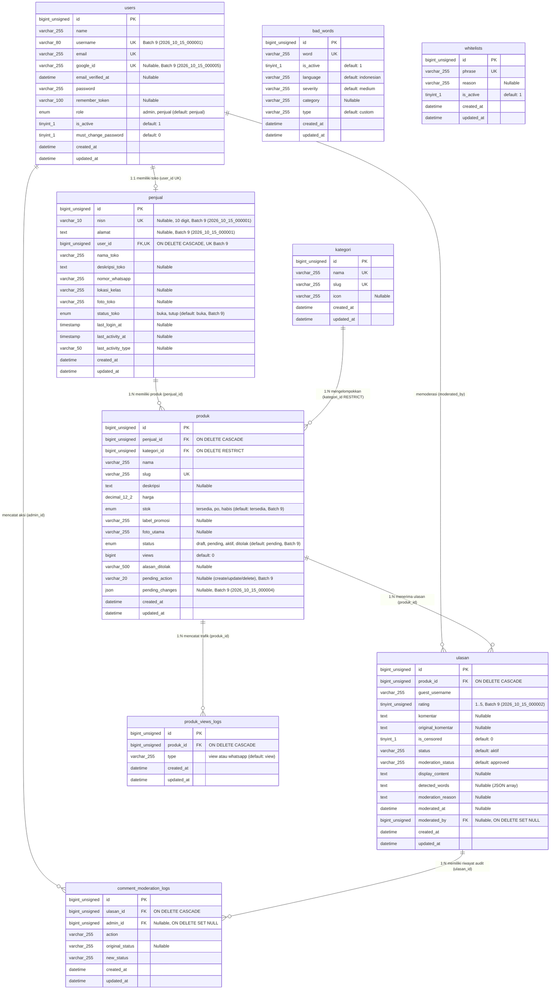
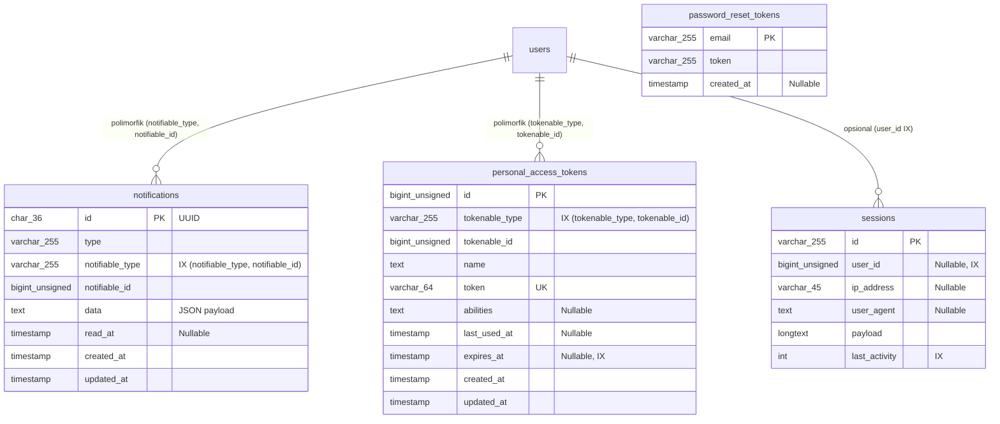

# Entity-Relationship Diagram (ERD) — SiswaMart

| Informasi Dokumen | Detail |
| :--- | :--- |
| **Judul** | Entity-Relationship Diagram (ERD) Skema Aktual SiswaMart |
| **Versi** | `1.1.0` |
| **Tanggal** | 27 Oktober 2026 |
| **Status** | Final (Source-Code & Live DB Verified) |
| **Penulis** | Tim Dokumentasi Teknis & Rekayasa Perangkat Lunak |
| **Sumber Data** | `database/migrations/` (27 berkas), `app/Models/` (9 model), dan skema aktual MySQL `siswamartid` (19 tabel) |

---

## Daftar Isi

1. [Ringkasan Skema Database Aktual](#1-ringkasan-skema-database-aktual)
2. [Diagram ERD Domain Bisnis & Moderasi (Mermaid)](#2-diagram-erd-domain-bisnis--moderasi-mermaid)
3. [Diagram ERD Infrastruktur & Framework (Mermaid)](#3-diagram-erd-infrastruktur--framework-mermaid)
4. [Daftar Kolom & Constraint dari Migrasi Penyelarasan (Batch 9 / `2026_10_15_*`)](#4-daftar-kolom--constraint-dari-migrasi-penyelarasan-batch-9--2026_10_15_)
5. [Kardinalitas dan Aturan Integritas Referensial (Foreign Keys)](#5-kardinalitas-dan-aturan-integritas-referensial-foreign-keys)
6. [Rujukan Kode](#6-rujukan-kode)

---

## 1. Ringkasan Skema Database Aktual

Database MySQL `siswamartid` memiliki total **19 tabel aktif** yang dibentuk dari **27 berkas migrasi** (seluruh 27 migrasi berstatus **`Ran`** pada Batch 1 s.d. Batch 9):

- **11 Tabel Domain Bisnis, Moderasi, Notifikasi, & API:**
  1. `users` — Akun pengguna (`admin` & `penjual`) beserta kredensial Google OAuth.
  2. `penjual` — Profil toko siswa (relasi `1:1` dengan `users`).
  3. `kategori` — Kategori produk katalog.
  4. `produk` — Katalog produk beserta state moderasi `pending_action` & `pending_changes`.
  5. `ulasan` — Ulasan dan rating bintang dari pengunjung publik beserta metadata moderasi.
  6. `produk_views_logs` — Log analitik berwaktu untuk kunjungan halaman (`view`) dan klik WhatsApp (`whatsapp`).
  7. `bad_words` — Kamus kata terlarang kustom di database.
  8. `whitelists` — Daftar frasa aman yang dikecualikan dari filter kata kasar.
  9. `comment_moderation_logs` — Jejak audit tindakan moderasi komentar oleh Admin.
  10. `notifications` — Notifikasi sistem polimorfik untuk Admin.
  11. `personal_access_tokens` — Token autentikasi Bearer API Laravel Sanctum.
- **8 Tabel Infrastruktur Framework Laravel:**
  12. `password_reset_tokens`, 13. `sessions`, 14. `cache`, 15. `cache_locks`, 16. `jobs`, 17. `job_batches`, 18. `failed_jobs`, 19. `migrations`.

---

## 2. Diagram ERD Domain Bisnis & Moderasi (Mermaid)

> [!NOTE]
> Kolom yang ditandai `[Batch 9 / Ex-Pending]` pada keterangan merupakan kolom/normalisasi dari 5 berkas migrasi `2026_10_15_000001` s.d. `2026_10_15_000005` yang pada dokumen lama masih berstatus *pending*, namun pada database aktual saat ini sudah dijalankan (**Batch 9 `Ran`**).

---

## 3. Diagram ERD Infrastruktur & Framework (Mermaid)

Tabel-tabel berikut mendukung polimorfisme notifikasi, token Sanctum, sesi pengguna, antrean latar belakang, dan cache:

---

## 4. Daftar Kolom & Constraint dari Migrasi Penyelarasan (Batch 9 / `2026_10_15_*`)

Pada dokumen `docs/ERD.md` versi sebelumnya, lima migrasi bertanggal `2026_10_15_*` dicatat sebagai *pending*. Pada database lokal `siswamartid` saat ini, kelima migrasi tersebut **telah dijalankan pada Batch 9 (`Ran`)** dan menghasilkan perubahan skema aktual berikut:

| Berkas Migrasi | Tabel Target | Perubahan Skema Aktual | Status di DB Lokal (`siswamartid`) | Status untuk Lingkungan Baru |
| :--- | :--- | :--- | :--- | :--- |
| `2026_10_15_000001_align_local_schema_with_erd.php` | `users`, `penjual` | 1. Menambah `users.username` (`varchar(80)` `UNIQUE`). 2. Menambah `penjual.nisn` (`varchar(10)` `nullable` `UNIQUE`), `penjual.alamat` (`text` `nullable`), dan indeks unik `penjual_user_id_unique` (menegakkan relasi `1:1`). 3. Sempat menambah `created_by_admin_id` lalu dihapus lagi oleh `000003`. | `[Implemented]` (Batch 9 `Ran`) | `[Pending migrasi]` jika server tujuan belum menjalankan `migrate` setelah 15 Okt 2026 |
| `2026_10_15_000002_normalize_erd_status_values.php` | `penjual`, `produk`, `ulasan` | 1. Mengubah `penjual.status_toko` dari `varchar(20)` menjadi `enum('buka','tutup')`. 2. Mengubah `produk.stok` dari `enum('tersedia','habis')` menjadi `enum('tersedia','po','habis')`. 3. Mengubah `produk.status` menjadi `enum('draft','pending','aktif','ditolak')` dengan default `'pending'` (nilai lama `'nonaktif'` dinormalisasi menjadi `'pending'`). 4. Mengubah `ulasan.rating` dari `int` menjadi `tinyint unsigned`. | `[Implemented]` (Batch 9 `Ran`) | `[Pending migrasi]` jika server tujuan belum menjalankan `migrate` |
| `2026_10_15_000003_remove_admin_creator_from_penjual.php` | `penjual` | Menghapus FK dan kolom `created_by_admin_id` dari tabel `penjual`. | `[Implemented]` (Batch 9 `Ran`) | `[Pending migrasi]` jika server tujuan belum menjalankan `migrate` |
| `2026_10_15_000004_add_product_moderation_requests.php` | `produk` | Menambah kolom `pending_action` (`varchar(20)` `nullable`) dan `pending_changes` (`json` `nullable`), serta menginisialisasi produk `pending` yang sudah ada dengan `pending_action = 'create'`. | `[Implemented]` (Batch 9 `Ran`) | `[Pending migrasi]` jika server tujuan belum menjalankan `migrate` |
| `2026_10_15_000005_add_google_id_to_users_table.php` | `users` | Menambah kolom `google_id` (`varchar(255)` `nullable` `UNIQUE`). | `[Implemented]` (Batch 9 `Ran`) | `[Pending migrasi]` jika server tujuan belum menjalankan `migrate` |

---

## 5. Kardinalitas dan Aturan Integritas Referensial (Foreign Keys)

Seluruh constraint kunci asing (*foreign key*) di bawah ini telah diverifikasi langsung dari `information_schema.KEY_COLUMN_USAGE` dan `information_schema.REFERENTIAL_CONSTRAINTS` pada database `siswamartid`:

| Nama Constraint | Tabel Anak (` kolom `) | Tabel Induk (` kolom `) | Kardinalitas | `ON DELETE` | `ON UPDATE` | Penjelasan Perilaku |
| :--- | :--- | :--- | :--- | :--- | :--- | :--- |
| `penjual_ibfk_1` | `penjual.user_id` (UK) | `users.id` (PK) | `1 : 1` | `CASCADE` | `RESTRICT` | Menghapus akun `users` otomatis menghapus profil `penjual`. Namun di lapisan aplikasi (`Admin\PenjualController::destroy`), penghapusan diblokir jika penjual masih memiliki produk. |
| `produk_ibfk_1` | `produk.penjual_id` | `penjual.id` (PK) | `N : 1` | `CASCADE` | `RESTRICT` | Jika baris `penjual` dihapus di level DB, produk miliknya ikut terhapus. |
| `produk_ibfk_2` | `produk.kategori_id` | `kategori.id` (PK) | `N : 1` | `NO ACTION` (`RESTRICT`) | `RESTRICT` | Mencegah penghapusan kategori yang masih memiliki produk terkait (selaras dengan cek di `Admin\KategoriController::destroy`). |
| `ulasan_ibfk_1` | `ulasan.produk_id` | `produk.id` (PK) | `N : 1` | `CASCADE` | `RESTRICT` | Jika produk dihapus permanen, seluruh ulasan produk tersebut ikut dihapus. |
| `ulasan_ibfk_2` | `ulasan.moderated_by` | `users.id` (PK) | `N : 1` | `SET NULL` | `RESTRICT` | Jika akun admin moderator dihapus, histori moderasi ulasan tetap tersimpan dengan `moderated_by = NULL`. |
| `produk_views_logs_ibfk_1` | `produk_views_logs.produk_id` | `produk.id` (PK) | `N : 1` | `CASCADE` | `RESTRICT` | Jika produk dihapus permanen, log kunjungan dan klik WhatsApp produk tersebut ikut terhapus. |
| `comment_moderation_logs_ibfk_1` | `comment_moderation_logs.ulasan_id` | `ulasan.id` (PK) | `N : 1` | `CASCADE` | `RESTRICT` | Jika ulasan dihapus, log riwayat moderasi ulasan tersebut ikut terhapus. |
| `comment_moderation_logs_ibfk_2` | `comment_moderation_logs.admin_id` | `users.id` (PK) | `N : 1` | `SET NULL` | `RESTRICT` | Jika akun admin dihapus, baris log audit tetap ada dengan `admin_id = NULL`. |

---

## 6. Rujukan Kode

- `database/migrations/0001_01_01_000000_create_users_table.php` s.d. `database/migrations/2026_10_15_000005_add_google_id_to_users_table.php`
- `app/Models/User.php#L1-L75`
- `app/Models/Penjual.php#L1-L82`
- `app/Models/Kategori.php#L1-L32`
- `app/Models/Produk.php#L1-L87`
- `app/Models/Ulasan.php#L1-L157`
- `app/Models/ProdukViewLog.php#L1-L26`
- `app/Models/BadWord.php#L1-L55`
- `app/Models/Whitelist.php#L1-L40`
- `app/Models/CommentModerationLog.php#L1-L30`
