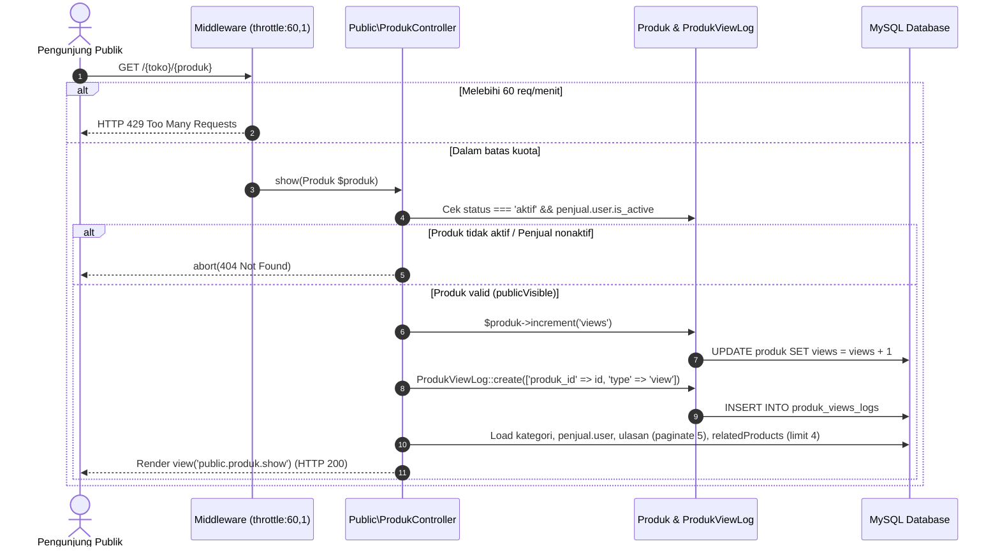
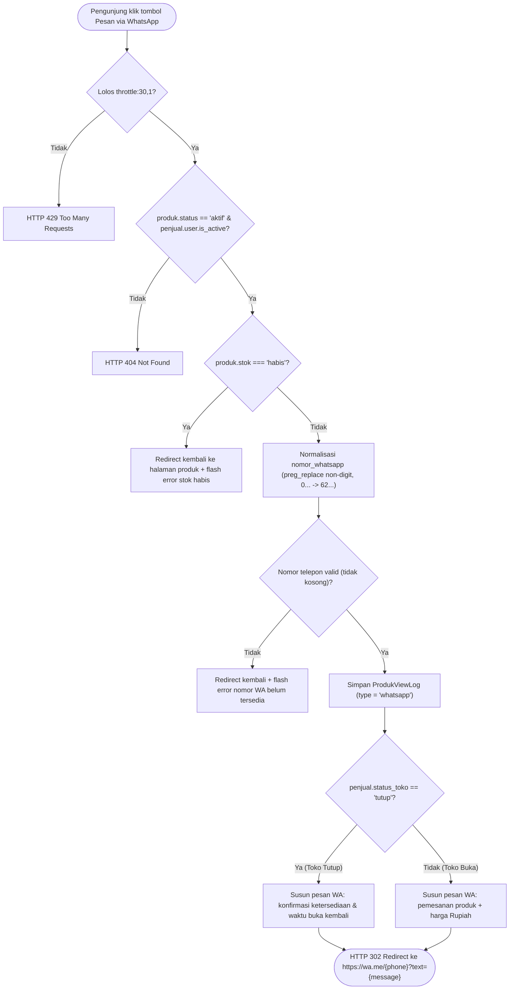
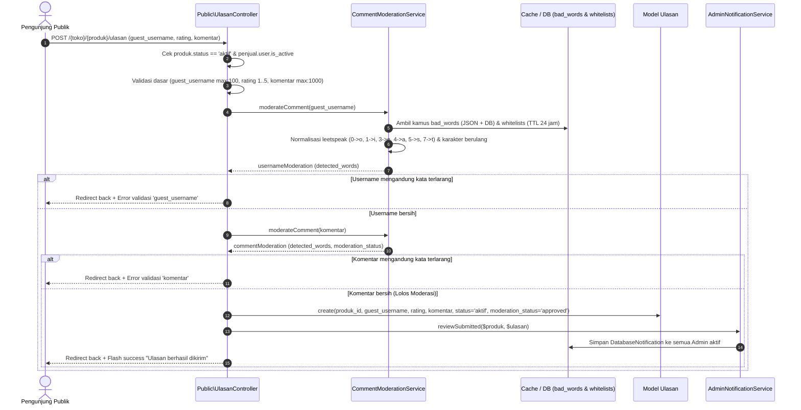
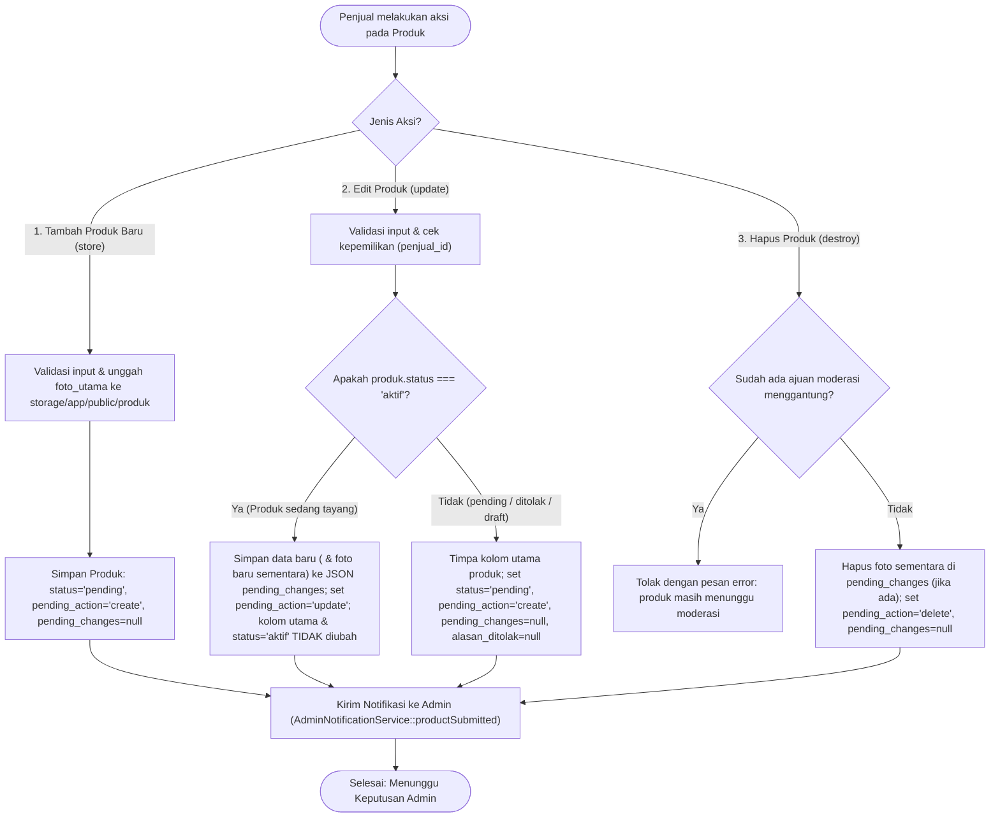
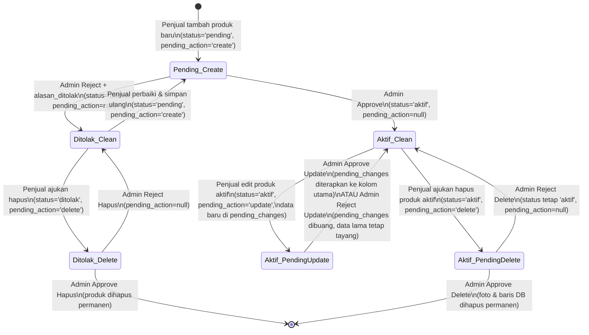
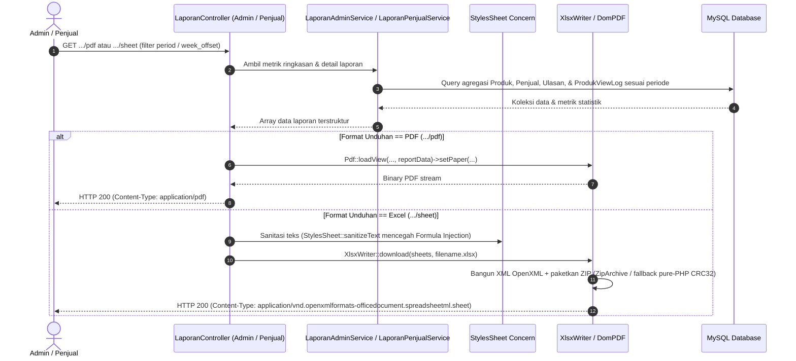

# Diagram Activity, Sequence, dan State — SiswaMart

| Informasi Dokumen | Detail |
| :--- | :--- |
| **Judul** | Activity (Flowchart), Sequence, dan State Diagram Alur Utama SiswaMart |
| **Versi** | `1.2.0` |
| **Tanggal** | 18 November 2026 |
| **Status** | Final (Source-Code Backed) |
| **Penulis** | Tim Dokumentasi Teknis & Rekayasa Perangkat Lunak |
| **Sumber Data** | `Public\ProdukController`, `Public\UlasanController`, `Penjual\ProdukController`, `Admin\ProdukController`, `CommentModerationService`, `LaporanAdminService`, `LaporanPenjualService` |

---

## Daftar Isi

1. [Alur 1: Melihat Detail Produk & Pencatatan Analitik Kunjungan (`view`)](#1-alur-1-melihat-detail-produk--pencatatan-analitik-kunjungan-view)
2. [Alur 2: Klik Pemesanan WhatsApp & Penyesuaian Status Toko (`whatsapp`)](#2-alur-2-klik-pemesanan-whatsapp--penyesuaian-status-toko-whatsapp)
3. [Alur 3: Pengiriman Ulasan Tamu dengan Filter Kata Kasar (`CommentModerationService`)](#3-alur-3-pengiriman-ulasan-tamu-dengan-filter-kata-kasar-commentmoderationservice)
4. [Alur 4: Pengajuan Produk Baru, Edit (`pending_changes`), dan Hapus oleh Penjual](#4-alur-4-pengajuan-produk-baru-edit-pending_changes-dan-hapus-oleh-penjual)
5. [Alur 5: Moderasi Produk (`Approve` / `Reject`) oleh Admin & State Machine Produk](#5-alur-5-moderasi-produk-approve--reject-oleh-admin--state-machine-produk)
6. [Alur 6: Pembuatan dan Pengunduhan Laporan PDF & Excel (`.xlsx`)](#6-alur-6-pembuatan-dan-pengunduhan-laporan-pdf--excel-xlsx)
7. [Rujukan Kode](#7-rujukan-kode)

---

## 1. Alur 1: Melihat Detail Produk & Pencatatan Analitik Kunjungan (`view`)

Rute: `GET /{penjual:slug}/{produk:slug}` (`Public\ProdukController@show`, `throttle:60,1`; rute legacy `GET /produk/{slug}` melakukan redirect `301`).

### 1.1 Sequence Diagram Lihat Produk



---

## 2. Alur 2: Klik Pemesanan WhatsApp & Penyesuaian Status Toko (`whatsapp`)

Rute: `GET /{penjual:slug}/{produk:slug}/whatsapp` (`Public\ProdukController@trackWhatsapp`, `throttle:30,1`; rute legacy `GET /produk/{slug}/whatsapp` melakukan redirect `301`).

### 2.1 Activity Flowchart Klik WhatsApp



---

## 3. Alur 3: Pengiriman Ulasan Tamu dengan Filter Kata Kasar (`CommentModerationService`)

Rute: `POST /{penjual:slug}/{produk:slug}/ulasan` (`Public\UlasanController@store`, `throttle:3,1`) dan `POST /api/products/{product}/reviews` (`Api\ReviewController@store`, `throttle:3,1`).

### 3.1 Sequence Diagram Kirim Ulasan & Filter Kata Kasar



---

## 4. Alur 4: Pengajuan Produk Baru, Edit (`pending_changes`), dan Hapus oleh Penjual

Rute: `POST /penjual/produk`, `PUT /penjual/produk/{produk}`, `DELETE /penjual/produk/{produk}` (`Penjual\ProdukController`).

### 4.1 Activity Flowchart Pengajuan Produk oleh Penjual



---

## 5. Alur 5: Moderasi Produk (`Approve` / `Reject`) oleh Admin & State Machine Produk

Rute: `PATCH /admin/produk/{produk}/update-status` (`Admin\ProdukController@updateStatus`).

### 5.1 Sequence Diagram Moderasi Produk oleh Admin

```mermaid
sequenceDiagram
    autonumber
    actor Admin as Admin Sekolah
    participant Ctrl as Admin\ProdukController
    participant Storage as Public Disk Storage
    participant DB as Tabel produk (MySQL)

    Admin->>Ctrl: PATCH /admin/produk/{produk}/update-status (status: 'aktif' | 'ditolak', alasan_ditolak)
    Ctrl->>Ctrl: Validasi status & wajib alasan_ditolak jika 'ditolak'
    Ctrl->>Ctrl: Deteksi action = produk.pending_action ?? (produk.status == 'pending' ? 'create' : null)

    alt Keputusan Admin: APPROVE (status == 'aktif')
        alt action === 'delete'
            Ctrl->>Storage: Hapus foto_utama & foto di pending_changes
            Ctrl->>DB: $produk->delete() (Hapus permanen dari DB)
            Ctrl-->>Admin: Redirect + Flash "Permintaan hapus disetujui"
        else action === 'update'
            Ctrl->>Storage: Hapus foto_utama lama jika diganti foto baru di pending_changes
            Ctrl->>DB: Salin pending_changes ke kolom utama; status='aktif', pending_action=null, pending_changes=null, alasan_ditolak=null
            Ctrl-->>Admin: Redirect + Flash "Perubahan produk disetujui"
        else action === 'create'
            Ctrl->>DB: Update status='aktif', pending_action=null, pending_changes=null, alasan_ditolak=null
            Ctrl-->>Admin: Redirect + Flash "Produk baru disetujui"
        end
    else Keputusan Admin: REJECT (status == 'ditolak')
        alt action === 'update' ATAU (action === 'delete' & produk.status === 'aktif')
            Ctrl->>Storage: Hapus foto baru sementara di pending_changes (jika ada)
            Ctrl->>DB: Pertahankan status='aktif' & kolom utama lama; set pending_action=null, pending_changes=null, alasan_ditolak=input
            Ctrl-->>Admin: Redirect + Flash "Ajuan ditolak, versi aktif tetap tayang"
        else action === 'create' (Produk belum aktif)
            Ctrl->>DB: Update status='ditolak', pending_action=null, pending_changes=null, alasan_ditolak=input
            Ctrl-->>Admin: Redirect + Flash "Produk baru ditolak"
        end
    end
```

### 5.2 State Diagram Siklus Hidup Produk (`status` & `pending_action`)



---

## 6. Alur 6: Pembuatan dan Pengunduhan Laporan PDF & Excel (`.xlsx`)

Rute:
- Admin: `GET /admin/laporan/penjual/pdf`, `GET /admin/laporan/ulasan/pdf`, `GET /admin/laporan/penjual/sheet`, `GET /admin/laporan/ulasan/sheet` (beserta laporan detail penjual).
- Penjual: `GET /penjual/laporan/pdf` (PDF A4 Portrait), `GET /penjual/laporan/sheet` (Excel 5 sheet).

### 6.1 Sequence Diagram Unduh Laporan PDF & Excel



---

## 7. Rujukan Kode

- `app/Http/Controllers/Public/ProdukController.php`
- `app/Http/Controllers/Public/UlasanController.php`
- `app/Services/CommentModerationService.php`
- `app/Http/Controllers/Penjual/ProdukController.php`
- `app/Http/Controllers/Admin/ProdukController.php`
- `app/Http/Controllers/Admin/LaporanController.php`
- `app/Http/Controllers/Penjual/LaporanController.php`
- `app/Exports/Concerns/StylesSheet.php`
- `app/Support/XlsxWriter.php`
