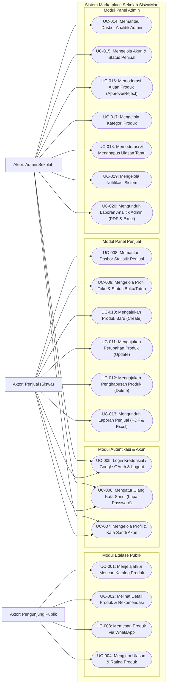

# Spesifikasi Use Case — SiswaMart

| Informasi Dokumen | Detail |
| :--- | :--- |
| **Judul** | Diagram dan Spesifikasi Use Case SiswaMart |
| **Versi** | `1.1.0` |
| **Tanggal** | 27 Oktober 2026 |
| **Status** | Final (Source-Code Backed) |
| **Penulis** | Tim Dokumentasi Teknis & Rekayasa Perangkat Lunak |
| **Sumber Data** | `routes/web.php`, `routes/auth.php`, `routes/api.php`, `app/Http/Controllers/` |

---

## Daftar Isi

1. [Daftar Aktor Sistem](#1-daftar-aktor-sistem)
2. [Diagram Use Case Sistem (Mermaid)](#2-diagram-use-case-sistem-mermaid)
3. [Indeks Ringkasan Use Case (`UC-001` s.d. `UC-020`)](#3-indeks-ringkasan-use-case-uc-001-sd-uc-020)
4. [Spesifikasi Use Case Pengunjung Publik (`UC-001` s.d. `UC-004`)](#4-spesifikasi-use-case-pengunjung-publik-uc-001-sd-uc-004)
5. [Spesifikasi Use Case Autentikasi & Profil (`UC-005` s.d. `UC-007`)](#5-spesifikasi-use-case-autentikasi--profil-uc-005-sd-uc-007)
6. [Spesifikasi Use Case Penjual (`UC-008` s.d. `UC-013`)](#6-spesifikasi-use-case-penjual-uc-008-sd-uc-013)
7. [Spesifikasi Use Case Admin (`UC-014` s.d. `UC-020`)](#7-spesifikasi-use-case-admin-uc-014-sd-uc-020)
8. [Rujukan Kode](#8-rujukan-kode)

---

## 1. Daftar Aktor Sistem

| Aktor | Peran di Database (`users.role`) | Deskripsi Hak Akses |
| :--- | :--- | :--- |
| **Pengunjung (Tamu)** | Tanpa Akun (*Guest*) | Menjelajahi katalog produk, menyaring kategori/harga, melihat detail produk, menghubungi penjual via WhatsApp, dan menulis ulasan produk. |
| **Penjual (Siswa)** | `penjual` (`is_active = 1`) | Mengelola profil toko, mengubah status toko (`buka`/`tutup`), mengajukan produk baru/edit/hapus, memantau statistik produk, dan mengunduh laporan toko (PDF/Excel). |
| **Admin (Pihak Sekolah)** | `admin` (`is_active = 1`) | Mengelola akun penjual siswa (NISN 10 digit), memoderasi produk (`approve`/`reject`), mengelola kategori, memoderasi komentar ulasan, memantau notifikasi, dan mengunduh laporan analitik global (PDF/Excel). |

---

## 2. Diagram Use Case Sistem (Mermaid)

---

## 3. Indeks Ringkasan Use Case (`UC-001` s.d. `UC-020`)

| ID Use Case | Nama Use Case | Aktor Utama | Rujukan Kebutuhan (`SRS.md`) | Rujukan Aturan Bisnis (`ATURAN_BISNIS.md`) | Status |
| :--- | :--- | :--- | :--- | :--- | :---: |
| **UC-001** | Menjelajahi & Mencari Katalog Produk | Pengunjung | `FR-PUB-001`, `FR-PUB-002` | `BR-PROD-01` | `[Implemented]` |
| **UC-002** | Melihat Detail Produk & Rekomendasi | Pengunjung | `FR-PUB-003` | `BR-PROD-01` | `[Implemented]` |
| **UC-003** | Memesan Produk via WhatsApp | Pengunjung | `FR-PUB-004` | `BR-STORE-01` | `[Implemented]` |
| **UC-004** | Mengirim Ulasan & Rating Produk | Pengunjung | `FR-PUB-005` | `BR-REV-01`, `BR-REV-02`, `BR-REV-03` | `[Implemented]` |
| **UC-005** | Login Kredensial / Google OAuth & Logout | Penjual, Admin | `FR-AUTH-001`, `FR-AUTH-002`, `FR-AUTH-005` | `BR-AUTH-01`, `BR-AUTH-02`, `BR-AUTH-03` | `[Implemented]` |
| **UC-006** | Mengatur Ulang Kata Sandi (Lupa Password) | Penjual, Admin | `FR-AUTH-003` | `BR-AUTH-03` | `[Implemented]` |
| **UC-007** | Mengelola Profil & Kata Sandi Akun | Penjual, Admin | `FR-AUTH-004` | `BR-AUTH-01` | `[Implemented]` |
| **UC-008** | Memantau Dasbor Statistik Penjual | Penjual | `FR-SEL-001` | — | `[Implemented]` |
| **UC-009** | Mengelola Profil Toko & Status Buka/Tutup | Penjual | `FR-SEL-005` | `BR-STORE-01` | `[Implemented]` |
| **UC-010** | Mengajukan Produk Baru (`Create`) | Penjual | `FR-SEL-002` | `BR-PROD-02` | `[Implemented]` |
| **UC-011** | Mengajukan Perubahan Produk (`Update`) | Penjual | `FR-SEL-003` | `BR-PROD-03`, `BR-PROD-05` | `[Implemented]` |
| **UC-012** | Mengajukan Penghapusan Produk (`Delete`) | Penjual | `FR-SEL-004` | `BR-PROD-04`, `BR-PROD-05` | `[Implemented]` |
| **UC-013** | Mengunduh Laporan Penjual (PDF & Excel) | Penjual | `FR-SEL-006` | `BR-REP-01` | `[Implemented]` |
| **UC-014** | Memantau Dasbor Analitik Admin | Admin | `FR-ADM-001` | — | `[Implemented]` |
| **UC-015** | Mengelola Akun & Status Penjual | Admin | `FR-ADM-002` | `BR-SELLER-01`, `BR-SELLER-02` | `[Implemented]` |
| **UC-016** | Memoderasi Ajuan Produk (`Approve`/`Reject`) | Admin | `FR-ADM-003` | `BR-PROD-02` s.d. `BR-PROD-05` | `[Implemented]` |
| **UC-017** | Mengelola Kategori Produk | Admin | `FR-ADM-004` | `BR-KAT-01` | `[Implemented]` |
| **UC-018** | Memoderasi & Menghapus Ulasan Tamu | Admin | `FR-ADM-005` | `BR-REV-01` | `[Implemented]` |
| **UC-019** | Mengelola Notifikasi Sistem | Admin | `FR-ADM-006` | — | `[Implemented]` |
| **UC-020** | Mengunduh Laporan Analitik Admin (PDF & Excel) | Admin | `FR-ADM-007` | `BR-REP-01` | `[Implemented]` |

---

## 4. Spesifikasi Use Case Pengunjung Publik (`UC-001` s.d. `UC-004`)

### UC-001: Menjelajahi & Mencari Katalog Produk
| Atribut | Spesifikasi |
| :--- | :--- |
| **Aktor** | Pengunjung Publik |
| **Prasyarat** | Pengunjung membuka halaman Beranda (`GET /`) atau Katalog Kategori (`GET /kategori`, `GET /kategori/{slug}`). |
| **Alur Utama** | 1. Pengunjung membuka halaman Beranda atau Katalog. 2. Sistem memanggil `Produk::publicVisible()` untuk hanya mengambil produk berstatus `aktif` milik penjual yang `user.is_active = true`. 3. Pengunjung memasukkan kata kunci (`q`), memilih kategori (`kategori[]`), mengisi rentang harga (`min_harga`, `max_harga`), atau memilih urutan (`terbaru`, `termurah`, `termahal`). 4. Sistem menampilkan daftar produk terpaginasi (12 item per halaman). |
| **Alur Alternatif** | - **A1 (`min_harga > max_harga`):** Sistem secara otomatis menukar nilai `min_harga` dan `max_harga` (`Public\KategoriController@index#L25-L29`) agar kueri tetap valid. - **A2 (Akses `/produk`):** Sistem mengarahkan (*redirect* 301) ke `/kategori` (`routes/web.php#L14`). |
| **Pascakondisi** | Daftar produk yang memenuhi kriteria tampil di layar pengunjung. |
| **Rujukan Kode** | `app/Http/Controllers/Public/HomeController.php#L13-L108`, `app/Http/Controllers/Public/KategoriController.php#L14-L163` |

### UC-002: Melihat Detail Produk & Rekomendasi
| Atribut | Spesifikasi |
| :--- | :--- |
| **Aktor** | Pengunjung Publik |
| **Prasyarat** | Produk berstatus `aktif` dan akun penjual aktif (`publicVisible`). |
| **Alur Utama** | 1. Pengunjung mengklik kartu produk menuju `GET /produk/{produk:slug}`. 2. Sistem memverifikasi visibilitas publik produk. 3. Sistem menambah kolom `produk.views` sebesar `+1` dan menyisipkan baris baru pada `produk_views_logs` (`type = 'view'`). 4. Sistem menampilkan informasi produk, profil toko, status toko (`buka`/`tutup`), daftar ulasan terpaginasi, dan maksimal 4 produk terkait dari kategori yang sama. |
| **Alur Alternatif** | - **A1 (Produk `pending`/`ditolak` atau penjual nonaktif):** Sistem mengembalikan respons HTTP `404 Not Found` (`Public\ProdukController@show#L17`). - **A2 (Batas permintaan terlampaui):** Jika melebihi 60 permintaan/menit per IP, middleware `throttle:60,1` mengembalikan HTTP `429`. |
| **Pascakondisi** | Penghitung `views` bertambah 1 dan log kunjungan tercatat di `produk_views_logs`. |
| **Rujukan Kode** | `app/Http/Controllers/Public/ProdukController.php#L15-L71` |

### UC-003: Memesan Produk via WhatsApp
| Atribut | Spesifikasi |
| :--- | :--- |
| **Aktor** | Pengunjung Publik |
| **Prasyarat** | Pengunjung berada di halaman detail produk yang berstatus `publicVisible`. |
| **Alur Utama** | 1. Pengunjung menekan tombol **"Pesan via WhatsApp"** (`GET /produk/{produk:slug}/whatsapp`). 2. Sistem memeriksa ketersediaan stok (`produk.stok != 'habis'`) dan keberadaan nomor WhatsApp penjual. 3. Sistem menormalisasi awalan nomor telepon (`0...` menjadi `62...`). 4. Sistem mencatat log klik pada `produk_views_logs` dengan `type = 'whatsapp'`. 5. Sistem menyusun pesan otomatis sesuai `penjual.status_toko` (`buka` atau `tutup`) dan mengarahkan pengguna (`HTTP 302`) ke `https://wa.me/{nomor}?text={pesan}`. |
| **Alur Alternatif** | - **A1 (Stok produk `habis`):** Sistem membatalkan pengalihan dan mengembalikan pengguna ke halaman produk dengan pesan error `"Maaf, produk ini sedang habis sehingga tidak dapat dipesan saat ini."` (`Public\ProdukController@trackWhatsapp#L79-L83`). - **A2 (Nomor WhatsApp kosong/tidak valid):** Sistem mengembalikan pengguna ke halaman produk dengan pesan error bahwa nomor WhatsApp belum tersedia (`#L86-L97`). |
| **Pascakondisi** | Log `type = 'whatsapp'` tercatat di `produk_views_logs` dan aplikasi WhatsApp terbuka di perangkat pengunjung. |
| **Rujukan Kode** | `app/Http/Controllers/Public/ProdukController.php#L73-L120` |

### UC-004: Mengirim Ulasan & Rating Produk
| Atribut | Spesifikasi |
| :--- | :--- |
| **Aktor** | Pengunjung Publik |
| **Prasyarat** | Produk tampil di halaman detail publik (`publicVisible`). |
| **Alur Utama** | 1. Pengunjung mengisi `guest_username` (maks 100 karakter), memilih `rating` (1–5 bintang), dan menulis `komentar` (maks 1000 karakter), lalu mengirim ke `POST /produk/{produk:slug}/ulasan`. 2. Sistem memanggil `CommentModerationService::moderateComment()` untuk memeriksa kata kasar di `guest_username` dan `komentar`. 3. Jika tidak ada kata kasar terdeteksi, sistem menyimpan ulasan ke tabel `ulasan` (`status = 'aktif'`, `moderation_status = 'approved'`) dan mengirim notifikasi ke Admin via `AdminNotificationService::reviewSubmitted()`. |
| **Alur Alternatif** | - **A1 (Terdeteksi kata kasar / leetspeak):** Sistem menolak penyimpanan dan mengembalikan error validasi pada field terkait (`"Nama mengandung kata yang tidak pantas..."` atau `"Ulasan mengandung kata yang tidak pantas..."`, `Public\UlasanController@store#L30-L43`). - **A2 (Spam > 3 kali/menit):** Middleware `throttle:3,1` memblokir permintaan dengan HTTP `429`. |
| **Pascakondisi** | Ulasan baru tersimpan di database, tampil di halaman produk, dan tercatat di lonceng notifikasi Admin. |
| **Rujukan Kode** | `app/Http/Controllers/Public/UlasanController.php#L18-L62`, `app/Services/CommentModerationService.php#L43-L112` |

---

## 5. Spesifikasi Use Case Autentikasi & Profil (`UC-005` s.d. `UC-007`)

### UC-005: Login Kredensial / Google OAuth & Logout
| Atribut | Spesifikasi |
| :--- | :--- |
| **Aktor** | Penjual, Admin |
| **Prasyarat** | Pengguna belum login (`guest` middleware) dan memiliki akun terdaftar di tabel `users`. |
| **Alur Utama (Kredensial)** | 1. Pengguna memasukkan `email` atau `username` serta `password` pada `POST /login` (atau `POST /api/login`). 2. `LoginRequest::authenticate()` mencari akun berdasarkan `email` atau `username`, memverifikasi `is_active == true`, dan mencocokkan hash kata sandi. 3. Jika pengguna adalah `penjual`, sistem memperbarui `last_login_at`, `last_activity_at`, dan `last_activity_type = 'login'`. 4. Sistem mengarahkan Admin ke `/admin/dashboard` atau Penjual ke `/penjual/dashboard`. |
| **Alur Utama (Google OAuth)** | 1. Pengguna memilih **Masuk dengan Google** (`GET /auth/google` $\rightarrow$ `GET /auth/google/callback`). 2. `GoogleAuthController` memverifikasi bahwa email Google terverifikasi (`email_verified == true`) dan mencari akun di `users` berdasarkan `google_id` atau `email`. 3. Jika cocok dan `is_active == true`, sistem menautkan `google_id` (jika belum tertaut) dan mengautentikasi sesi pengguna. |
| **Alur Alternatif** | - **A1 (Akun `is_active == false`):** Login ditolak dengan pesan `"Akun Anda telah dinonaktifkan oleh admin."` (`LoginRequest.php#L61-L65`, `GoogleAuthController.php#L96-L99`). - **A2 (Email Google belum terdaftar di `users`):** Login ditolak dengan pesan `"Akun dengan email ini belum terdaftar."` (`GoogleAuthController.php#L75-L79`). - **A3 (Gagal 5 kali berturut-turut):** `RateLimiter` mengunci percobaan login sementara (`LoginRequest.php#L82-L101`). |
| **Pascakondisi** | Sesi autentikasi (atau token Sanctum API) terbentuk dan aktivitas login tercatat. |
| **Rujukan Kode** | `app/Http/Requests/Auth/LoginRequest.php#L44-L108`, `app/Http/Controllers/Auth/GoogleAuthController.php#L23-L133`, `app/Http/Controllers/Api/AuthController.php#L19-L97` |

### UC-006: Mengatur Ulang Kata Sandi (Lupa Password)
| Atribut | Spesifikasi |
| :--- | :--- |
| **Aktor** | Penjual, Admin |
| **Prasyarat** | Pengguna berada di halaman `/forgot-password`. |
| **Alur Utama** | 1. Pengguna mengirimkan alamat email ke `POST /forgot-password` (`throttle:5,1`). 2. Jika email terdaftar, sistem mengirim email `BrandedResetPassword` berisi tautan token. 3. Pengguna membuka `/reset-password/{token}`, memasukkan password baru, dan mengirim ke `POST /reset-password`. 4. Sistem memperbarui password dan mengatur `must_change_password = false`. |
| **Alur Alternatif** | - **A1 (Email tidak terdaftar di sistem):** Sistem **tetap menampilkan pesan generik yang sama** (`"Jika email terdaftar, tautan reset password akan dikirimkan ke kotak masuk Anda."`) untuk mencegah enumerasi akun (`PasswordResetLinkController.php#L36-L44`). |
| **Pascakondisi** | Kata sandi pengguna diperbarui di tabel `users`. |
| **Rujukan Kode** | `app/Http/Controllers/Auth/PasswordResetLinkController.php#L24-L45`, `app/Http/Controllers/Auth/NewPasswordController.php#L31-L69` |

### UC-007: Mengelola Profil & Kata Sandi Akun
| Atribut | Spesifikasi |
| :--- | :--- |
| **Aktor** | Penjual, Admin |
| **Prasyarat** | Pengguna telah login. |
| **Alur Utama** | 1. Pengguna memperbarui nama/email melalui `PATCH /profile` (`ProfileController@update`) atau kata sandi melalui `PUT /password` (`PasswordController@update`). 2. Saat kata sandi diperbarui, kolom `must_change_password` diatur menjadi `false` (`PasswordController.php#L29`). |
| **Pascakondisi** | Data akun pengguna tersimpan. |
| **Rujukan Kode** | `app/Http/Controllers/ProfileController.php#L28-L66`, `app/Http/Controllers/Auth/PasswordController.php#L16-L34` |

---

## 6. Spesifikasi Use Case Penjual (`UC-008` s.d. `UC-013`)

### UC-008: Memantau Dasbor Statistik Penjual
| Atribut | Spesifikasi |
| :--- | :--- |
| **Aktor** | Penjual |
| **Prasyarat** | Login sebagai `penjual` aktif (`EnsurePenjual`). |
| **Alur Utama** | 1. Penjual mengakses `GET /penjual/dashboard`. 2. Sistem menampilkan ringkasan jumlah produk (`aktif`, `pending`, `ditolak`), total tayangan (`views`), klik WhatsApp, rating rata-rata toko, dan produk terbaru. |
| **Pascakondisi** | Statistik performa toko tampil di layar penjual. |
| **Rujukan Kode** | `app/Http/Controllers/Penjual/DashboardController.php#L13-L61` |

### UC-009: Mengelola Profil Toko & Status Buka/Tutup
| Atribut | Spesifikasi |
| :--- | :--- |
| **Aktor** | Penjual |
| **Prasyarat** | Login sebagai `penjual` aktif. |
| **Alur Utama** | 1. Penjual membuka `GET /penjual/profil` dan mengirim perubahan ke `PUT /penjual/profil` (`nama_toko`, `deskripsi_toko`, `nomor_whatsapp`, `lokasi_kelas`, `status_toko`, `foto_toko`, atau perubahan password opsional). 2. Atau penjual menekan tombol sakelar cepat `PATCH /penjual/profil/status-toko` untuk mengubah `status_toko` antara `'buka'` dan `'tutup'`. 3. Sistem menyimpan perubahan dan mencatat `recordActivity('profile_updated')`. |
| **Pascakondisi** | Profil dan status operasional toko diperbarui serta berdampak langsung pada pesan WhatsApp di etalase publik. |
| **Rujukan Kode** | `app/Http/Controllers/Penjual/ProfilController.php#L18-L106` |

### UC-010: Mengajukan Produk Baru (`Create`)
| Atribut | Spesifikasi |
| :--- | :--- |
| **Aktor** | Penjual |
| **Prasyarat** | Login sebagai `penjual` aktif. |
| **Alur Utama** | 1. Penjual mengisi formulir tambah produk (`POST /penjual/produk` atau `POST /api/seller/products`): `nama`, `kategori_id`, `deskripsi`, `harga`, `stok` (`tersedia`/`po`/`habis`), `label_promosi`, dan berkas `foto_utama` (maks 2 MB). 2. Sistem membuat `slug` unik, menyimpan berkas ke `storage/app/public/produk/`, dan menyimpan baris produk dengan `status = 'pending'`, `pending_action = 'create'`, `pending_changes = null`. 3. Sistem mengirim notifikasi ke Admin melalui `AdminNotificationService::productSubmitted($produk, 'create')`. |
| **Pascakondisi** | Produk baru masuk ke antrean moderasi Admin (`pending`). |
| **Rujukan Kode** | `app/Http/Controllers/Penjual/ProdukController.php#L61-L103`, `app/Http/Controllers/Api/SellerProductController.php#L56-L95` |

### UC-011: Mengajukan Perubahan Produk (`Update`)
| Atribut | Spesifikasi |
| :--- | :--- |
| **Aktor** | Penjual |
| **Prasyarat** | Login sebagai `penjual` aktif dan merupakan pemilik produk (`produk.penjual_id == penjual.id`). |
| **Alur Utama** | 1. Penjual mengirim pembaruan produk melalui `PUT /penjual/produk/{produk}`. 2. **Jika produk sedang berstatus `aktif`**: kolom utama produk **tidak diubah** dan `status` tetap `'aktif'`. Sistem menyimpan seluruh perubahan (termasuk foto baru jika ada) ke kolom JSON `pending_changes` dan menyetel `pending_action = 'update'`. 3. **Jika produk belum `aktif` (`pending`/`ditolak`/`draft`)**: sistem memperbarui kolom utama secara langsung, menyetel `status = 'pending'`, `pending_action = 'create'`, `pending_changes = null`, dan `alasan_ditolak = null`. 4. Sistem mengirim notifikasi ke Admin (`productSubmitted`). |
| **Alur Alternatif** | - **A1 (Produk milik penjual lain):** Sistem mengembalikan HTTP `403 Forbidden`. - **A2 (Produk sedang dalam antrean hapus `pending_action == 'delete'`):** Pada API `PUT /api/seller/products/{produk}`, sistem menolak edit dengan HTTP `422` (`Api\SellerProductController@update#L106-L108`). |
| **Pascakondisi** | Ajuan perubahan tercatat di antrean moderasi tanpa menghilangkan produk aktif dari etalase publik. |
| **Rujukan Kode** | `app/Http/Controllers/Penjual/ProdukController.php#L126-L189`, `app/Http/Controllers/Api/SellerProductController.php#L97-L162` |

### UC-012: Mengajukan Penghapusan Produk (`Delete`)
| Atribut | Spesifikasi |
| :--- | :--- |
| **Aktor** | Penjual |
| **Prasyarat** | Login sebagai `penjual` aktif dan pemilik produk. |
| **Alur Utama** | 1. Penjual memilih hapus produk (`DELETE /penjual/produk/{produk}`). 2. Sistem memeriksa apakah sudah ada ajuan moderasi yang menggantung (`hasPendingModerationRequest()`). 3. Sistem membersihkan foto sementara di `pending_changes` (jika ada), menyetel `pending_action = 'delete'`, `pending_changes = null`, dan `alasan_ditolak = null`. 4. Sistem mengirim notifikasi ke Admin (`productSubmitted($produk, 'delete')`). |
| **Alur Alternatif** | - **A1 (Produk masih memiliki ajuan moderasi aktif):** Sistem menolak permintaan hapus tambahan dengan pesan peringatan (`Penjual\ProdukController@destroy#L198-L203`). |
| **Pascakondisi** | Produk ditandai `pending_action = 'delete'` menunggu persetujuan Admin. |
| **Rujukan Kode** | `app/Http/Controllers/Penjual/ProdukController.php#L191-L219` |

### UC-013: Mengunduh Laporan Penjual (PDF & Excel)
| Atribut | Spesifikasi |
| :--- | :--- |
| **Aktor** | Penjual |
| **Prasyarat** | Login sebagai `penjual` aktif. |
| **Alur Utama** | 1. Penjual memilih filter (`status`, `kategori_id`, `stok`, `search`) pada `/penjual/laporan`. 2. Penjual memilih unduh PDF (`GET /penjual/laporan/export` atau `/download`) atau Excel (`GET /penjual/laporan/export-excel`). 3. `LaporanPenjualService::buildReportData()` menyusun metrik toko dan daftar produk. 4. Sistem mengembalikan berkas PDF (DomPDF A4 Landscape) atau buku kerja `.xlsx` 2 lembar (*Ringkasan* & *Daftar Produk*) melalui `LaporanPenjualExport` & `XlsxWriter`. |
| **Pascakondisi** | Berkas `.pdf` atau `.xlsx` terunduh ke perangkat penjual. |
| **Rujukan Kode** | `app/Http/Controllers/Penjual/LaporanController.php#L14-L53`, `app/Services/LaporanPenjualService.php#L14-L162`, `app/Exports/LaporanPenjualExport.php#L15-L163` |

---

## 7. Spesifikasi Use Case Admin (`UC-014` s.d. `UC-020`)

### UC-014: Memantau Dasbor Analitik Admin
| Atribut | Spesifikasi |
| :--- | :--- |
| **Aktor** | Admin |
| **Prasyarat** | Login sebagai `admin` aktif (`EnsureAdmin`). |
| **Alur Utama** | 1. Admin membuka `GET /admin/dashboard`. 2. Sistem menghitung total penjual, produk (`aktif`, `pending`, `ditolak`), total tayangan, total klik WhatsApp, produk terpopuler, dan antrean moderasi terbaru. |
| **Pascakondisi** | Ringkasan analitik seluruh toko tampil di dasbor Admin. |
| **Rujukan Kode** | `app/Http/Controllers/Admin/DashboardController.php#L14-L98` |

### UC-015: Mengelola Akun & Status Penjual
| Atribut | Spesifikasi |
| :--- | :--- |
| **Aktor** | Admin |
| **Prasyarat** | Login sebagai `admin` aktif. |
| **Alur Utama** | 1. Admin menambah penjual baru (`POST /admin/penjual`) dengan `name`, `nisn` (wajib 10 digit angka unik), `email`, `password`, `nama_toko`, `nomor_whatsapp`, `lokasi_kelas`, dan `alamat`. 2. Sistem membuat baris `users` (`role = 'penjual'`, `username` otomatis unik) dan `penjual` di dalam transaksi database (`DB::transaction`). 3. Admin dapat memperbarui data penjual (`PUT /admin/penjual/{penjual}`), mengaktifkan/menonaktifkan akun (`PATCH /admin/penjual/{penjual}/toggle`), atau menghapus penjual yang belum memiliki produk (`DELETE /admin/penjual/{penjual}`). |
| **Alur Alternatif** | - **A1 (Menghapus penjual yang masih memiliki produk):** Sistem menolak penghapusan dengan pesan `"Penjual tidak dapat dihapus karena masih memiliki {N} produk terdaftar. Nonaktifkan akun penjual jika ingin menyembunyikan tokonya."` (`Admin\PenjualController@destroy#L204-L210`). |
| **Pascakondisi** | Data akun dan toko penjual tersimpan atau status keaktifannya diperbarui. |
| **Rujukan Kode** | `app/Http/Controllers/Admin/PenjualController.php#L18-L246` |

### UC-016: Memoderasi Ajuan Produk (`Approve`/`Reject`)
| Atribut | Spesifikasi |
| :--- | :--- |
| **Aktor** | Admin |
| **Prasyarat** | Login sebagai `admin` aktif; produk berada dalam antrean moderasi (`status = 'pending'` atau `pending_action IS NOT NULL`). |
| **Alur Utama (Approve)** | 1. Admin meninjau produk di `/admin/produk/{produk}` (termasuk tabel komparasi *diff* jika `pending_action == 'update'`). 2. Admin menyetujui ajuan (`PATCH /admin/produk/{produk}/status` dengan `status = 'aktif'`). 3. - Jika `create`: `status` menjadi `'aktif'`, `pending_action = null`.    - Jika `update`: nilai di `pending_changes` disalin ke kolom utama produk (dan foto lama dihapus jika diganti), `status = 'aktif'`, `pending_action = null`, `pending_changes = null`.    - Jika `delete`: berkas foto produk dihapus dari storage dan baris produk dihapus permanen dari database (`$produk->delete()`). |
| **Alur Utama (Reject)** | 1. Admin menolak ajuan (`status = 'ditolak'`) disertai `alasan_ditolak` (wajib diisi, maks 500 karakter). 2. - Jika produk sudah `aktif` (`update`/`delete` ditolak): foto sementara di `pending_changes` dihapus, `pending_action = null`, `pending_changes = null`, `alasan_ditolak` disimpan, dan **`status` produk tetap `'aktif'`**.     - Jika produk baru (`create` ditolak): `status` menjadi `'ditolak'`, `pending_action = null`, dan `alasan_ditolak` disimpan. |
| **Pascakondisi** | Status produk diperbarui sesuai keputusan moderasi dan berkas foto yatim (*orphan files*) dibersihkan. |
| **Rujukan Kode** | `app/Http/Controllers/Admin/ProdukController.php#L61-L163`, `app/Http/Controllers/Api/AdminModerationController.php#L47-L166` |

### UC-017: Mengelola Kategori Produk
| Atribut | Spesifikasi |
| :--- | :--- |
| **Aktor** | Admin |
| **Prasyarat** | Login sebagai `admin` aktif. |
| **Alur Utama** | 1. Admin membuat (`POST /admin/kategori`), mengubah (`PUT /admin/kategori/{kategori}`), atau menghapus (`DELETE /admin/kategori/{kategori}`) kategori. 2. Sistem menghasilkan `slug` otomatis dari `nama` kategori. |
| **Alur Alternatif** | - **A1 (Menghapus kategori yang masih memiliki produk):** Sistem menolak penghapusan jika `$kategori->produk()->count() > 0` (`Admin\KategoriController@destroy#L68-L72`). |
| **Pascakondisi** | Master kategori diperbarui. |
| **Rujukan Kode** | `app/Http/Controllers/Admin/KategoriController.php#L14-L79` |

### UC-018: Memoderasi & Menghapus Ulasan Tamu
| Atribut | Spesifikasi |
| :--- | :--- |
| **Aktor** | Admin |
| **Prasyarat** | Login sebagai `admin` aktif. |
| **Alur Utama** | 1. Admin membuka `/admin/komentar` untuk menyaring ulasan berdasarkan kata kunci, rating, atau produk. 2. Admin melihat detail ulasan (`GET /admin/komentar/{ulasan}`) atau menghapus ulasan yang melanggar aturan (`DELETE /admin/komentar/{ulasan}`). |
| **Pascakondisi** | Ulasan yang dihapus hilang dari halaman produk dan perhitungan rata-rata rating produk. |
| **Rujukan Kode** | `app/Http/Controllers/Admin/KomentarController.php#L14-L66` |

### UC-019: Mengelola Notifikasi Sistem
| Atribut | Spesifikasi |
| :--- | :--- |
| **Aktor** | Admin |
| **Prasyarat** | Login sebagai `admin` aktif. |
| **Alur Utama** | 1. Admin membuka daftar notifikasi (`GET /admin/notifikasi` atau `GET /admin/notifikasi/feed`). 2. Admin mengklik satu notifikasi (`GET /admin/notifikasi/{id}/baca`) yang menandai `read_at = now()` lalu mengarahkan ke URL target (`action_url`), atau menekan **Tandai Semua Dibaca** (`PATCH /admin/notifikasi/baca-semua`) / **Hapus Semua** (`DELETE /admin/notifikasi/hapus-semua`). |
| **Pascakondisi** | Status baca atau daftar notifikasi Admin diperbarui. |
| **Rujukan Kode** | `app/Http/Controllers/Admin/NotificationController.php#L13-L108` |

### UC-020: Mengunduh Laporan Analitik Admin (PDF & Excel)
| Atribut | Spesifikasi |
| :--- | :--- |
| **Aktor** | Admin |
| **Prasyarat** | Login sebagai `admin` aktif. |
| **Alur Utama** | 1. Admin menyaring laporan di `/admin/laporan` berdasarkan periode (`daily`, `weekly`, `monthly`, `yearly`, `custom`), `penjual_id`, `kategori_id`, `status`, dan kata kunci. 2. Admin mengunduh PDF (`GET /admin/laporan/export` atau `/download`) atau Excel (`GET /admin/laporan/export-excel`). 3. `LaporanAdminService::buildReportData()` menghitung ringkasan global, performa per toko, dan detail produk. 4. Sistem menghasilkan PDF (DomPDF A4 Landscape) atau buku kerja `.xlsx` 3 lembar (*Ringkasan & Statistik*, *Performa Penjual*, *Daftar Produk*) via `LaporanAdminExport` & `XlsxWriter`. |
| **Pascakondisi** | Berkas laporan analitik `.pdf` atau `.xlsx` terunduh ke perangkat Admin. |
| **Rujukan Kode** | `app/Http/Controllers/Admin/LaporanController.php#L14-L53`, `app/Services/LaporanAdminService.php#L15-L296`, `app/Exports/LaporanAdminExport.php#L15-L261` |

---

## 8. Rujukan Kode

- `routes/web.php#L1-L107`
- `routes/auth.php#L1-L66`
- `routes/api.php#L1-L77`
- `app/Http/Controllers/Public/`
- `app/Http/Controllers/Penjual/`
- `app/Http/Controllers/Admin/`
- `app/Http/Controllers/Auth/`
- `app/Http/Controllers/Api/`
