# Roadmap Pengembangan Proyek — SiswaMart

| Informasi Dokumen | Detail |
| :--- | :--- |
| **Judul** | Roadmap Pengembangan Berikutnya SiswaMart |
| **Versi** | `1.1.0` |
| **Tanggal** | 27 Oktober 2026 |
| **Status** | Final (Source-Code Backed) |
| **Penulis** | Tim Dokumentasi Teknis & Rekayasa Perangkat Lunak |
| **Sumber Data** | `docs/01-prd/PRD.md`, `docs/01-prd/GAP_ANALYSIS.md`, `app/Http/Controllers/Api/CartController.php`, `database/migrations/` |

---

## Daftar Isi

1. [Status Fondasi Saat Ini (`v1.1.0` — Implemented)](#1-status-fondasi-saat-ini-v110--implemented)
2. [Diagram Alur Fase Roadmap (Mermaid)](#2-diagram-alur-fase-roadmap-mermaid)
3. [Rincian Inisiatif Roadmap per Fase (`[Planned]`)](#3-rincian-inisiatif-roadmap-per-fase-planned)
   - [3.1 Fase 1: Penyempurnaan Operasional & Moderasi UI (Jangka Pendek)](#31-fase-1-penyempurnaan-operasional--moderasi-ui-jangka-pendek)
   - [3.2 Fase 2: Pengalaman Katalog & Analitik Lanjutan (Jangka Menengah)](#32-fase-2-pengalaman-katalog--analitik-lanjutan-jangka-menengah)
   - [3.3 Fase 3: Keranjang Multi-Item WhatsApp & Pencatatan Pesanan (Jangka Panjang)](#33-fase-3-keranjang-multi-item-whatsapp--pencatatan-pesanan-jangka-panjang)
4. [Ketergantungan Teknis Antar-Inisiatif](#4-ketergantungan-teknis-antar-inisiatif)
5. [Rujukan Kode](#5-rujukan-kode)

---

## 1. Status Fondasi Saat Ini (`v1.1.0` — Implemented)

Seluruh fitur inti yang pada dokumen PRD versi awal (`v1.0`) masih tercatat sebagai rencana—termasuk **Ekspor Laporan Excel (`.xlsx`) Admin & Penjual**, **Login Google OAuth 2.0**, **Moderasi Dua Tahap dengan `pending_changes`**, **Sakelar Buka/Tutup Toko**, serta **22 Endpoint REST API Aktif**—kini **telah selesai diimplementasikan (`[Implemented]`)**.

Oleh karena itu, roadmap di bawah ini difokuskan pada peningkatan kapabilitas fase berikutnya (`[Planned]`).

---

## 2. Diagram Alur Fase Roadmap (Mermaid)

```mermaid
flowchart LR
    subgraph Current["Rilis Saat Ini (v1.1.0 - Implemented)"]
        C1["Katalog Publik & Direct-to-WhatsApp"]
        C2["Moderasi 2 Tahap (pending_changes)"]
        C3["Laporan PDF & Excel (.xlsx)"]
        C4["Google OAuth & REST API Sanctum"]
    end

    subgraph Phase1["Fase 1: Operasional & Moderasi UI (Planned)"]
        P1A["RD-01: UI CRUD Kamus Bad Words & Whitelist di Panel Admin"]
        P1B["RD-02: Alur Simpan sebagai Draft (status='draft') di Form Penjual"]
        P1C["RD-03: Notifikasi Balik ke Penjual (Saat Produk Disetujui/Ditolak)"]
    end

    subgraph Phase2["Fase 2: Katalog & Analitik Lanjutan (Planned)"]
        P2A["RD-04: Galeri Multi-Foto Produk & Kompresi WebP Otomatis"]
        P2B["RD-05: Deduplikasi Views Berbasis Sesi/IP Window"]
        P2C["RD-06: Halaman Profil Toko Publik Mandiri (/toko/{slug})"]
    end

    subgraph Phase3["Fase 3: Keranjang & Pencatatan Order (Planned)"]
        P3A["RD-07: Implementasi Keranjang Multi-Item (/api/cart & Web)"]
        P3B["RD-08: Checkout Bundling ke WhatsApp per Toko"]
        P3C["RD-09: Pencatatan Status Pesanan COD Sederhana"]
    end

    Current --> Phase1 --> Phase2 --> Phase3
```

---

## 3. Rincian Inisiatif Roadmap per Fase (`[Planned]`)

### 3.1 Fase 1: Penyempurnaan Operasional & Moderasi UI (Jangka Pendek)

| ID Roadmap | Inisiatif Fitur | Status Saat Ini di Kode | Pekerjaan yang Dibutuhkan (`[Planned]`) | Prioritas |
| :--- | :--- | :--- | :--- | :---: |
| **RD-01** | **Antarmuka CRUD Kamus `bad_words` & `whitelists` di Panel Admin** | `[Partial]` — Tabel `bad_words`, `whitelists`, model, dan `CommentModerationService` sudah ada, namun pengelolaan masih via seeder/CLI `comments:load-badwords`. | Menambahkan kontroler `Admin\BadWordController` dan halaman Blade di `/admin/komentar/kamus` yang otomatis memanggil `CommentModerationService::clearCache()` saat data diubah. | **Tinggi** |
| **RD-02** | **Tombol "Simpan sebagai Draft" (`status = 'draft'`) pada Form Produk Penjual** | `[Partial]` — Enum `produk.status` di DB sudah mendukung `'draft'` (`2026_10_15_000002`), tetapi `Penjual\ProdukController@store` selalu menyimpan sebagai `'pending'`. | Menambahkan opsi simpan sebagai `'draft'` pada form tambah/edit produk penjual sebelum diajukan ke Admin. | **Sedang** |
| **RD-03** | **Notifikasi In-App & Email ke Penjual Saat Produk Dimoderasi** | `[Partial]` — Tabel `notifications` saat ini dipakai untuk memberi tahu Admin (`AdminNotificationService`). | Mengirim `DatabaseNotification` ke akun `penjual.user` ketika Admin menyetujui atau menolak produk di `Admin\ProdukController@updateStatus`. | **Tinggi** |
| **RD-04** | **Peringatan Visual Wajib Ganti Password (`must_change_password`)** | `[Partial]` — Kolom `users.must_change_password` sudah disetel `false` saat ganti password, namun belum memunculkan banner pengingat di dasbor penjual. | Menampilkan banner peringatan di `/penjual/dashboard` jika `auth()->user()->must_change_password === true`. | **Sedang** |

---

### 3.2 Fase 2: Pengalaman Katalog & Analitik Lanjutan (Jangka Menengah)

| ID Roadmap | Inisiatif Fitur | Status Saat Ini di Kode | Pekerjaan yang Dibutuhkan (`[Planned]`) | Prioritas |
| :--- | :--- | :--- | :--- | :---: |
| **RD-05** | **Galeri Multi-Foto Produk & Konversi WebP Otomatis** | `[Planned]` — Saat ini menggunakan 1 kolom `foto_utama` pada tabel `produk`. | Membuat tabel `produk_fotos` untuk mendukung hingga 5 foto per produk dan kompresi gambar sisi server saat unggah. | **Sedang** |
| **RD-06** | **Deduplikasi Penghitung `views` Berbasis Sesi (`Session Window`)** | `[Partial]` — Saat ini dilindungi `throttle:60,1` pada `GET /produk/{slug}`. | Menyimpan daftar ID produk yang baru dilihat di dalam session selama 30 menit agar `F5` berulang tidak menambah `views` dan `produk_views_logs`. | **Sedang** |
| **RD-07** | **Halaman Etalase Toko Publik Mandiri (`/toko/{penjual}`)** | `[Partial]` — Endpoint API `GET /api/sellers/{penjual}` sudah tersedia (`API-012`), tetapi rute web khusus profil toko publik belum dipisahkan. | Menambahkan rute web `GET /toko/{penjual}` yang menampilkan profil toko siswa beserta seluruh produk aktifnya. | **Sedang** |

---

### 3.3 Fase 3: Keranjang Multi-Item WhatsApp & Pencatatan Pesanan (Jangka Panjang)

| ID Roadmap | Inisiatif Fitur | Status Saat Ini di Kode | Pekerjaan yang Dibutuhkan (`[Planned]`) | Prioritas |
| :--- | :--- | :--- | :--- | :---: |
| **RD-08** | **Implementasi Keranjang Belanja Multi-Item (`/api/cart*` & Web)** | `[Planned / 501]` — Rute `/api/cart*` sudah disiapkan di `routes/api.php#L71-L75` dan `Api\CartController` (saat ini mengembalikan HTTP `501`). | Mengimplementasikan penyimpanan item keranjang (berbasis sesi/localStorage untuk tamu dan tabel `cart_items` untuk pengguna API) yang dikelompokkan per toko penjual. | **Rendah** |
| **RD-09** | **Checkout Bundling Multi-Produk ke WhatsApp** | `[Planned]` — Saat ini pesan WhatsApp dibuat per 1 produk (`Public\ProdukController@trackWhatsapp`). | Menyusun ringkasan pesanan beberapa produk dari toko yang sama ke dalam satu teks pesan WhatsApp terformat beserta total harga otomatis. | **Rendah** |

---

## 4. Ketergantungan Teknis Antar-Inisiatif

1. **RD-01 (UI Kamus Kata Kasar)** tidak membutuhkan migrasi database baru karena tabel `bad_words`, `whitelists`, dan `comment_moderation_logs` sudah lengkap di skema saat ini.
2. **RD-02 (Draft Produk)** dan **RD-03 (Notifikasi Penjual)** tidak membutuhkan perubahan skema tabel karena kolom `produk.status = 'draft'` dan tabel polimorfik `notifications` sudah tersedia.
3. **RD-09 (Checkout Bundling WA)** bergantung pada selesainya **RD-08 (Keranjang Multi-Item)**.

---

## 5. Rujukan Kode

- `app/Http/Controllers/Api/CartController.php#L1-L37`
- `routes/api.php#L71-L75`
- `app/Services/CommentModerationService.php#L340-L359`
- `app/Services/AdminNotificationService.php#L1-L132`
- `database/migrations/2026_10_15_000002_normalize_erd_status_values.php#L15-L45`
