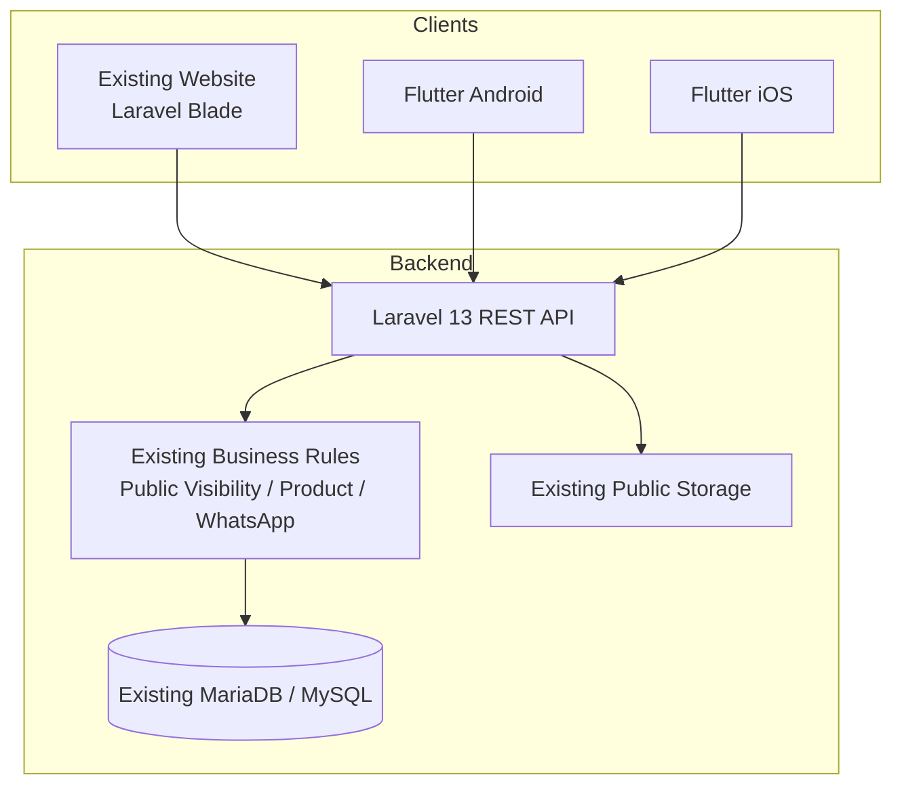

# Mobile App Architecture — SiswaMart

| Atribut | Detail |
|---|---|
| Dokumen | Mobile App Architecture |
| Versi | 1.0.0 |
| Status | Proposed — implementation blueprint |
| Client | Flutter / Dart |
| Backend existing | Laravel 13 |
| Database existing | MariaDB / MySQL |
| API root | https://siswamart.app/api/v1 |
| Platform | Android dan iOS |

## 1. Tujuan arsitektur

Dokumen ini menetapkan rancangan teknis aplikasi mobile SiswaMart. Aplikasi adalah client terpisah, tetapi backend, aturan bisnis, dan database tetap dimiliki aplikasi Laravel yang ada.

Prinsip:
- Laravel tetap menjadi source of truth.
- Tidak ada database kedua untuk data katalog.
- Aplikasi mobile hanya mengonsumsi public API pada MVP.
- Business rules dan filter publikasi tidak boleh diduplikasi sebagai otoritas di client.
- Kontrak API didokumentasikan sebelum integrasi.
- Perubahan backend harus menjaga kompatibilitas website.

## 2. Konteks sistem saat ini

Audit repository main menemukan:
- Laravel Framework constraint ^13.38 dan PHP ^8.3 di composer.json.
- Web menggunakan Blade, Tailwind CSS v4, Alpine.js, dan Vite.
- REST API berada pada routes/api.php.
- Rute publik katalog didaftarkan pada /api/* dan alias /api/v1/*.
- Laravel Sanctum tersedia untuk endpoint terproteksi.
- Model Produk menyediakan scope publicVisible(): status produk harus aktif dan akun user penjual harus aktif.
- Domain kanonis publik yang didokumentasikan repository adalah https://siswamart.app.

Aplikasi katalog tidak membutuhkan Sanctum token untuk membaca endpoint publik. Jangan memanggil endpoint seller dashboard, profile, notification, atau cart dari aplikasi katalog MVP.

## 3. High-level architecture



Website tetap menggunakan route web dan Blade. Aplikasi mobile menggunakan route API. Kedua jalur berbagi model, aturan bisnis, storage, dan database yang sama.

## 4. Mobile technology stack

| Concern | Recommended choice | Responsibility |
|---|---|---|
| Framework | Flutter stable | Satu codebase Android/iOS |
| Language | Dart | Bahasa aplikasi |
| Architecture | Feature-first + layered | Pemisahan fitur dan tanggung jawab |
| State management | Riverpod | State dan dependency injection |
| HTTP | Dio | REST request, timeout, interceptor |
| Routing | GoRouter | Navigation dan deep link |
| Image | cached_network_image | Cache dan placeholder foto |
| Local preferences | SharedPreferences | Favorit lokal dan installation UUID |
| Serialization | json_serializable | Model JSON yang konsisten |
| External URL | url_launcher | WhatsApp dan browser |
| Testing | flutter_test, integration_test | Unit, widget, dan integration test |
| Crash reporting | Firebase Crashlytics (optional) | Monitoring crash |
| Push | Firebase Cloud Messaging (future) | Notifikasi versi mendatang |

Pilih versi paket yang kompatibel dengan Flutter stable pada saat implementasi. Jangan mengunci versi dependency berdasarkan dokumen ini tanpa memeriksa kompatibilitas SDK.

## 5. Architectural layers

### 5.1 Presentation
- Screens, widgets, forms, dan navigation.
- Membaca state dari Riverpod providers/notifiers.
- Tidak membuat HTTP request langsung dari widget.
- Tidak memuat aturan publikasi produk sebagai business rule lokal.

### 5.2 Domain
- Entity dan kontrak repository.
- Use case jika logika memang memerlukan orkestrasi.
- Aturan presentasi domain seperti format harga dan pemetaan status.

### 5.3 Data
- DTO/model API.
- Remote data source menggunakan Dio.
- Local data source untuk favorite IDs dan installation UUID.
- Repository implementation yang mengubah DTO menjadi entity.

### 5.4 Core
- App configuration dan environment.
- Network client, error mapping, retry policy.
- Router, theme, constants, logger, formatter.
- Dependency providers lintas fitur.

## 6. Suggested project structure

```text
siswamart-mobile/
├── android/
├── ios/
├── assets/
│   ├── fonts/
│   ├── icons/
│   └── images/
├── lib/
│   ├── main.dart
│   ├── app.dart
│   ├── core/
│   │   ├── config/
│   │   ├── constants/
│   │   ├── errors/
│   │   ├── network/
│   │   ├── router/
│   │   ├── theme/
│   │   └── utils/
│   ├── shared/
│   │   └── widgets/
│   └── features/
│       ├── home/
│       │   ├── data/
│       │   ├── domain/
│       │   └── presentation/
│       ├── catalog/
│       ├── category/
│       ├── product_detail/
│       ├── seller/
│       ├── favorites/
│       └── app_info/
└── test/
    ├── unit/
    ├── widget/
    └── integration/
```

Setiap fitur mengikuti struktur data/domain/presentation. Fitur sederhana tidak perlu dipaksa memiliki banyak abstraction kosong; gunakan lapisan domain ketika memberi manfaat yang jelas.

## 7. API integration strategy

### 7.1 Base URL and environments

- Production: https://siswamart.app/api/v1
- Local development: base URL ditentukan dari konfigurasi environment; untuk emulator Android, localhost host machine bukan 127.0.0.1 milik emulator.
- Staging: gunakan domain staging terpisah bila tersedia.
- Simpan base URL dalam konfigurasi build/environment, bukan disebar di setiap service.

### 7.2 HTTP client

Konfigurasi Dio:
- Header Accept: application/json.
- Header X-Device-Id pada request detail produk untuk deduplikasi view.
- Connect dan receive timeout yang wajar.
- Mapping status HTTP ke error domain.
- Logging request/response hanya di development; redaksi data sensitif.
- Retry terbatas hanya untuk request GET yang aman.
- Jangan melakukan automatic retry pada POST WhatsApp karena request dapat mencatat interaksi lebih dari sekali.

### 7.3 Public endpoint policy

MVP menggunakan endpoint publik:
- GET products
- GET product detail
- POST product WhatsApp URL
- GET categories
- GET category products
- GET sellers
- GET seller detail
- GET product reviews bila diperlukan untuk halaman ulasan

Endpoint ini tidak memerlukan Sanctum token. Jangan menyematkan token admin/penjual di aplikasi mobile.

### 7.4 API response and error mapping

API menggunakan envelope:
- Sukses: success, message, data.
- Error: success, message, errors.
- Validasi API: HTTP 422.
- Produk atau kategori tidak ditemukan/tidak publik: HTTP 404.
- Rate limit: HTTP 429.

Paginator Laravel berada di dalam properti data, dan item katalog berada di data.data. Repository Flutter harus mengisolasi bentuk ini ke model pagination internal.

## 8. Core feature flows

### 8.1 Home
Jalankan request kategori, produk populer, dan produk terbaru secara paralel. Tiap section menyimpan status loading/error sendiri agar satu kegagalan tidak menghilangkan seluruh beranda.

Tidak ada banner API pada backend saat audit. Gunakan feature product section atau visual brand statis; jangan membuat data banner tiruan.

### 8.2 Catalog
- Query state: search, category, min_price, max_price, sort, page, per_page.
- Setiap perubahan query membatalkan/mengabaikan request lama dan mereset page ke 1.
- Load more hanya ketika next page tersedia.
- Gunakan deduplication berdasarkan product ID.

### 8.3 Product detail and views
GET product detail sudah menambah jumlah tayangan dan menulis log view. Aplikasi mengirim installation UUID acak melalui X-Device-Id agar backend dapat melakukan deduplikasi 24 jam. Jangan memanggil POST /products/{product}/view setelah GET detail, karena dapat menghasilkan hitungan ganda.

### 8.4 WhatsApp
1. Pengguna menekan CTA.
2. Aplikasi POST ke /products/{product}/whatsapp.
3. Backend memvalidasi produk publik, membentuk pesan sesuai kondisi stok/toko, dan mencatat interaksi.
4. Aplikasi membuka nilai data.whatsapp_url yang dikembalikan backend.
5. Pengguna memeriksa dan mengirim pesan sendiri.

Aplikasi tidak boleh membangun nomor atau pesan sendiri sebagai fallback jika API gagal.

### 8.5 Seller profile
- GET /sellers/{sellerId} untuk metadata profil.
- GET /products?seller_id={sellerId}&page=1&per_page=12 untuk daftar produk dengan pagination.
- Jangan mengandalkan nomor telepon dari seller profile publik; response publik sengaja mengirim phone dan nomor_whatsapp sebagai null.

## 9. Local persistence and cache

| Data | Storage | Policy |
|---|---|---|
| Favorite product IDs | SharedPreferences | Lokal, tanpa akun |
| Installation UUID | Secure/random UUID stored locally | Random app-generated identifier; bukan hardware ID |
| Product images | Image cache | Gunakan URL absolute dari API |
| Catalog response | Optional short-lived cache | Jangan tampilkan cache sebagai data terbaru tanpa indikator |
| WhatsApp URL | Not persisted | Dinamis dan harus diminta saat CTA ditekan |

Cache gambar dan cache data katalog memiliki lifecycle berbeda. Jangan menyimpan nomor WhatsApp atau isi pesan ke analytics/log.

## 10. Deep linking

Gunakan URL produk kanonis website sebagai candidate Universal Link / Android App Link:
https://siswamart.app/{seller-slug}/{product-slug}

Implementasi memerlukan:
- Android intent filter dan assetlinks.json.
- iOS Associated Domains dan apple-app-site-association.
- Route resolver yang mengambil detail produk melalui API berdasarkan slug.
- Fallback ke website ketika aplikasi tidak terpasang.

Konfigurasi domain dan path harus diverifikasi di repository/deployment sebelum mengaktifkan link association.

## 11. Design system

Gunakan komponen reusable:
- ProductCard
- CategoryChip
- SearchField
- PriceRangeFilter
- SortSheet
- ProductImageGallery
- SellerSummary
- WhatsAppCTA
- SkeletonCard
- EmptyState
- ErrorState
- OfflineBanner
- BottomNavigation

Arah visual mobile yang diminta: biru, putih, oranye. Repository saat audit mendokumentasikan design system website dengan primary #3F6A96, ink #1F3550, background #F5F8FC, surface #FFFFFF, dan aksen #F2B84B. Karena aksen existing adalah kuning, keputusan final untuk menggunakan oranye perlu disetujui lalu diselaraskan pada design system lintas platform. Jangan mengganti token secara diam-diam.

## 12. Security and privacy

- Semua komunikasi production menggunakan HTTPS.
- Tidak ada database credential, private API key, atau Sanctum token privileged di mobile bundle.
- Backend tetap menjadi otoritas visibilitas produk dan data publik.
- Gunakan X-Device-Id berupa UUID acak aplikasi, bukan IMEI, advertising ID, atau identifier hardware.
- Jangan mengirim data kontak atau pesan WhatsApp ke analytics.
- Buka URL eksternal hanya melalui allowlist scheme/host yang diperlukan.
- Log hanya metadata teknis yang tidak sensitif.
- Terapkan rate limit dan validasi di backend.

## 13. Testing strategy

### Unit tests
- DTO parsing.
- Pagination mapping.
- Repository success/error mapping.
- Filter query builder.
- Price and status formatting.
- Favorite local data source.

### Widget tests
- Product card.
- Category chip.
- Search field.
- Filter sheet.
- Empty/error/loading state.
- Bottom navigation.

### Integration tests
- Beranda memuat data.
- Search dan filter.
- Pagination katalog.
- Buka detail produk.
- Profil penjual dan produk penjual.
- POST WhatsApp dan external URL handling.
- Offline / timeout state.

### Platform matrix
Uji Android dan iOS pada layar kecil dan besar, kondisi jaringan lambat, serta versi OS minimum yang dipilih saat release.

## 14. CI/CD and release

GitHub Actions dapat menjalankan:
- dart format --set-exit-if-changed .
- flutter analyze
- flutter test
- Android build appbundle untuk release candidate.

Build/signing iOS memerlukan macOS dan Xcode. Distribusi internal iOS melalui TestFlight, Android melalui internal testing atau APK QA. Store publication memerlukan akun developer dan metadata store yang valid.

## 15. Architecture decisions

| ID | Decision | Rationale |
|---|---|---|
| MOB-ADR-001 | Flutter untuk Android dan iOS | Satu codebase dan UI konsisten |
| MOB-ADR-002 | Laravel existing sebagai backend | Menghindari duplikasi business logic |
| MOB-ADR-003 | Shared MariaDB/MySQL | Website dan app selalu membaca sumber data yang sama |
| MOB-ADR-004 | Public read API untuk katalog MVP | Tidak memerlukan akun pengunjung |
| MOB-ADR-005 | WhatsApp via endpoint produk | Backend menentukan nomor, pesan, dan pencatatan |
| MOB-ADR-006 | Favorite lokal | Menghindari akun dan perubahan database pada MVP |
| MOB-ADR-007 | Feature-first layered structure | Memudahkan pengujian dan evolusi fitur |

## 16. Open decisions

- Final palette mobile: orange accent atau existing gold accent.
- Minimum Android SDK dan iOS deployment target.
- Final application ID dan iOS bundle identifier.
- Apakah endpoint home agregat diperlukan setelah pengukuran performa.
- Apakah ulasan akan ditampilkan/dikirim dari mobile pada fase berikutnya.
- Ketersediaan macOS/Xcode untuk build dan signing iOS.
