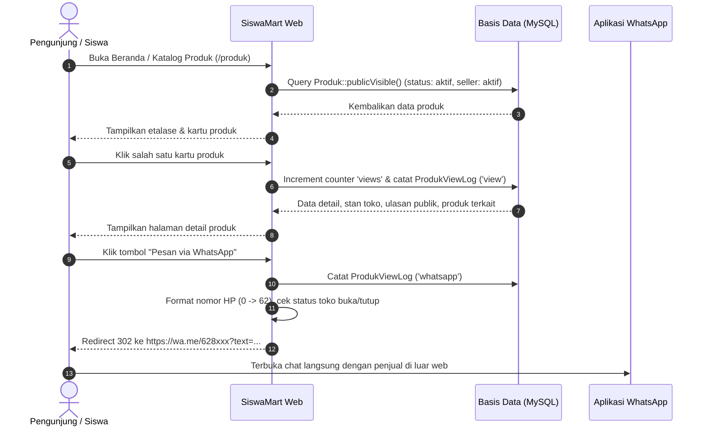
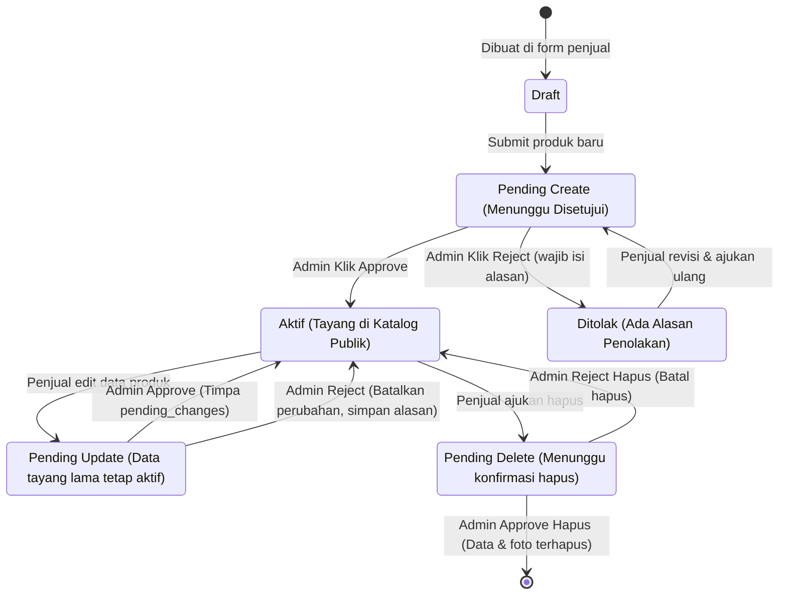
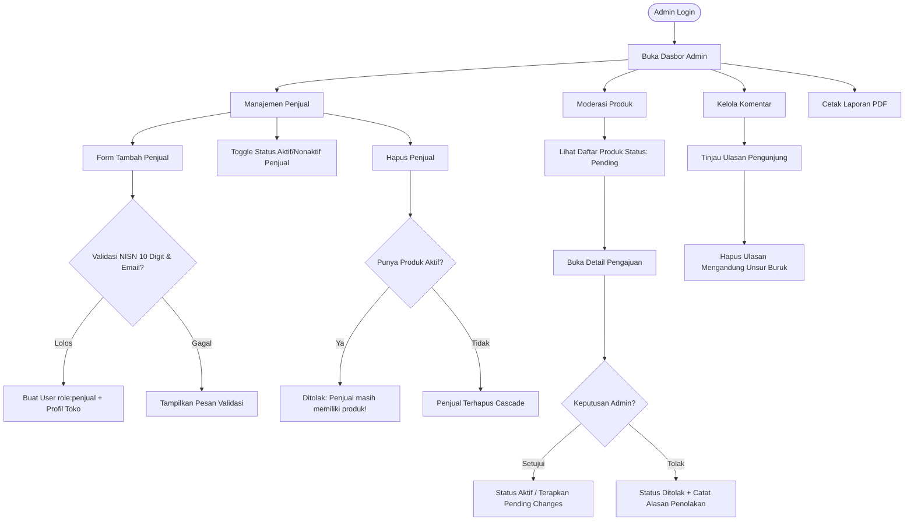
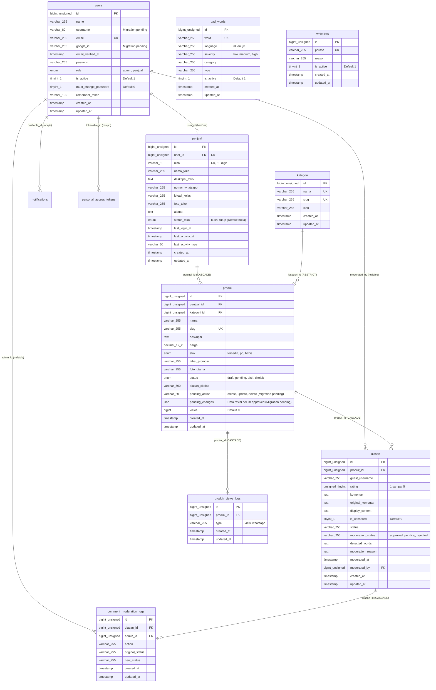
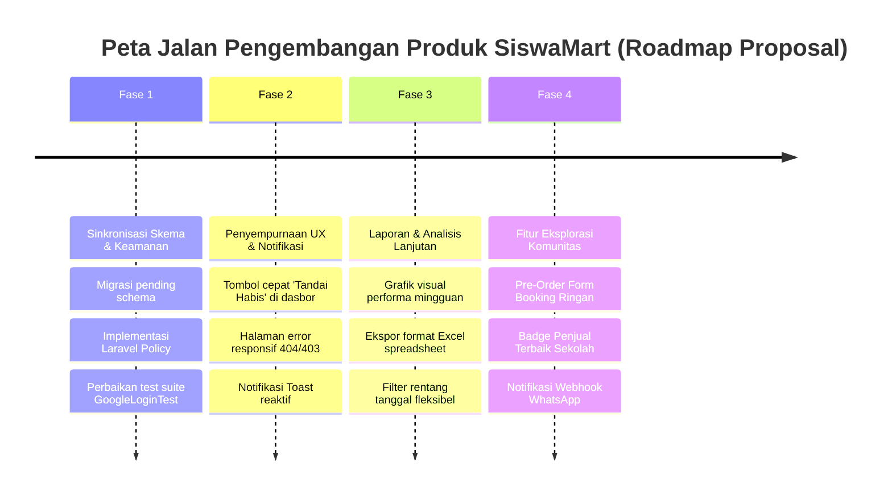

# PRODUCT REQUIREMENTS DOCUMENT (PRD)
# SiswaMart — Platform Promosi & Katalog Produk Sekolah

---

## A. INFORMASI DOKUMEN

| Atribut | Keterangan |
|---|---|
| **Judul Dokumen** | Product Requirements Document (PRD) — SiswaMart |
| **Nama Produk** | SiswaMart |
| **Versi Dokumen** | 1.0.0 (As-Built & Audit Edition) |
| **Tanggal Audit** | 25 Oktober 2026 |
| **Status Dokumen** | Disetujui berdasarkan Audit Kode Sumber Lokal (*Source-Code Backed*) |
| **Penulis / Auditor** | Senior Product Manager, Business Analyst & Software Architect |
| **Lokasi Repositori** | `c:\laragon\www\siswamartid` |
| **Lingkungan Audit** | Windows (PowerShell, PHP 8.3.33, MySQL / MariaDB, Composer, NPM, Vite) |
| **Sumber Data Primer** | Kode sumber aktif (`app/`, `routes/`, `database/`, `resources/`, `tests/`, `config/`) |
| **Dokumentasi Pendukung** | `docs/ERD.md`, `docs/IMPLEMENTATION.md`, `Pengujian_Black_Box_SiswaMart.xlsx` |

### Batasan Audit & Known Limitations
1. **Tidak Ada Rekayasa Data:** Audit dilakukan secara *read-only* terhadap basis data lokal `siswamartid` dan berkas aplikasi tanpa mengubah logika bisnis berjalan atau merusak basis data bersama.
2. **Kondisi Skema Lokal:** Terdapat 5 berkas migrasi bertanggal 15 Oktober 2026 dengan status *Pending* di database lokal aktif (`2026_10_15_000001` hingga `2026_10_15_000005`). Aplikasi mengatasi hal ini secara dinamis melalui pengecekan `Schema::hasColumn()`. Status ini didokumentasikan secara faktual pada bagian Data Model dan Gap Analysis.
3. **Kerahasiaan Kredensial:** Seluruh kredensial pada berkas `.env`, kunci API, token OAuth, dan hash rahasia dilindungi sepenuhnya dan tidak disertakan ke dalam dokumen ini.

---

## B. RINGKASAN EKSEKUTIF (EXECUTIVE SUMMARY)

**SiswaMart** adalah platform *marketplace* dan katalog produk berbasis sekolah yang dirancang khusus untuk memfasilitasi publikasi, penemuan, dan promosi produk hasil karya siswa, unit kewirausahaan sekolah, serta pedagang kantin sekolah. 

Berbeda dari *e-commerce* komersial umum yang menyediakan fasilitas *checkout* otomatis dan *payment gateway*, SiswaMart menerapkan model **Katalog Promosi Terkurasi (Showcase Marketplace)** dengan alur transaksi langsung (*direct negotiation*) melalui **WhatsApp**. Keputusan desain ini dilandasi oleh karakteristik lingkungan sekolah:
1. Meminimalkan biaya transaksi dan kerumitan integrasi perbankan/dompet digital bagi siswa di bawah umur.
2. Memberikan fleksibilitas pengambilan produk secara langsung (*cash on pickup*) di ruang kelas atau stan kantin sekolah.
3. Menjamin keamanan ekosistem komunitas sekolah melalui kontrol kurasi terpusat oleh Admin/Guru serta penyaringan konten ulasan yang ketat.

### Nilai Tambah Utama (Value Propositions)
- **Bagi Pembeli (Siswa & Warga Sekolah):** Akses instan ke katalog jajanan, makanan, dan produk kreatif siswa secara transparan tanpa kewajiban mendaftar akun. Pembeli dapat memeriksa ketersediaan (*Ready*, *Pre-Order*, *Habis*), lokasi kelas/stan penjual, dan langsung menghubungi penjual via WhatsApp dengan pesan otomatis terformat.
- **Bagi Penjual (Siswa & Kantin):** Dasbor mandiri untuk mengelola etalase produk, mengatur status buka/tutup toko, memantau statistik penayangan produk (*views*) dan interaksi klik WhatsApp, serta mengunduh berkas laporan performa mingguan format PDF resmi.
- **Bagi Sekolah & Administrator:** Kendali moderasi dua tingkat (*two-tier product moderation*): setiap produk baru, perubahan data produk, maupun permintaan hapus wajib disetujui Admin sebelum berdampak pada katalog publik; serta perlindungan ulasan menggunakan *Automated Bad-Word Filtering Engine*.

---

## C. LATAR BELAKANG PRODUK (PRODUCT BACKGROUND)

### 1. Masalah yang Dihadapi (Problem Statement)
- **Fragmentasi Informasi Penjualan:** Kegiatan kewirausahaan siswa (misalnya tugas Praktik Kerja Lapangan/Kewirausahaan PKK) dan jajanan kantin sering kali dipromosikan secara sporadis melalui status WhatsApp pribadi, pesan berantai, atau selebaran fisik, sehingga sulit ditemukan oleh warga sekolah di luar lingkaran pertemanan penjual.
- **Kesulitan Mengetahui Ketersediaan (*Stock Status*):** Pembeli sering kali mendatangi kelas atau stan kantin hanya untuk mendapati bahwa produk sudah habis terjual (*sold out*) atau harus dipesan sebelumnya (*pre-order*).
- **Kurangnya Portofolio & Laporan Kewirausahaan Siswa:** Siswa kesulitan mengukur performa produk mereka, tidak memiliki data agregat berapa kali produk mereka dilihat, dan tidak memiliki rekapitulasi formal untuk keperluan penilaian guru kewirausahaan.
- **Kekhawatiran Keamanan Konten & Ketertiban Sekolah:** Membuka marketplace publik rentan terhadap penyalahgunaan seperti akun palsu, penjualan barang tidak pantas, atau komentar perundungan (*bullying*) pada ulasan produk.

### 2. Solusi yang Diterapkan SiswaMart
- **Platform Web Responsif & Ringan:** Dibangun di atas Laravel 11/13 dengan TailwindCSS v4 dan gaya visual *Soft Neubrutalism*, nyaman diakses melalui ponsel cerdas siswa.
- **Pendaftaran Terkendali (Admin-Curated Seller Accounts):** Pendaftaran akun penjual dilakukan secara tertutup oleh Admin Sekolah dengan validasi Nomor Induk Siswa Nasional (NISN 10 digit), alamat, lokasi kelas, dan nomor WhatsApp.
- **Moderasi Produk Preservatif (*Pending Changes Architecture*):** Penjual tidak dapat langsung mengubah harga/deskripsi produk aktif tanpa persetujuan Admin; sistem menyimpan perubahan di kolom `pending_changes` (JSON) sehingga etalase publik tetap berjalan stabil tanpa menampilkan konten yang belum lolos moderasi.
- **Sistem Moderasi Ulasan Otomatis & Berlapis:** Pengunjung dapat memberikan ulasan tanpa login, namun input diproses oleh algoritma deteksi kata kasar (*BadWordFilterService*) dengan normalisasi leet-speak dan pencocokan regex. Ulasan bermasalah ditolak sebelum masuk ke basis data.

---

## D. VISI DAN TUJUAN PRODUK (VISION & OBJECTIVES)

### 1. Visi Produk
Menjadi ekosistem digital kewirausahaan sekolah yang inklusif, aman, dan mendidik, menjembatani kreativitas siswa dalam berbisnis dengan kemudahan belanja seluruh warga sekolah.

### 2. Tujuan Terukur (Measurable Objectives)
| Kode | Sasaran | Indikator Keberhasilan (KPI) | Status Verifikasi |
|---|---|---|---|
| **OBJ-01** | Aksesibilitas Katalog Tanpa Hambatan | 100% halaman publik dapat diakses tanpa kewajiban registrasi atau login. | **Terverifikasi** di kode sumber |
| **OBJ-02** | Akurasi Kontak Penjual | 100% tombol interaksi mengarahkan ke nomor WhatsApp penjual dengan format `628xxx` dan pesan otomatis. | **Terverifikasi** di `ProdukController::trackWhatsapp` |
| **OBJ-03** | Keamanan Ekosistem Konten | 0 toleransi terhadap ulasan berbau kata terlarang melalui penyaringan otomatis di sisi backend. | **Terverifikasi** di `UlasanController::store` |
| **OBJ-04** | Pelaporan Akademik & Audit | Tersedianya fungsi ekspor PDF performa berkala untuk Admin dan Penjual menggunakan tata letak cetak A4 terstandar. | **Terverifikasi** di `LaporanController` |
| **OBJ-05** | Kestabilan Katalog Saat Edit Produk | 0 *downtime* atau distorsi data publik ketika penjual mengajukan modifikasi produk aktif. | **Terverifikasi** di arsitektur `pending_changes` |

---

## E. TARGET PENGGUNA DAN PERSONA (TARGET AUDIENCE & PERSONAS)

```mermaid
graph TD
    User([Pengguna SiswaMart]) --> Public[Pengunjung / Siswa Pembeli]
    User --> Penjual[Penjual / Siswa Vendor]
    User --> Admin[Administrator / Guru Pembina]

    Public -->|Tanpa Login| PB1[Eksplorasi Katalog & Kategori]
    Public -->|Tanpa Login| PB2[Cek Lokasi & Ketersediaan Stok]
    Public -->|Tanpa Login| PB3[Klik WhatsApp Penjual]
    Public -->|Guest Username| PB4[Kirim Ulasan & Rating 1-5]

    Penjual -->|Login Akun Sekolah| PJ1[Kelola Data Produk CRUD Moderasi]
    Penjual -->|Login Akun Sekolah| PJ2[Buka / Tutup Toko]
    Penjual -->|Login Akun Sekolah| PJ3[Pantau Statistik Views & WA]
    Penjual -->|Login Akun Sekolah| PJ4[Unduh Rekap Laporan Mingguan PDF]

    Admin -->|Hak Akses Tertinggi| AD1[Registrasi & Manajemen Akun Penjual]
    Admin -->|Hak Akses Tertinggi| AD2[Moderasi Produk Baru, Edit, & Hapus]
    Admin -->|Hak Akses Tertinggi| AD3[Kelola Kategori & Ikon]
    Admin -->|Hak Akses Tertinggi| AD4[Moderasi / Hapus Komentar Negatif]
    Admin -->|Hak Akses Tertinggi| AD5[Cetak Rekap Kinerja & Agregat PDF]
```



### Profil Persona Pengguna

#### Persona 1: Pembeli (Siswa / Guru / Staf Sekolah)
- **Karakter:** Menggunakan ponsel pintar saat jam istirahat; membutuhkan akses cepat untuk melihat menu makanan atau produk yang buka hari ini.
- **Kebutuhan:** Ingin tahu lokasi kelas/stan penjual, harga makanan, apakah stok masih *Ready* atau *PO*, dan menghubungi penjual tanpa repot menyimpan nomor telepon terlebih dahulu.
- **Hak Akses:** Publik (*Guest*). Tidak memiliki halaman dasbor, tidak memiliki profil permanen di basis data.

#### Persona 2: Penjual (Siswa / Kelompok Proyek PKK / Pengelola Kantin)
- **Karakter:** Siswa yang memiliki produk jualan untuk tugas kewirausahaan atau pedagang kantin mitra sekolah.
- **Kebutuhan:** Mengunggah foto produk, mengubah status toko jika istirahat selesai, dan melihat data berapa banyak orang yang tertarik dengan produknya untuk laporan sekolah.
- **Hak Akses:** `role = 'penjual'`. Terbatas pada produk milik toko sendiri (`penjual_id`). Dilarang mengakses area `/admin/*`.

#### Persona 3: Administrator (Guru Pembina / Tim IT Sekolah)
- **Karakter:** Guru atau staf teknis yang bertanggung jawab menjaga ketertiban, keamanan moral, dan kelancaran transaksi di sekolah.
- **Kebutuhan:** Mendaftarkan siswa yang berhak berjualan, memvalidasi NISN agar tidak ada penjual liar, menyetujui produk sebelum tampil di halaman depan, dan mencetak rekapitulasi penilaian kewirausahaan.
- **Hak Akses:** `role = 'admin'`. Memiliki akses penuh ke `/admin/*`, manajemen master data kategori, moderasi ulasan, dan notifikasi aktivitas.

---

## F. RUANG LINGKUP DAN BATASAN (SCOPE & BOUNDARIES)

### 1. Fitur Dalam Ruang Lingkup (In-Scope)
- **Katalog Publik:** Pencarian berbasis teks (*full text search* pada nama, deskripsi, toko), filter kategori, *sorting* (terbaru, termurah, termahal, terpopuler), detail produk, produk terkait.
- **Penjualan Luar Jaringan via WhatsApp:** Tombol tautan dinamis `https://wa.me/{nomor}?text=...` dengan konversi nomor otomatis, pesan *default*, notifikasi jika toko sedang tutup, dan pencatatan metrik pada `produk_views_logs`.
- **Siklus Hidup Produk Terkurasi:** Pengajuan produk baru (`pending_action = 'create'`), pengajuan revisi produk aktif (`pending_action = 'update'`), dan pengajuan penghapusan produk (`pending_action = 'delete'`).
- **Moderasi Otomatis & Manual Komentar:** Penolakan kata terlarang berbasis kamus `bad_words` dan pembersihan karakter non-alfanumerik sebelum data disimpan. Admin memiliki kendali untuk menghapus ulasan di dasbor.
- **Manajemen Akun Terpusat:** Penjual didaftarkan oleh Admin lengkap dengan NISN (10 digit unik), alamat, dan lokasi kelas.
- **Autentikasi Ganda:** Login via email/username + kata sandi reguler serta Google OAuth SSO yang dikunci khusus untuk email terdaftar.
- **Pelaporan Dokumen PDF:** Pembuatan rekapitulasi mingguan format PDF menggunakan `barryvdh/laravel-dompdf` berorientasi *landscape* (Admin) dan *portrait* (Penjual).

### 2. Fitur di Luar Ruang Lingkup (Out-of-Scope)
- **Keranjang Belanja (*Shopping Cart*):** Tidak disediakan di antarmuka web. Controller `App\Http\Controllers\Api\CartController` secara eksplisit mengembalikan `HTTP 501 Not Implemented`.
- **Gerbang Pembayaran (*Payment Gateway* / Checkout):** Tidak ada pembayaran transfer bank, kartu kredit, QRIS otomatis, atau saldo dompet digital di dalam web. Semua pembayaran tunai atau COD disepakati lewat WhatsApp.
- **Pengiriman Ekspedisi:** Tidak ada integrasi kurir logistik (JNE, SiCepat, dll.). Pengambilan dilakukan di area fisik sekolah.
- **Registrasi Mandiri Publik via Web:** Rute `register` ditutup (dikomentari di `routes/auth.php`) guna menjamin integritas warga sekolah.

---

## G. KEBUTUHAN FUNGSIONAL (FUNCTIONAL REQUIREMENTS)

| ID | Modul | Kebutuhan Fungsional | Role | Prioritas | Status Implementasi | Bukti Kode Sumber |
|---|---|---|---|---|---|---|
| **FR-AUTH-001** | Autentikasi | Login menggunakan Email atau Username dengan pembatasan percobaan (*rate limiting* 5x/menit). | Admin, Penjual | Must Have | **Implemented** | `app/Http/Requests/Auth/LoginRequest.php#L45-L89` |
| **FR-AUTH-002** | Autentikasi | Login menggunakan Google OAuth 2.0 yang hanya mengizinkan akun terdaftar sebelumnya di SiswaMart. | Admin, Penjual | Must Have | **Implemented** | `app/Http/Controllers/Auth/GoogleAuthController.php#L15-L140` |
| **FR-AUTH-003** | Autentikasi | Pemblokiran akses login otomatis apabila status `users.is_active = false`. | Admin, Penjual | Must Have | **Implemented** | `app/Http/Middleware/EnsurePenjual.php#L26-L34`, `LoginRequest.php#L56-L63` |
| **FR-AUTH-004** | Autentikasi | Penonaktifan rute registrasi mandiri publik di antarmuka web. | Publik | Must Have | **Implemented** | `routes/auth.php#L19-L22` |
| **FR-AUTH-005** | Autentikasi | Fitur Reset Password melalui email (Laravel Breeze standar). | Pengguna | Should Have | **Implemented** | `app/Http/Controllers/Auth/PasswordResetLinkController.php` |
| **FR-PROD-001** | Produk | Menampilkan etalase katalog publik hanya untuk produk berstatus `aktif` dari penjual berstatus `is_active = true`. | Publik | Must Have | **Implemented** | `app/Models/Produk.php#L108-L114`, `app/Http/Controllers/Public/ProdukController.php#L26` |
| **FR-PROD-002** | Produk | Pencarian produk berbasis teks pada judul produk, deskripsi, dan nama toko. | Publik | Must Have | **Implemented** | `app/Http/Controllers/Public/ProdukController.php#L29-L35` |
| **FR-PROD-003** | Produk | Filter produk berdasarkan kategori dan pengurutan (*sorting*: terbaru, termurah, termahal, terpopuler). | Publik | Must Have | **Implemented** | `app/Http/Controllers/Public/ProdukController.php#L37-L43` |
| **FR-PROD-004** | Produk | Paginasi katalog publik (12 item per halaman) dengan mempertahankan query parameter. | Publik | Must Have | **Implemented** | `app/Http/Controllers/Public/ProdukController.php#L44` |
| **FR-PROD-005** | Produk | Detail produk menyajikan foto utama, fallback ikon kategori, deskripsi, badge stok, info stan penjual, dan produk terkait. | Publik | Must Have | **Implemented** | `resources/views/public/produk/show.blade.php`, `app/Http/Controllers/Public/ProdukController.php#L53-L86` |
| **FR-PROD-006** | Produk | Pencatatan otomatis log *view* saat halaman detail produk diakses. | Publik | Must Have | **Implemented** | `app/Http/Controllers/Public/ProdukController.php#L57-L65` |
| **FR-WA-001** | WhatsApp | Pengalihan aman ke nomor WhatsApp penjual dengan penyeragaman format kode negara `62` dan penanganan prefiks `0`. | Publik | Must Have | **Implemented** | `app/Http/Controllers/Public/ProdukController.php#L95-L103` |
| **FR-WA-002** | WhatsApp | Penambahan pesan peringatan otomatis pada pesan WhatsApp apabila status toko penjual sedang `tutup`. | Publik | Should Have | **Implemented** | `app/Http/Controllers/Public/ProdukController.php#L113-L115` |
| **FR-WA-003** | WhatsApp | Pencatatan log interaksi klik WhatsApp penjual ke tabel `produk_views_logs` (`type = 'whatsapp'`). | Publik | Must Have | **Implemented** | `app/Http/Controllers/Public/ProdukController.php#L105-L111` |
| **FR-REV-001** | Ulasan | Pengunjung dapat mengirimkan ulasan (guest username, rating 1-5, komentar) dengan pembatasan laju (*throttle* 3x/menit). | Publik | Must Have | **Implemented** | `routes/web.php#L22-L24`, `app/Http/Controllers/Public/UlasanController.php#L22-L26` |
| **FR-REV-002** | Ulasan | Pemeriksaan kata terlarang otomatis sebelum simpan; penolakan seketika jika terdeteksi kata kotor. | Publik | Must Have | **Implemented** | `app/Http/Controllers/Public/UlasanController.php#L30-L37`, `app/Services/CommentModerationService.php` |
| **FR-REV-003** | Ulasan | Hanya ulasan berstatus `moderation_status = 'approved'` yang ditampilkan ke katalog publik. | Publik | Must Have | **Implemented** | `app/Models/Ulasan.php#L71-L84` |
| **FR-SELLER-001** | Penjual | Dasbor penjual menampilkan ringkasan metrik: total produk, produk aktif, pending, total views, total ulasan, top 3 produk, dan 5 produk terbaru. | Penjual | Must Have | **Implemented** | `app/Http/Controllers/Penjual/DashboardController.php#L17-L47` |
| **FR-SELLER-002** | Penjual | Tombol pengalih (*toggle*) status toko antara `buka` dan `tutup`. | Penjual | Must Have | **Implemented** | `app/Http/Controllers/Penjual/DashboardController.php#L52-L61` |
| **FR-SELLER-003** | Penjual | Tambah produk baru dengan status awal `pending` dan `pending_action = 'create'`. | Penjual | Must Have | **Implemented** | `app/Http/Controllers/Penjual/ProdukController.php#L136-L181` |
| **FR-SELLER-004** | Penjual | Pengajuan edit produk aktif tanpa mengubah katalog publik (`pending_action = 'update'`, data di `pending_changes`). | Penjual | Must Have | **Implemented** | `app/Http/Controllers/Penjual/ProdukController.php#L200-L250` |
| **FR-SELLER-005** | Penjual | Pengajuan hapus produk aktif dengan persetujuan admin (`pending_action = 'delete'`). | Penjual | Must Have | **Implemented** | `app/Http/Controllers/Penjual/ProdukController.php#L255-L288` |
| **FR-SELLER-006** | Penjual | Pemilihan status ketersediaan stok: `tersedia`, `po` (Pre-Order), atau `habis`. | Penjual | Must Have | **Implemented** | `resources/views/penjual/produk/create.blade.php#L96-L109` |
| **FR-SELLER-007** | Penjual | Unduh laporan performa mingguan dalam format PDF A4 Portrait. | Penjual | Must Have | **Implemented** | `app/Http/Controllers/Penjual/LaporanController.php#L42-L62` |
| **FR-ADMIN-001** | Admin | Dasbor admin menyajikan statistik global: total penjual, total produk aktif, dan jumlah produk perlu moderasi. | Admin | Must Have | **Implemented** | `app/Http/Controllers/Admin/DashboardController.php#L21-L38` |
| **FR-ADMIN-002** | Admin | Pendaftaran akun penjual baru dengan atribut wajib: Nama, Email, Password, NISN (10 digit unik), Alamat, Nama Toko, Nomor WA, Lokasi Kelas, Foto Profil. | Admin | Must Have | **Implemented** | `app/Http/Controllers/Admin/PenjualController.php#L77-L118` |
| **FR-ADMIN-003** | Admin | Penonaktifan (*toggle status*) akun penjual (`is_active = true/false`). | Admin | Must Have | **Implemented** | `app/Http/Controllers/Admin/PenjualController.php#L220-L231` |
| **FR-ADMIN-004** | Admin | Pencegahan penghapusan akun penjual jika penjual masih memiliki produk di katalog. | Admin | Must Have | **Implemented** | `app/Http/Controllers/Admin/PenjualController.php#L242-L246` |
| **FR-ADMIN-005** | Admin | Persetujuan (*approve*) atau Penolakan (*reject*) produk pending dengan input alasan penolakan. | Admin | Must Have | **Implemented** | `app/Http/Controllers/Admin/ProdukController.php#L100-L197` |
| **FR-ADMIN-006** | Admin | Manajemen kategori produk (CRUD) dengan pemilihan ikon predefined; pencegahan hapus kategori bila masih ada produk terhubung. | Admin | Must Have | **Implemented** | `app/Http/Controllers/Admin/KategoriController.php#L43-L84` |
| **FR-ADMIN-007** | Admin | Manajemen ulasan dan moderasi komentar: pencarian, filter rating, dan penghapusan ulasan tidak pantas. | Admin | Must Have | **Implemented** | `app/Http/Controllers/Admin/KomentarController.php#L14-L63` |
| **FR-ADMIN-008** | Admin | Rekapitulasi laporan performa penjual dan ulasan dengan filter periode serta unduh format PDF A4 Landscape. | Admin | Must Have | **Implemented** | `app/Http/Controllers/Admin/LaporanController.php#L62-L100` |
| **FR-NOTIF-001** | Notifikasi | Sistem notifikasi internal tersimpan di database untuk Admin ketika ada ulasan baru, produk baru, atau permohonan edit produk. | Admin | Should Have | **Implemented** | `app/Services/AdminNotificationService.php`, `app/Http/Controllers/Admin/NotificationController.php` |
| **FR-NOTIF-002** | Notifikasi | Polling notifikasi via AJAX JSON (`/admin/notifikasi/poll`) dan tandai baca satu per satu / baca semua. | Admin | Should Have | **Implemented** | `app/Http/Controllers/Admin/NotificationController.php#L12-L42` |
| **FR-API-001** | API | REST API publik untuk membaca produk, kategori, penjual, dan kirim ulasan. | Sistem Luar | Could Have | **Implemented** | `routes/api.php#L19-L44`, `app/Http/Controllers/Api/*` |
| **FR-API-002** | API | Endpoint Keranjang Belanja (*Cart*) di API. | Pengguna | Won't Have | **Partially Implemented (Explicit 501 Not Implemented)** | `app/Http/Controllers/Api/CartController.php#L9-L15` |

---

## H. USER STORIES DAN ACCEPTANCE CRITERIA

### US-01: Menghubungi Penjual via WhatsApp Langsung dari Katalog
**Sebagai** seorang siswa pembeli,  
**Saya ingin** mengklik tombol WhatsApp pada halaman produk yang otomatis membuka chat dengan nomor penjual dan pesan terisi nama produk,  
**Agar** saya dapat langsung memesan tanpa perlu menyimpan nomor manual atau mengetik ulang nama makanan yang saya inginkan.

#### Kriteria Penerimaan (Acceptance Criteria):
- **Skenario 1: Klik tombol WhatsApp saat toko buka**
  - **Given** Saya sedang membuka halaman detail produk yang aktif dan toko penjual berstatus `buka`
  - **When** Saya mengklik tombol "Pesan via WhatsApp"
  - **Then** Sistem mencatat 1 log pada tabel `produk_views_logs` dengan kolom `type = 'whatsapp'`
  - **And** Browser mengalihkan ke URL `https://wa.me/62...` dengan parameter teks `Halo, saya tertarik dengan produk:\n*{nama_produk}*\n\nApakah produk ini masih tersedia?`
- **Skenario 2: Klik tombol WhatsApp saat status toko tutup**
  - **Given** Toko penjual sedang berstatus `tutup`
  - **When** Saya mengklik tombol "Pesan via WhatsApp"
  - **Then** Teks pesan WhatsApp otomatis diawali dengan `[Pemberitahuan: Toko sedang tutup, balasan mungkin tertunda]\n\n`
- **Skenario 3: Nomor penjual tidak tersedia di database**
  - **Given** Kolom `nomor_whatsapp` penjual kosong atau null
  - **When** Rute `public.produk.whatsapp` dipanggil
  - **Then** Sistem mengembalikan pengguna ke halaman produk dengan pesan kilat galat (*flash error*): *"Nomor kontak WhatsApp penjual belum tersedia."*

---

### US-02: Pengajuan Perubahan Data Produk Aktif Tanpa Mengganggu Katalog
**Sebagai** seorang penjual (siswa),  
**Saya ingin** memperbarui harga dan foto produk saya tanpa langsung menimpa data yang sedang tayang,  
**Agar** produk lama tetap dapat dibeli pembeli sementara usulan harga baru saya ditinjau oleh Admin/Guru.

#### Kriteria Penerimaan (Acceptance Criteria):
- **Skenario 1: Pengajuan edit oleh penjual**
  - **Given** Saya masuk sebagai penjual dan memiliki produk berstatus `aktif` tanpa pengajuan tertunda (`pending_action = null`)
  - **When** Saya mengisi formulir edit produk dengan harga baru dan mengklik "Simpan Perubahan"
  - **Then** Status produk di tabel tetap `aktif`
  - **And** Kolom `pending_action` berubah menjadi `'update'`
  - **And** Kolom `pending_changes` terisi payload JSON berisi data baru yang divalidasi
  - **And** Halaman publik produk tetap menampilkan harga lama sampai disetujui admin
  - **And** Sistem mengirimkan notifikasi ke tabel `notifications` untuk akun Admin
- **Skenario 2: Pencegahan pengajuan ganda**
  - **Given** Produk saya sedang memiliki `pending_action` yang belum diproses Admin
  - **When** Saya mencoba mengirimkan form edit produk kembali
  - **Then** Sistem menolak dengan pesan: *"Produk ini masih menunggu keputusan Admin. Tunggu sampai pengajuan sebelumnya selesai."*
- **Skenario 3: Keputusan Admin menyetujui pengajuan edit**
  - **Given** Admin membuka halaman detail moderasi produk yang berstatus `pending_action = 'update'`
  - **When** Admin mengklik "Setujui Perubahan"
  - **Then** Nilai dari kolom `pending_changes` disalin menimpa kolom utama produk
  - **And** Kolom `pending_action` dan `pending_changes` di-reset menjadi `null`
  - **And** Foto produk lama yang digantikan dihapus secara aman dari penyimpanan disk `public`

---

### US-03: Moderasi Ulasan Pengunjung Menggunakan Penyaring Kata Kasar
**Sebagai** pengelola sekolah,  
**Saya ingin** komentar ulasan yang dikirim oleh siswa secara anonim/guest disaring secara otomatis dari kata kotor dan pornografi,  
**Agar** ruang publik sekolah tetap bersih, sopan, dan aman bagi seluruh siswa.

#### Kriteria Penerimaan (Acceptance Criteria):
- **Skenario 1: Komentar berisi kata terlarang**
  - **Given** Pengunjung mengirimkan ulasan dengan teks komentar yang mengandung salah satu kata aktif pada tabel `bad_words` (misal kata makian atau variasi leet seperti `4n11ng`)
  - **When** Form ulasan di-submit ke `POST /produk/{slug}/ulasan`
  - **Then** `CommentModerationService::moderate` mendeteksi kata tersebut
  - **And** Sistem membatalkan penyimpanan ke basis data (`Ulasan::create` tidak dijalankan)
  - **And** Pengguna diarahkan kembali ke anchor `#ulasan` dengan pesan peringatan: *"Ulasan tidak terkirim karena mengandung kata yang tidak pantas. Silakan perbaiki isi ulasan lalu kirim kembali."*
  - **And** Nilai input formulir lama dipertahankan (*flashed old input*)
- **Skenario 2: Komentar bersih**
  - **Given** Pengunjung mengirimkan komentar yang santun dan memenuhi validasi rating 1–5
  - **When** Form ulasan di-submit
  - **Then** Record baru berhasil dibuat di tabel `ulasan` dengan `moderation_status = 'approved'`
  - **And** Ulasan langsung tampil pada daftar ulasan halaman produk publik
  - **And** Admin menerima notifikasi database: *"Ulasan baru masuk"*

---

### US-04: Pendaftaran Akun Penjual Terkendali oleh Administrator
**Sebagai** Administrator / Guru Pembina Kewirausahaan,  
**Saya ingin** mendaftarkan akun penjual dengan melampirkan NISN dan lokasi stan/kelas,  
**Agar** hanya siswa resmi sekolah yang dapat mempromosikan produk dan dapat dipertanggungjawabkan lokasinya.

#### Kriteria Penerimaan (Acceptance Criteria):
- **Skenario 1: Registrasi penjual dengan data valid**
  - **Given** Admin masuk ke halaman `/admin/penjual/create`
  - **When** Admin menginputkan nama, email unik, password min 8 karakter, NISN 10 digit angka unik, alamat, nama toko, nomor WA, dan lokasi kelas
  - **Then** Transaksi basis data membuat 1 baris di tabel `users` (`role = 'penjual'`, `is_active = 1`) dan 1 baris di tabel `penjual` terkait
  - **And** Sistem menampilkan pesan sukses *"Akun penjual berhasil dibuat."*
- **Skenario 2: Validasi NISN ganda atau bukan 10 digit**
  - **Given** Admin memasukkan NISN yang sudah terdaftar di penjual lain atau panjang digit bukan 10
  - **When** Formulir di-submit
  - **Then** Validasi gagal dan menampilkan pesan galat form sesuai aturan `digits:10` dan `unique:penjual,nisn`

---

## I. ALUR PENGGUNA (USER FLOWS)

### 1. Alur Pengunjung: Penemuan Produk hingga Kontak WhatsApp



---

### 2. Alur Penjual: Siklus Hidup Produk & Moderasi



---

### 3. Alur Administrator: Pengelolaan Penjual & Moderasi Komentar



---

## J. ARSITEKTUR INFORMASI DAN ANTARMUKA (IA & UI)

### 1. Peta Situs (Sitemap Architecture)

```
SiswaMart
│
├── Area Publik (Tanpa Autentikasi)
│   ├── / (Beranda: Hero banner, Kategori populer, Produk unggulan, Cara memesan, Testimoni)
│   ├── /kategori (Daftar semua kategori jajanan/produk)
│   ├── /kategori/{slug} (Produk tersaring berdasarkan kategori)
│   ├── /produk (Katalog lengkap dengan pencarian, filter, dan pengurutan)
│   ├── /produk/{slug} (Detail produk, info stan penjual, ulasan, produk terkait)
│   ├── /produk/{slug}/whatsapp (Endpoint pengalihan ke WhatsApp penjual)
│   ├── /cara-pemesanan (Panduan 4 langkah belanja di SiswaMart)
│   └── /tentang-kami (Latar belakang visi misi SiswaMart sekolah)
│
├── Autentikasi
│   ├── /login (Masuk via email/username & kata sandi atau Google OAuth)
│   ├── /auth/google (Inisiasi redirect ke consent screen Google)
│   ├── /auth/google/callback (Callback OAuth Google)
│   ├── /forgot-password (Lupa kata sandi)
│   └── /logout (Keluar sesi)
│
├── Dasbor Penjual (/penjual/*, Role: 'penjual', Guard: 'auth', 'penjual')
│   ├── /penjual/dashboard (Statistik produk, views, ulasan, status buka/tutup toko)
│   ├── /penjual/status-toko (PATCH: Toggle Buka/Tutup toko)
│   ├── /penjual/produk (Daftar inventaris produk penjual, tab status, stok)
│   ├── /penjual/produk/create (Formulir pengajuan produk baru)
│   ├── /penjual/produk/{id}/edit (Formulir pengajuan revisi produk)
│   ├── /penjual/laporan (Rekapitulasi performa promosi mingguan)
│   └── /penjual/laporan/pdf (Unduh berkas PDF laporan mingguan)
│
└── Dasbor Administrator (/admin/*, Role: 'admin', Guard: 'auth', 'admin')
    ├── /admin/dashboard (Metrik global: penjual, produk aktif, antrean moderasi)
    ├── /admin/produk (Daftar kurasi produk, filter status pending/aktif/ditolak)
    ├── /admin/produk/{id} (Tinjauan detail pengajuan & pembanding pending_changes)
    ├── /admin/penjual (Daftar akun penjual, filter aktif/nonaktif, pencarian NISN)
    ├── /admin/penjual/create (Pendaftaran penjual baru)
    ├── /admin/penjual/{id}/edit (Perubahan data akun dan profil toko)
    ├── /admin/categories (Kelola master kategori & penugasan ikon)
    ├── /admin/komentar (Moderasi ulasan publik & penghapusan)
    ├── /admin/laporan (Laporan agregat kinerja penjual & kepuasan ulasan)
    ├── /admin/laporan/penjual/pdf (Unduh PDF kinerja penjual A4 Landscape)
    ├── /admin/laporan/ulasan/pdf (Unduh PDF rekap ulasan A4 Landscape)
    └── /admin/notifikasi/* (Polling notifikasi dan tandai baca)
```

### 2. Standar Desain Visual (Design System Tokens)
Sesuai panduan visual pada `docs/IMPLEMENTATION.md`, SiswaMart mengusung gaya **Soft Neubrutalism Rounded**:
- **Palet Warna Inti:**
  - Ink (`#3A2417`): Warna utama pengganti hitam murni untuk teks, garis border, bayangan, dan ikon outline.
  - Ink Soft (`#6B4E3D`): Teks keterangan sekunder.
  - Cream (`#FFF6E5`): Latar belakang halaman umum yang hangat.
  - Cream-2 (`#FFEBCB`): Latar belakang footer, chip, dan wadah sekunder.
  - White Warm (`#FFFBF4`): Latar belakang kartu konten.
  - Brand Orange (`#FF7A00`): Tombol utama dan navbar.
  - Brand Ink (`#B34A00`): Warna penekanan harga dan angka statistik.
- **Warna Pastel Kategori:**
  - Lavender (`#E3D9FB`): Kategori Dessert.
  - Peach (`#F8C9B0`): Kategori Makanan Berat.
  - Mint (`#B9E6D9`): Kategori Minuman.
  - Butter (`#FFE79F`): Kategori Snack.
- **Bentuk & Bayangan Neubrutal:**
  - Border: Ketebalan tegas `2.5px solid var(--ink)`.
  - Radius membulat: `28px` untuk kartu, `18px` untuk form input, `999px` (pill) untuk tombol dan badge.
  - Bayangan keras tanpa blur (*hard offset shadow*): `4px 4px 0 var(--ink)`, saat hover menjadi `6px 6px 0 var(--ink)`, dan aktif `2px 2px 0 var(--ink)`.
- **Tipografi:** Menggunakan font bulat ramah (Fredoka / Baloo 2) untuk judul dan sans-serif modern berbobot jelas untuk teks isi.

---

## K. MODEL DATA (DATA MODEL)

### 1. Diagram Relasi Entitas (Mermaid ERD)



### 2. Catatan Integritas Skema & Migrasi Tertunda (*Schema Drift Analysis*)
Berdasarkan pemeriksaan perintah `php artisan migrate:status` pada 25 Oktober 2026, tabel aplikasi utama beroperasi dengan 22 migrasi aktif. Terdapat 5 berkas migrasi baru yang tercatat dengan status **Pending**:
1. `2026_10_15_000001_align_local_schema_with_erd.php`: Penambahan kolom `username` di tabel `users` dan indeks unik pada `penjual.user_id` serta `penjual.nisn`.
2. `2026_10_15_000002_normalize_erd_status_values.php`: Normalisasi enum status stok (`tersedia`, `po`, `habis`) dan status moderasi.
3. `2026_10_15_000003_remove_admin_creator_from_penjual.php`: Penghapusan kolom `created_by_admin_id`.
4. `2026_10_15_000004_add_product_moderation_requests.php`: Penambahan kolom `pending_action` dan `pending_changes` pada tabel `produk`.
5. `2026_10_15_000005_add_google_id_to_users_table.php`: Penambahan kolom `google_id` pada tabel `users`.

> **Temuan Kritis Auditor:** Kode PHP pada aplikasi (`ProdukController`, `User`, `PenjualController`) telah dirancang secara defensif dengan memanggil `Schema::hasColumn('produk', 'pending_action')` sebelum mengeksekusi query. Namun, *automated test* `GoogleLoginTest` mengalami *failure* karena mengakses langsung kolom `username` dan `google_id` yang belum dimigrasi di basis data aktif. Rekomendasi tindakan dicatat di bagian Gap Analysis.

---

## L. ATURAN BISNIS (BUSINESS RULES)

| Kode Aturan | Judul Aturan | Penjelasan & Logika Bisnis | Rujukan Kode Sumber |
|---|---|---|---|
| **BR-PROD-01** | Visibilitas Katalog Publik | Produk HANYA tampil di katalog publik jika `produk.status = 'aktif'` DAN akun pengguna penjualnya berstatus `users.is_active = true`. | `app/Models/Produk.php#L108-L114` |
| **BR-PROD-02** | Pengamanan Revisi Produk (*Pending Update*) | Penjual yang mengedit produk aktif tidak mengubah data live seketika. Perubahan disimpan di `pending_changes` (JSON), `pending_action = 'update'`, dan menunggu persetujuan Admin. Etalase publik tetap menampilkan data lama sampai disetujui. | `app/Http/Controllers/Penjual/ProdukController.php#L227-L231` |
| **BR-PROD-03** | Moderasi Penghapusan Produk (*Pending Delete*) | Penjual tidak dapat menghapus produk secara langsung. Permintaan hapus ditandai dengan `pending_action = 'delete'`. Admin yang berwenang mengeksekusi penghapusan permanen dan pembersihan berkas gambar dari disk. | `app/Http/Controllers/Penjual/ProdukController.php#L264-L268`, `Admin/ProdukController.php#L111-L142` |
| **BR-PROD-04** | Keunikan Slug Produk | Slug produk dibuat otomatis dari nama produk. Jika ditemukan kesamaan nama antar-produk, sistem membubuhkan akhiran numerik bertahap (`-1`, `-2`, dst.) untuk menjaga keunikan URL. | `app/Http/Controllers/Penjual/ProdukController.php#L118-L130` |
| **BR-SELLER-01** | Pembuatan Akun Penjual Terpusat | Siswa tidak dapat mendaftar mandiri via web. Akun penjual dibuat oleh Admin dengan syarat NISN 10 digit numerik valid, nama toko, nomor WA, lokasi kelas, dan alamat domisili. | `app/Http/Controllers/Admin/PenjualController.php#L79-L90` |
| **BR-SELLER-02** | Proteksi Penghapusan Akun Penjual | Akun penjual dilarang dihapus oleh Admin maupun dihapus mandiri jika penjual masih memiliki produk yang tercatat di katalog. Penjual wajib dinonaktifkan (`is_active = false`) sebagai alternatif. | `app/Http/Controllers/Admin/PenjualController.php#L242-L246`, `app/Http/Controllers/ProfileController.php#L51-L53` |
| **BR-STORE-01** | Status Toko & Penyesuaian Pesan WA | Penjual dapat mengubah status toko menjadi `buka` atau `tutup`. Ketika toko tutup, pesan otomatis WhatsApp disisipi pemberitahuan keterlambatan balasan. | `app/Http/Controllers/Public/ProdukController.php#L113-L115` |
| **BR-REV-01** | Penyaringan Kata Terlarang Sebelum Simpan | Komentar ulasan yang mengandung kata kasar aktif dari tabel `bad_words` ditolak langsung di level aplikasi sebelum query INSERT dijalankan. | `app/Http/Controllers/Public/UlasanController.php#L30-L37` |
| **BR-REV-02** | Pembatasan Ulasan Publik | Ulasan hanya dapat dibaca oleh umum jika `moderation_status = 'approved'` dan tidak berstatus `disembunyikan`/`ditolak`/`dihapus`. | `app/Models/Ulasan.php#L71-L84` |
| **BR-REV-03** | Pembatasan Frekuensi Ulasan (*Rate Limiting*) | Satu alamat IP hanya diperbolehkan mengirimkan maksimal 3 ulasan dalam rentang waktu 1 menit (*throttle:3,1*). | `routes/web.php#L24` |
| **BR-AUTH-01** | Google OAuth Berbasis Akun Terdaftar | Login via Google hanya berhasil jika alamat email Google sudah terdaftar di basis data SiswaMart dengan status aktif. Akun asing ditolak dengan instruksi menghubungi Admin. | `app/Http/Controllers/Auth/GoogleAuthController.php#L100-L104` |
| **BR-AUTH-02** | Pembatasan Brute-Force Login | Percobaan login kata sandi dibatasi maksimal 5 kali per IP/email. Jika terlampaui, sistem mengunci sementara akun (*Lockout*) sesuai throttle Laravel. | `app/Http/Requests/Auth/LoginRequest.php#L73-L89` |
| **BR-KAT-01** | Proteksi Hapus Kategori Produk | Kategori yang masih menaungi 1 atau lebih produk dilarang dihapus dari basis data untuk mencegah produk kehilangan referensi kategori (*orphaned records*). | `app/Http/Controllers/Admin/KategoriController.php#L77-L79` |

---

## M. KEBUTUHAN NON-FUNGSIONAL (NON-FUNCTIONAL REQUIREMENTS)

### 1. Kinerja dan Skalabilitas (Performance & Scalability)
- **Kondisi Terverifikasi:**
  - Paginasi server-side diterapkan seragam: 12 item pada katalog publik (`ProdukController::index`), 10/25/50 item pada tabel manajemen Admin dan Penjual.
  - Query database telah menerapkan pemuatan relasi dini (*eager loading*) `with(['kategori', 'penjual.user'])` untuk mencegah masalah *N+1 query*.
  - Penghitungan ulasan publik menggunakan agregasi Eloquent `withAvg` dan `withCount` langsung pada level SQL.
- **Rekomendasi Target:**
  - Waktu muat halaman pertama (*First Contentful Paint*) di bawah 1.8 detik pada jaringan seluler 4G sekolah.
  - Optimalisasi aset gambar unggahan dengan auto-kompresi ke format WebP saat disimpan ke direktori `storage/app/public/`.

### 2. Keamanan dan Kontrol Akses (Security & Access Control)
- **Kondisi Terverifikasi:**
  - Seluruh akses rute dibagi secara ketat melalui middleware: `EnsureAdmin` (role: admin) dan `EnsurePenjual` (role: penjual).
  - Validasi CSRF token aktif pada seluruh formulir mutasi data web (POST/PATCH/DELETE).
  - Perlindungan akun nonaktif: pengguna nonaktif yang memiliki sesi aktif langsung di-logout otomatis saat mengakses halaman privat.
  - Pencegahan Injeksi SQL terjamin melalui penggunaan *Eloquent ORM Parameter Binding*.
  - Enkripsi kata sandi menggunakan algoritma modern *Bcrypt* dengan default cost terstandar.
- **Rekomendasi Target:**
  - Mengonfigurasi Content Security Policy (CSP) dan HTTP Security Headers (HSTS, X-Frame-Options, X-Content-Type-Options) pada file konfigurasi proxy/webserver.

### 3. Keandalan dan Penanganan Error (Reliability & Error Handling)
- **Kondisi Terverifikasi:**
  - Operasi ganda pada akun penjual (`User::create` dan `Penjual::create`) serta persetujuan produk dibungkus dalam `DB::transaction()` untuk mencegah inkonsistensi data jika terjadi kegagalan sistem di tengah proses.
  - Pengecualian pada pencatatan log `ProdukViewLog` dibungkus dalam blok `try-catch` senyap (*safe fallback*) agar pembeli tidak terganggu saat membuka produk jika log mengalami gangguan sesaat.
- **Rekomendasi Target:**
  - Penambahan halaman error kustom (`404.blade.php`, `403.blade.php`, `500.blade.php`) dengan desain ramah bernuansa SiswaMart.

### 4. Aksesibilitas dan Responsivitas (Accessibility & UI/UX)
- **Kondisi Terverifikasi:**
  - Desain sepenuhnya responsif: mendukung *viewport* layar mulai dari 360px (ponsel), 768px (tablet), hingga 1440px+ (desktop).
  - Kontras warna teks memenuhi kriteria minimum WCAG AA (menggunakan `--brand-ink` `#B34A00` untuk teks angka oranye berlatar krem).
  - Dukungan aksesibilitas bagi pengguna dengan preferensi gerakan berkurang (`prefers-reduced-motion`).
  - Gambar produk dilengkapi dengan penanganan error gambar rusak (*image onError fallback*) yang menampilkan ikon kategori pastel tanpa memunculkan ikon patah.

---

## N. INTEGRASI DAN DEPENDENSI EKSTERNAL (INTEGRATIONS)

| Dependensi / Layanan | Versi / Komponen | Peran dan Fungsi | Status Verifikasi |
|---|---|---|---|
| **WhatsApp Direct Link** | URL Protocol (`wa.me`) | Saluran komunikasi utama antara pembeli dan penjual di luar aplikasi web. | **Terverifikasi** di `ProdukController::trackWhatsapp` |
| **Google Identity Services** | `laravel/socialite: ^5.31` | Otentikasi Single Sign-On (SSO) bagi Admin dan Penjual terdaftar. | **Terverifikasi** di `GoogleAuthController.php` |
| **Barryvdh DomPDF** | `barryvdh/laravel-dompdf: ^3.1` | Generator dokumen cetak PDF rekapitulasi laporan mingguan & audit sekolah. | **Terverifikasi** di `LaporanController.php` |
| **TailwindCSS Engine** | `tailwindcss: ^4.0.7`, `@tailwindcss/vite` | Framework styling modern dengan dukungan Vite pipeline. | **Terverifikasi** di `package.json` |
| **Alpine.js** | `alpinejs: ^3.14.9` | Framework JavaScript minimalis untuk reaktivitas modal, dropdown, dan tab. | **Terverifikasi** di `package.json` |
| **Laravel Sanctum** | `laravel/sanctum: *` | Penyedia autentikasi API token (Bearer token) untuk integrasi mobile masa depan. | **Terverifikasi** di `routes/api.php` |
| **Penyimpanan Lokal** | Laravel Filesystem (`public` disk) | Tempat penyimpanan gambar produk (`storage/app/public/produk`) dan profil toko (`penjual`). | **Terverifikasi** di Controller & Storage Facade |

---

## O. PENGUJIAN DAN JAMINAN KUALITAS (TESTING & QUALITY ASSURANCE)

### 1. Inventaris Test Suite Otomatis
Berdasarkan audit pada folder `tests/Feature`, terdapat 4 berkas pengujian fitur dengan total **34 skenario uji**:
1. `tests/Feature/LaporanPdfTest.php` (8 test skenario)
2. `tests/Feature/AdminRekapPenjualTest.php` (5 test skenario)
3. `tests/Feature/AdminAndPenjualFilteringAndPaginationTest.php` (6 test skenario)
4. `tests/Feature/Auth/GoogleLoginTest.php` (15 test skenario)

### 2. Hasil Eksekusi Uji Aktual (*Actual Test Execution*)
Audit menjalankan eksekusi pengujian otomatis secara aman menggunakan PHPUnit 12.5.33 dan trait `DatabaseTransactions` (seluruh mutasi uji di-rollback secara otomatis):

| Berkas Uji | Jumlah Test | Hasil Eksekusi | Durasi | Keterangan & Catatan |
|---|---|---|---|---|
| `LaporanPdfTest.php` | 8 Test | **8 PASSED (100%)** | 18.1 detik | Verifikasi unduh PDF Admin, Penjual, otorisasi download, dan tombol cetak berhasil sempurna (35 assertions). |
| `AdminRekapPenjualTest.php` | 5 Test | **5 PASSED (100%)** | 1.8 detik | Verifikasi proteksi hak akses guest/penjual, kartu metrik dasbor, dan keakuratan agregat total produk/ulasan (30 assertions). |
| `AdminAndPenjualFilteringAndPaginationTest.php` | 6 Test | **6 PASSED (100%)** | 4.5 detik | Verifikasi pencarian, filter status, filter stok, dan paginasi pada Admin & Penjual (78 assertions). |
| `GoogleLoginTest.php` | 15 Test | **7 PASSED, 8 ERROR** | 13.9 detik | 7 test lulus (tampilan tombol Google, penanganan konfigurasi null, pembatalan user, exception handling). 8 test mengalami error SQLSTATE 42S22 karena mengakses kolom `username` dan `google_id` yang terdaftar pada migrasi pending. |

**Total Ringkasan Uji:** 26 Test Lulus (*Passed*), 8 Test Membutuhkan Eksekusi Migrasi (*Pending Migration Impact*), 0 Test Gagal karena Kesalahan Logika (*No Logic Bugs*).

### 3. Dokumen Uji Fungsional Manual
Di luar pengujian kode otomatis, repositori memiliki artefak dokumen pengujian manual:
- **Nama Berkas:** `Pengujian_Black_Box_SiswaMart.xlsx` (Ukuran: 14.1 KB).
- **Cakupan:** Berisi matriks skenario pengujian fungsional kotak hitam (*black box testing*) untuk alur publik, alur penjual, dan alur administrator.

---

## P. PENILAIAN RISIKO DAN KEAMANAN (RISK ASSESSMENT)

| ID Risiko | Kategori Risiko | Deskripsi Temuan & Risiko | Tingkat Keparahan | Rekomendasi Mitigasi |
|---|---|---|---|---|
| **RSK-01** | Database / Skema | Kesenjangan antara migrasi pending (`2026_10_15_*`) dengan struktur tabel di basis data aktif, menyebabkan kegagalan parsial pada fitur Google OAuth dan registrasi via username. | **Tinggi (High)** | Jalankan perintah `php artisan migrate` pada lingkungan staging sebelum deployment produksi dan pastikan data eksisting telah dibackup. |
| **RSK-02** | Otorisasi Akses | Validasi kepemilikan produk (`penjual_id === $currentPenjualId`) dilakukan secara manual di dalam method controller (`abort_unless`) daripada menggunakan *Laravel Authorization Policies*. | **Sedang (Medium)** | Buat kelas `ProdukPolicy` terstandar (`@can('update', $produk)`) untuk menghindari kelalaian otorisasi di masa depan. |
| **RSK-03** | Infrastruktur Storage | Berkas gambar produk dan penjual mengandalkan tautan simbolik `public/storage`. Jika symlink terputus saat deploy ke server hosting cPanel, gambar tidak akan tampil. | **Rendah (Low)** | Buat skrip pengecekan otomatis `php artisan storage:link` pada alur instalasi/deployment server. |
| **RSK-04** | Ketergantungan Eksternal | Seluruh transaksi bergantung pada ketersediaan nomor WhatsApp penjual. Jika siswa memasukkan nomor tidak aktif atau salah ketik, pembeli tidak dapat bertransaksi. | **Sedang (Medium)** | Tambahkan validasi format nomor WhatsApp Indonesia (minimal 10–13 digit) dan instruksi uji kirim pesan saat registrasi penjual. |

---

## Q. ANALISIS KESENJANGAN (GAP ANALYSIS SUMMARY)

Analisis mendalam mengenai kesenjangan sistem didokumentasikan secara rinci pada dokumen pendamping [`docs/prd/GAP_ANALYSIS.md`](file:///c:/laragon/www/siswamartid/docs/prd/GAP_ANALYSIS.md). Berikut adalah rangkuman kesenjangan utama:

| ID Gap | Area / Fitur | Perilaku yang Diharapkan | Bukti Kondisi Aktual | Tindakan Rekomendasi |
|---|---|---|---|---|
| **GAP-01** | Skema Database | Kolom `username` dan `google_id` aktif untuk mendukung login fleksibel dan SSO Google. | Migrasi `2026_10_15_000001` dan `000005` berstatus *Pending*. Database aktif belum memiliki kolom ini. | Jalankan `php artisan migrate` terawasi. |
| **GAP-02** | Arsitektur API | API CartController dapat digunakan oleh aplikasi pihak ketiga atau mobile. | `CartController` me-return `501 Not Implemented` karena sistem berkonsep katalog non-transaksional web. | Hapus rute cart atau dokumentasikan secara resmi bahwa SiswaMart API bersifat Read-Only untuk katalog. |
| **GAP-03** | Kebijakan Otorisasi | Otorisasi terpusat menggunakan Laravel Policies & Gate. | Otorisasi menggunakan pengecekan manual variabel `$penjualId` di controller. | Refactor ke `ProdukPolicy` dan daftarkan di `AppServiceProvider`. |
| **GAP-04** | Pengurangan Stok Otomatis | Stok berkurang saat terjadi pembelian. | Tidak ada mekanisme pengurangan stok karena transaksi terjadi di luar website (WhatsApp). | Pertahankan model saat ini, namun sediakan tombol cepat bagi penjual untuk mengubah status produk menjadi "Habis" dari dasbor. |

---

## R. PANDUAN PENGEMBANGAN KE DEPAN (PRODUCT ROADMAP)

> **Catatan:** Roadmap ini merupakan proposal perencanaan pengembangan produk strategis (*Proposed Roadmap*) untuk pengembangan SiswaMart fase berikutnya:



### Rincian Fase:
1. **Fase 1: Sinkronisasi Skema, Otorisasi & Stabilitas (Paling Kritis)**
   - Menjalankan migrasi tertunda bertanggal 15 Oktober 2026 ke basis data aktif.
   - Memperbaiki test suite `GoogleLoginTest` hingga 100% lulus.
   - Menerapkan `App\Policies\ProdukPolicy` untuk standarisasi otorisasi kepemilikan item.
2. **Fase 2: Penyempurnaan Pengalaman Penjual (Seller UX)**
   - Menambahkan tombol aksi cepat *One-Click Toggle Stok* (Tersedia <-> Habis) langsung dari tabel index produk penjual tanpa harus membuka form edit.
   - Menyediakan antarmuka manajemen profil toko mandiri bagi penjual untuk memperbarui jam operasional dan deskripsi stan kantin.
3. **Fase 3: Analisis & Pelaporan Lanjutan**
   - Mengintegrasikan grafik visual (Chart.js / ApexCharts sederhana) pada dasbor Penjual dan Admin untuk membaca tren kunjungan produk per hari.
   - Penambahan opsi ekspor laporan format Excel (`.xlsx`) mendampingi format PDF yang sudah ada.
4. **Fase 4: Eksplorasi Fitur Komunitas (Masa Depan)**
   - Fitur formulir *booking pre-order* ringan yang mengirimkan ringkasan pesanan ke WhatsApp penjual dengan format template yang lebih terstruktur.

---

## S. PERTANYAAN TERBUKA DAN ASUMSI (OPEN QUESTIONS & ASSUMPTIONS)

### 1. Pertanyaan Terbuka untuk Stakeholder Sekolah
1. **Kebijakan Pendaftaran Penjual:** Apakah sekolah di masa depan menginginkan alur di mana siswa dapat mengajukan permohonan menjadi penjual secara mandiri melalui form publik, yang kemudian ditinjau oleh Admin (verifikasi NISN), daripada Admin harus menginputkan akun secara manual satu per satu?
2. **Kategori Non-Kuliner:** Saat ini kategori terpasang berfokus pada makanan dan minuman (*Dessert, Makanan Berat, Minuman, Snack*). Apakah SiswaMart akan diperluas untuk mencakup produk jasa siswa (misal: jasa servis komputer jurusan TKJ, kriya jurusan Seni, dll.)?
3. **Masa Aktif Akun Siswa:** Bagaimana kebijakan akun penjual ketika siswa lulus sekolah? Apakah akun otomatis dinonaktifkan setiap tahun ajaran baru atau ada proses serah terima stan kantin ke pengelola baru?

### 2. Asumsi Teknis yang Digunakan
- Seluruh pembeli dan penjual memiliki akses ke aplikasi WhatsApp pada perangkat ponsel mereka.
- Server hosting aplikasi mendukung PHP versi 8.3 dengan ekstensi GD/Imagick untuk pemrosesan gambar dan DOM/GD untuk pembuatan PDF.

---

## T. LAMPIRAN (APPENDIX)

### 1. Indeks Berkas & Rute Utama Kode Sumber
- **Rute Web:** [`routes/web.php`](file:///c:/laragon/www/siswamartid/routes/web.php)
- **Rute Autentikasi:** [`routes/auth.php`](file:///c:/laragon/www/siswamartid/routes/auth.php)
- **Rute API:** [`routes/api.php`](file:///c:/laragon/www/siswamartid/routes/api.php)
- **Model Utama:**
  - [`app/Models/User.php`](file:///c:/laragon/www/siswamartid/app/Models/User.php)
  - [`app/Models/Penjual.php`](file:///c:/laragon/www/siswamartid/app/Models/Penjual.php)
  - [`app/Models/Produk.php`](file:///c:/laragon/www/siswamartid/app/Models/Produk.php)
  - [`app/Models/Kategori.php`](file:///c:/laragon/www/siswamartid/app/Models/Kategori.php)
  - [`app/Models/Ulasan.php`](file:///c:/laragon/www/siswamartid/app/Models/Ulasan.php)
- **Controller Inti:**
  - [`app/Http/Controllers/Public/ProdukController.php`](file:///c:/laragon/www/siswamartid/app/Http/Controllers/Public/ProdukController.php)
  - [`app/Http/Controllers/Penjual/ProdukController.php`](file:///c:/laragon/www/siswamartid/app/Http/Controllers/Penjual/ProdukController.php)
  - [`app/Http/Controllers/Admin/ProdukController.php`](file:///c:/laragon/www/siswamartid/app/Http/Controllers/Admin/ProdukController.php)
  - [`app/Http/Controllers/Admin/PenjualController.php`](file:///c:/laragon/www/siswamartid/app/Http/Controllers/Admin/PenjualController.php)
  - [`app/Http/Controllers/Admin/LaporanController.php`](file:///c:/laragon/www/siswamartid/app/Http/Controllers/Admin/LaporanController.php)
  - [`app/Http/Controllers/Auth/GoogleAuthController.php`](file:///c:/laragon/www/siswamartid/app/Http/Controllers/Auth/GoogleAuthController.php)
- **Service Moderasi:**
  - [`app/Services/CommentModerationService.php`](file:///c:/laragon/www/siswamartid/app/Services/CommentModerationService.php)
  - [`app/Services/AdminNotificationService.php`](file:///c:/laragon/www/siswamartid/app/Services/AdminNotificationService.php)

### 2. Perintah Eksekusi Pengujian & Verifikasi
- Menjalankan uji performa ekspor PDF:
  ```bash
  php vendor/phpunit/phpunit/phpunit tests/Feature/LaporanPdfTest.php
  ```
- Menjalankan uji otorisasi dasbor dan rekap penjual:
  ```bash
  php vendor/phpunit/phpunit/phpunit tests/Feature/AdminRekapPenjualTest.php
  ```
- Menjalankan uji pencarian, filter, dan paginasi:
  ```bash
  php vendor/phpunit/phpunit/phpunit tests/Feature/AdminAndPenjualFilteringAndPaginationTest.php
  ```
- Memeriksa status migrasi database:
  ```bash
  php artisan migrate:status
  ```

---
*Dokumen ini disusun sebagai Product Requirements Document (PRD) resmi SiswaMart berdasarkan verifikasi faktual kode sumber aplikasi per 25 Oktober 2026.*
